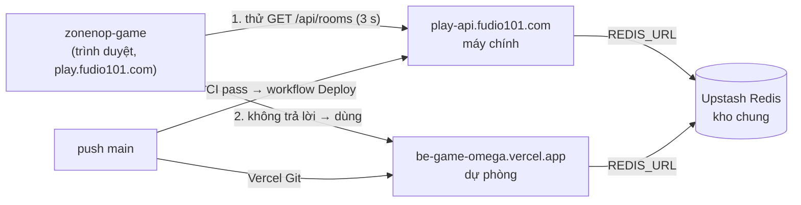

# be_game — Môi trường, phát hành và lưu ý vận hành

be_game chạy **hai backend thật cùng lúc**, cùng code từ nhánh `main`: server tự host `https://play-api.fudio101.com` là máy chính, Vercel `https://be-game-omega.vercel.app` là máy dự phòng. Frontend ([zonenop-game](https://github.com/ThachHuynhIT/zonenop-game), `https://play.fudio101.com`) tự chuyển sảnh và bàn mới sang máy dự phòng khi máy chính không trả lời. Repo `portfolio` không còn chứa game. Tài liệu này mô tả các môi trường, luồng từ PR tới hai backend, những gì phải giữ tương thích, và các bài học vận hành. Thao tác trên server (lệnh, cấu hình, sự cố) nằm ở [`SELF_HOSTING.md`](SELF_HOSTING.md); kiến trúc code ở [`GUIDE.md`](GUIDE.md).

Mục lục: [Môi trường](#các-môi-trường) · [Frontend chọn backend](#frontend-chọn-backend-thế-nào) · [Luồng phát hành](#luồng-phát-hành) · [Biến môi trường](#biến-môi-trường-theo-nơi-chạy) · [Giữ tương thích](#giữ-tương-thích-khi-đổi-code) · [Kiểm tra sau deploy](#kiểm-tra-sau-deploy) · [Sự cố và quay lại](#sự-cố-và-quay-lại) · [Bảo mật](#bảo-mật) · [Bài học](#bài-học-đã-gặp)

---

## Các môi trường

| Môi trường | URL | Chạy ở đâu | Store | Được deploy khi | Vai trò |
|---|---|---|---|---|---|
| **Tự host (chính)** | `https://play-api.fudio101.com` | Điện thoại `vsmart-zangyapro` (arm64), `compose.selfhost.yml`, sau Cloudflare Tunnel + Traefik của chủ máy | **Hiện tại: Redis trong compose (`./data/redis`; `/api/health` báo `redisHost: "redis"`, `sharedStore: false`)**. Upstash chung với máy dự phòng chỉ sau khi chuyển (chưa làm) | Workflow **Deploy** sau khi CI pass trên một lần push vào `main` | Phục vụ frontend zonenop-game |
| **Vercel production (dự phòng)** | `https://be-game-omega.vercel.app` | Vercel Functions, region `sin1`, Fluid compute | Upstash Redis (Singapore) | Vercel Git: **mỗi push vào `main`** | Frontend tự chuyển sang khi máy chính không trả lời; nơi quay về khi cần |
| **Vercel preview** | `be-game-<hash>-thachs-projects-48e5eaf9.vercel.app` | Như trên | **Cùng Upstash Redis với production** (xem [Bài học](#bài-học-đã-gặp)) | Vercel Git: **mỗi push vào mọi nhánh khác** | Thử PR với frontend thật |
| **Local** | `http://localhost:4000` | `npm run dev` | RAM (hoặc `REDIS_URL` nếu đặt) | Tay | Phát triển, test |
| `docker-compose.yml` (Caddy) | — | Mẫu cho VPS có IP public | Redis volume | — | **Không dùng hiện tại**; giữ làm mẫu (README → "Tự host") |



Sơ đồ vẽ trạng thái **sau khi chuyển sang kho chung** (đích, chưa có). Hiện `REDIS_URL` của máy chính trống nên máy chính dùng Redis cục bộ trong compose, còn máy dự phòng dùng Upstash: hai kho riêng.

## Frontend chọn backend thế nào

Ở repo zonenop-game, `src/components/games/gameClient.ts` (chi tiết: `docs/GAMES_GUIDE.md` §1.2 của repo đó):

- `NEXT_PUBLIC_TIENLEN_SERVER_URL` = máy chính, `NEXT_PUBLIC_TIENLEN_FALLBACK_URL` = máy dự phòng. Cả hai được gắn vào bundle **lúc build**: đổi thì phải build lại zonenop-game (bản tự host: sửa `.env` rồi `docker compose up -d --build`; bản Vercel: redeploy).
- Sảnh và bàn mới dùng máy đầu tiên trả lời `GET /api/rooms` trong 3 giây; lựa chọn được nhớ 60 giây.
- **Hai máy dùng chung Upstash** (sau khi chuyển; cách chuyển và quay lại: [`SELF_HOSTING.md`](SELF_HOSTING.md#chuyển-sang--quay-lại-kho-chung)): phòng, sảnh và bảng điểm là một. Mỗi phòng vẫn được ghim vào máy tạo ra nó; máy đó không trả lời thì client tự thử máy còn lại (cần bản zonenop-game có failover theo phòng; bản cũ vẫn chờ máy đã ghim) và vào lại đúng phòng đang chơi (cùng mã, lượt, bài, tiền). **Đây là thiết kế, chưa được chạy thử đầu-cuối**: buổi diễn tập failover thật (spec §7.3) chưa làm, và việc chuyển máy chính sang Upstash chưa xảy ra (ngày 16/10/2026 máy chính vẫn dùng Redis cục bộ); diễn tập (hoặc văn bản miễn của chủ dự án) là điều kiện bắt buộc trước khi chuyển ([`SELF_HOSTING.md` → Điều kiện trước khi chuyển](SELF_HOSTING.md#điều-kiện-trước-khi-chuyển)). `GET /api/health` của mỗi máy trả `redisHost`, `sharedStore`, `now` và `commit` (đồng hồ của máy đó, epoch ms). `sharedStore` tính **theo từng máy** và chỉ có nghĩa "máy này dùng Redis ở xa" (Vercel luôn báo `true`): nó **không** cho biết hai máy có chung kho. Muốn biết hai máy có chung kho hay không thì so `redisHost` của cả hai: phải giống nhau. Khi máy chính còn Redis riêng (trước khi chuyển, hoặc sau khi quay lại Redis cục bộ), `redisHost` của hai máy khác nhau và hành vi cũ giữ nguyên: phòng không chuyển qua lại, ván đang chơi trên máy chính chờ máy chính sống lại.
- Link mời chưa biết máy: thử máy đang dùng, gặp "Không tìm thấy phòng" thì thử máy còn lại.

Hệ quả cho backend: **`GET /api/rooms` phải luôn rẻ và luôn có trên mọi môi trường** (frontend dùng nó để thử máy còn sống), và chuỗi lỗi `"Không tìm thấy phòng"` của hub là một phần của giao thức — đổi nó thì phải đổi `ROOM_NOT_FOUND` bên zonenop-game cùng lúc.

## Luồng phát hành

1. **Nhánh → PR vào `main`.** CI (`.github/workflows/ci.yml`): `npm run typecheck`, `npm test` (gồm fuzz), kiểm tra hai file compose, build image Docker và gọi thử `/api`. Vercel build **preview** cho nhánh; dùng nó để thử với frontend nếu cần (preview dùng chung Redis dự phòng — cẩn thận khi PR đổi cấu trúc state; **sau khi chuyển sang kho chung thì kho đó cũng là kho của máy chính**, nên preview có thể làm hỏng cả phòng máy chính đang phục vụ).
2. **Merge vào `main`.** Hai việc chạy **song song, độc lập**:
   - Vercel deploy production → máy dự phòng chạy commit mới sau khoảng 1 phút.
   - CI chạy trên `main`; xanh thì workflow **Deploy** đưa đúng commit đó lên máy chính (Tailscale OIDC → SSH → `docker compose up -d --build` → health). Chi tiết từng bước: [`SELF_HOSTING.md` → Luồng deploy](SELF_HOSTING.md#luồng-deploy).
   - Cùng workflow có job `vercel` (chạy song song khi có repo variable `VERCEL_HEALTH_URL` = `https://be-game-omega.vercel.app/api/health`, hiện là biến repo duy nhất): đợi tối đa 10 phút cho tới khi bản Vercel trả đúng `commit` vừa push; Vercel build lỗi hoặc treo thì run đỏ. Job `deploy` cũng chỉ qua khi `/api/health` (trong container và qua domain public) trả đúng `commit` đó, nên container cũ còn trả lời không được tính là deploy xong.
3. CI trên `main` đỏ (ví dụ test chập chờn) thì **máy chính không được deploy nhưng Vercel vẫn deploy** → hai máy lệch phiên bản. **Sau khi chuyển sang kho chung, lệch phiên bản nghĩa là code cũ và code mới cùng đọc, tick và ghi lại cùng một JSON phòng**, có thể kéo dài hàng giờ nếu CI `main` đỏ và điện thoại chậm hơn Vercel. Vì vậy **sửa CI đỏ trên `main` trước tiên** (ưu tiên hơn mọi việc khác), rồi push lại, hoặc chạy Deploy bằng tay (Actions → Deploy → Run workflow, trên `main`) sau khi CI xanh.
4. Thay đổi cần cả frontend: merge và deploy be_game **trước**, kiểm tra cả hai máy, rồi mới deploy zonenop-game (xem mục dưới).

Chỉ `main` được deploy lên máy chính; CI của PR không bao giờ deploy. Không push thẳng vào `main`.

## Biến môi trường theo nơi chạy

| Biến | Local | Tự host (`~/apps/be_game/.env` + compose) | Vercel `be-game` |
|---|---|---|---|
| `REDIS_URL` / `KV_URL` / `UPSTASH_REDIS_URL` | trống → RAM | trống → compose dùng `redis://redis:6379`; đặt URL Upstash (bí mật, quyền `600`) để dùng chung kho với máy dự phòng | Upstash (integration), production **và** preview |
| `ALLOWED_ORIGIN` | trống → mọi origin | Frontend chính: `https://play.fudio101.com`, `https://zonenop-game.vercel.app`, preview `https://zonenop-game-*-thachs-projects-48e5eaf9.vercel.app`, và `http://localhost:3000`. Danh sách trên server còn các mục `https://portfolio-thach.vercel.app` và `https://portfolio-*-thachs-projects-48e5eaf9.vercel.app` của site portfolio cũ (game không còn chạy ở đó; bỏ được). Giá trị đầy đủ: [`SELF_HOSTING.md`](SELF_HOSTING.md#cấu-hình-nằm-ở-đâu) | **giống máy chính** (production, preview, development). Đổi một bên thì đổi bên kia, và Vercel cần redeploy mới áp dụng |
| `GAME_DOMAIN` | — | `play-api.fudio101.com` (bắt buộc; Traefik route theo nó) | — |
| `PORT` / `HOST` | `4000` / `0.0.0.0` | compose đặt `PORT=4000` | không dùng |
| `BE_GAME_COUNT_COMMANDS` | — | tuỳ chọn (`1` = log số lệnh Redis mỗi 60 giây) | — |
| `BUILD_COMMIT` | — | workflow Deploy export, compose chuyển vào container (không đặt tay trong `.env`) | — |
| `VERCEL`, `VERCEL_REGION`, `VERCEL_GIT_COMMIT_SHA` | — | — | Vercel tự đặt (commit cần bật "Automatically expose System Environment Variables"); `/api/health` trả `region: "sin1"` và `commit` |

Secret và variable của workflow Deploy (environment `self-hosted` trên GitHub, cùng repo variable `VERCEL_HEALTH_URL`) và biến bên zonenop-game: bảng đầy đủ ở [`SELF_HOSTING.md` → Cấu hình](SELF_HOSTING.md#cấu-hình-nằm-ở-đâu). Mẫu cho local: `.env.example`.

## Giữ tương thích khi đổi code

Ba thứ được deploy độc lập và không cùng lúc: máy chính, máy dự phòng, frontend zonenop-game (bundle cố định lúc build, người chơi có thể còn mở tab cũ hàng giờ). Vì vậy:

- **Giao thức chỉ thêm, không đổi tên hay bỏ trong một bước.** Field mới trong lệnh client → server phải optional ở server; field mới trong view phải optional ở client (zonenop-game khai báo `?`). Muốn bỏ một field: bỏ chỗ dùng ở zonenop-game trước, deploy, rồi mới bỏ ở be_game.
- **Hai máy dùng chung kho thì thay đổi hình dạng state phải qua cả hai máy cùng commit** (hoặc giữ tương thích cả hai chiều: code cũ đọc/ghi lại được state mới và ngược lại, vì máy lệch phiên bản vẫn tick và lưu phòng). Đừng merge thay đổi state khi `main` đang đỏ hoặc hai máy đang lệch; kiểm tra `REVISION` và commit Vercel trùng nhau trước và sau khi merge.
- **State trong Redis sống qua deploy** (TTL 12 giờ, AOF trên máy chính). Code mới phải đọc được phòng tạo bởi code cũ: settings qua `xxxSettingsOf(room)`, field mới optional có mặc định (GUIDE → "Phòng cũ trong Redis").
- **Thứ tự deploy khi frontend cần backend mới:** be_game (`main` → cả hai máy) → kiểm tra cả hai `/api/health` → zonenop-game.
- **Bản sao ở zonenop-game** (`src/lib/<game>/`): đổi luật/kiểu ở be_game thì sửa bản bên đó trong cùng đợt (GUIDE → "Đồng bộ với zonenop-game").
- **Deploy làm rớt WebSocket vài giây** (container được tạo lại; trên Vercel instance mới). Client tự kết nối lại, phòng còn nguyên trong Redis. `SIGTERM` đóng mọi socket bằng mã 1001 để client kết nối lại ngay (`src/server/app.ts`).

## Kiểm tra sau deploy

```bash
curl -s https://play-api.fudio101.com/api/health        # "ok":true,"store":"redis","region":"local"
curl -s https://be-game-omega.vercel.app/api/health # "ok":true,"store":"redis","region":"sin1"; thêm `now`, `redisHost`, `commit`
# `commit` = commit đang chạy (BUILD_COMMIT trên điện thoại, VERCEL_GIT_COMMIT_SHA trên Vercel); workflow Deploy đợi cả hai máy báo đúng commit vừa push (`commit: null` = không biết, ví dụ chạy local).
ssh vsmart-zangyapro cat ~/apps/be_game/REVISION    # commit đang chạy trên máy chính
```

- Commit trên Vercel: Vercel → project `be-game` → Deployments (bản Production). Hai commit phải giống nhau; khác thì xem bước 3 của [Luồng phát hành](#luồng-phát-hành).
- Khi hai máy dùng chung kho: `redisHost` của hai máy giống nhau, và **đồng hồ lệch ≤ ~2 giây** (so trường `now` của hai `/api/health`, gọi cùng lúc). Lý do: hạn chót lượt, `lastSeen` và điểm của chỉ mục sảnh do máy này ghi còn máy kia so với giờ của mình.
- Thử WebSocket thật: mở `https://play.fudio101.com`, tạo bàn, kiểm tra vào được.
- Workflow Deploy đã tự kiểm tra health (kèm đúng `commit`) trong container và, vì environment `self-hosted` có variable `GAME_DOMAIN`, qua domain public; job `vercel` kiểm tra bản Vercel.

## Sự cố và quay lại

Hai cột trạng thái: **trước khi chuyển** là hiện tại (máy chính dùng Redis cục bộ, chưa chuyển); **sau khi chuyển** là trạng thái đích khi máy chính và máy dự phòng chung Upstash (chưa diễn tập, xem [Frontend chọn backend](#frontend-chọn-backend-thế-nào)).

| Tình huống | Trước khi chuyển | Sau khi chuyển | Làm gì |
|---|---|---|---|
| Máy chính tắt (pin, mất điện, mạng) | Bàn mới tự sang Vercel; bàn đang chơi trên máy chính treo tới khi máy sống lại | Bàn mới sang Vercel; bàn đang chơi được thiết kế để tiếp tục trên Vercel (cùng phòng, trong ~15 giây) vì state nằm ở Upstash. **Chưa kiểm chứng đầu-cuối** | `tailscale status \| grep vsmart`; offline thì báo chủ máy (chỉ họ bật lại được). Không cần đổi gì ở frontend. Máy lên lại: làm theo [danh sách sau khi máy tắt cứng](SELF_HOSTING.md#sau-khi-máy-tắt-cứng--bật-lại) (gồm kiểm tra đồng hồ) |
| Bản mới lỗi trên cả hai máy | Mọi người chơi | Mọi người chơi; nếu lỗi nằm ở state ghi vào Upstash thì phòng trong kho cũng có thể hỏng | Revert commit trên `main` → cả hai máy tự deploy lại. Gấp: Vercel → Instant Rollback cho máy dự phòng |
| Bản mới chỉ lỗi trên máy chính (môi trường khác) | Người chơi trên máy chính | Như trước; thêm: máy dự phòng (code cũ) vẫn đọc/ghi chung phòng với máy chính (code mới), xem [Giữ tương thích](#giữ-tương-thích-khi-đổi-code) | Revert, hoặc tạm chuyển hẳn sang Vercel: đổi `NEXT_PUBLIC_TIENLEN_SERVER_URL` của zonenop-game về `https://be-game-omega.vercel.app` rồi build lại zonenop-game |
| Workflow Deploy đỏ | Máy chính giữ bản cũ, Vercel đã có bản mới (lệch) | Như trước, nhưng hai phiên bản cùng ghi một JSON phòng: sửa nhanh, và state chỉ được đổi khi cả hai máy cùng commit | Đọc log; bảng sự cố ở [`SELF_HOSTING.md`](SELF_HOSTING.md#xử-lý-sự-cố) |
| Upstash hết quota / lỗi | Máy dự phòng và mọi preview hỏng; máy chính không ảnh hưởng | **Cả hai máy hỏng** (kho chung là điểm hỏng chung; kể cả máy chính): quay lại Redis cục bộ ngay, xem [`SELF_HOSTING.md`](SELF_HOSTING.md#xử-lý-sự-cố) (cùng một hàng) và lưu ý phòng cũ sau khi quay lại | Kiểm tra trên Vercel Storage / bảng điều khiển Upstash; sau khi chuyển làm theo `SELF_HOSTING.md` |

## Bảo mật

- `ALLOWED_ORIGIN` chặn trang lạ mở WebSocket từ trình duyệt; client không phải trình duyệt (không gửi `Origin`) luôn được nhận, nên đây không phải xác thực. Không dùng `https://*.vercel.app` (ai cũng tạo được); dùng mẫu theo project + team như ở bảng trên.
- Không có secret nào trong repo: `.env` bị ignore; key deploy, thông tin Tailscale nằm trong environment `self-hosted` của GitHub; Redis Vercel do integration quản lý.
- Key deploy trên máy chính bị giới hạn (`restrict,from=<dải IP tailnet>`); Tailscale dùng OIDC, không có secret lâu dài.
- Token người chơi không bao giờ nằm trong view (GUIDE → "Bảo mật view").

## Bài học đã gặp

**Hạ tầng / Vercel**
- Trên Vercel chỉ có 5 function (`api/*.ts`); `/api` trần **không phải function → 404**. Đừng dùng `/api` để kiểm tra máy còn sống; dùng `/api/rooms` hoặc `/api/health`.
- **Preview của be_game dùng chung Upstash Redis với production.** Một PR đổi cấu trúc state hay khoá Redis có thể làm hỏng phòng trên máy dự phòng ngay khi push nhánh. **Sau khi chuyển sang kho chung, kho này cũng là kho của máy chính**: preview giờ có thể làm hỏng cả phòng đang được điện thoại phục vụ, không chỉ máy dự phòng. Với thay đổi kiểu đó: tránh mở phòng trên preview, hoặc tách store cho preview (Vercel → Storage → chỉ gắn store riêng cho Preview).
- **Upstash free tier (500k lệnh/tháng) cạn vì tab sảnh để mở**, không phải vì ván chơi: mỗi tab poll `/rooms` của cả 7 game mỗi 5–10 s, mỗi lần 2 + số phòng lệnh Redis. Vì vậy `recentRooms` / `leaderboard` của store Redis được cache ngắn trong process (`src/server/store.ts`) và dọn index tối đa 1 lần/phút. Không dùng cache CDN (`s-maxage`) cho các endpoint này: header CORS phụ thuộc `Origin`. Preview của mọi nhánh cũng tốn quota này. Sau khi chuyển, poll sảnh và `/api/health` của **máy chính** cũng đi vào Upstash, nên đo tốc độ lệnh thật trước khi chuyển ([`SELF_HOSTING.md` → Đếm lệnh Redis](SELF_HOSTING.md#đếm-lệnh-redis-upstash)).
- Gói Hobby giới hạn WebSocket 300 giây/kết nối; server gửi `reconnect` trước khi hết hạn (README → "Giới hạn của Vercel"). Máy tự host không có giới hạn này.

**Máy tự host**
- Firewall của host chặn traffic tailnet tới cổng Docker publish kiểu bridge → đi qua Traefik (`traefik_network`), không publish cổng.
- Host dùng containerd image store: build lại cùng tag thì image cũ tự biến mất; image không có `curl` → health check bằng `node -e "fetch(...)"` trong container.
- Build cache: mỗi app build bằng BuildKit builder riêng (`be_game`, `zonenop-game`), deploy tự dọn còn tối đa 1 GB / 2 GB rồi tắt builder. Không prune builder `default` (dùng chung với chủ máy); xem [`SELF_HOSTING.md`](SELF_HOSTING.md).
- Máy là điện thoại: có thể tắt cứng bất cứ lúc nào → `restart: unless-stopped`, dữ liệu ghi xuống đĩa (bind mount, AOF), và frontend có máy dự phòng.
- Chủ máy có thể sửa file trong `~/apps/be_game` trực tiếp → so với repo trước khi deploy.

**CI / script**
- Script deploy chạy với `set -euo pipefail`: `| head` hay `| grep -q` làm lệnh trước nhận SIGPIPE → thoát 141 ngẫu nhiên. Lấy output vào biến rồi so.
- `compose.selfhost.yml` bắt buộc `GAME_DOMAIN` → mọi `docker compose config` trong CI phải truyền giá trị mẫu.
- **Test dùng `Math.random()` chưa inject sẽ chập chờn trên CI**, và CI đỏ trên `main` chặn deploy máy chính (Vercel vẫn deploy → lệch phiên bản; sau khi chuyển sang kho chung, hai phiên bản cùng ghi chung state phòng, nên đây là việc sửa đầu tiên). Mọi hàm phòng/ván nhận `random`, test truyền RNG có seed.

**Giao thức**
- Origin bị từ chối: be_game trả 403, nhưng qua Cloudflare/Traefik thường thành **502** khi mở WebSocket. Thấy 502 thì kiểm tra `ALLOWED_ORIGIN` trước.
- `"Không tìm thấy phòng"` được zonenop-game dùng để quyết định thử máy còn lại — giữ nguyên chuỗi này hoặc đổi đồng bộ.
