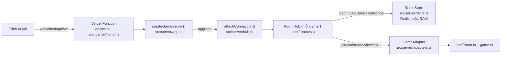

# be_game — Hướng dẫn cho developer

Tài liệu này mô tả be_game đủ chi tiết để sửa / thêm tính năng mà **không cần đọc source trước**. Mọi tên file, hàm, hằng số và hình dạng message dưới đây đều lấy từ code hiện tại. Khi code đổi, cập nhật tài liệu cùng commit.

Mục lục: [Tổng quan](#tổng-quan) · [Kiến trúc](#kiến-trúc) · [Giao thức WebSocket](#giao-thức-websocket) · [Tick & deadline](#tick--deadline) · [Presence, khán giả, emoji, chat](#presence-heartbeat-mất-kết-nối) · [Lịch sử, điểm, leaderboard](#lịch-sử-ván-điểm-xếp-hạng-và-leaderboard) · [HTTP endpoints](#http-endpoints) · [Chạy local, env, test, deploy](#chạy-local) · [Môi trường & phát hành](DEPLOYMENT.md) · [Server tự host](SELF_HOSTING.md) · [Thêm một game mới](#thêm-một-game-mới) · [Quy ước & bẫy](#quy-ước-chung--bẫy-thường-gặp)

---

## Tổng quan

be_game là backend realtime (Node `http.Server` + `ws`) cho các game online trên site portfolio. Cùng một code chạy ở ba kiểu: **tiến trình Node** (`src/local.ts`, Docker) với Redis — đây là máy chính `play-api.fudio101.com`; **Vercel Functions** (WebSocket, Fluid compute) với Upstash Redis — máy dự phòng `be-game-omega.vercel.app`; và local với store trong RAM. Frontend nằm ở repo `portfolio` (Next.js), kết nối qua `NEXT_PUBLIC_TIENLEN_SERVER_URL` (mặc định `http://localhost:4000`) và tự chuyển sang `NEXT_PUBLIC_TIENLEN_FALLBACK_URL` khi máy chính không trả lời. Môi trường và luồng phát hành: [`DEPLOYMENT.md`](DEPLOYMENT.md).

| Game | `GameKind` | Thư mục | Số người | Route frontend | WebSocket | Tài liệu |
|---|---|---|---|---|---|---|
| Tiến Lên Miền Nam | `tienlen` | `src/game/` | 2–4 | `/tien-len` | `/api/ws` | [games/tienlen.md](games/tienlen.md) |
| Mèo Nổ | `meono` | `src/meono/` | 2–7 (tuỳ chế độ) | `/meo-no` | `/api/meono/ws` | [games/meono.md](games/meono.md) |
| Cờ Tỷ Phú | `typhu` | `src/typhu/` | 2–6 | `/co-ty-phu` | `/api/typhu/ws` | [games/typhu.md](games/typhu.md) |
| Đá Quý (Splendor) | `splendor` | `src/splendor/` | 2–4 | `/splendor` | `/api/splendor/ws` | [games/splendor.md](games/splendor.md) |
| Đấu Súng (Bang!) | `bang` | `src/bang/` | 3–8 | `/bang` | `/api/bang/ws` | [games/bang.md](games/bang.md) |
| Cờ Cá Ngựa | `cangua` | `src/cangua/` | 2–4 | `/co-ca-ngua` | `/api/cangua/ws` | [games/cangua.md](games/cangua.md) |
| Ô Ăn Quan | `oanquan` | `src/oanquan/` | 2–4 | `/o-an-quan` | `/api/oanquan/ws` | [games/oanquan.md](games/oanquan.md) |

Mỗi game có `/rooms` và `/leaderboard` cùng tiền tố (Tiến Lên dùng đường dẫn không tiền tố: `/api/rooms`, `/api/leaderboard`).

Cấu trúc thư mục của một game (trừ Tiến Lên và Đấu Súng có thêm file):

| File | Vai trò |
|---|---|
| `cards.ts` hoặc `board.ts` | Dữ liệu tĩnh (bộ bài, bàn cờ, hằng số, option settings). Thường được chép sang portfolio. |
| `game.ts` | Máy trạng thái thuần của **một ván**: tạo ván, lệnh, `tickGame`, `nextGameTickAt`. |
| `room.ts` | Vòng đời **phòng**: ghế, host, presence, settings, kick, chấm điểm khi ván kết thúc, view/summary. |
| `protocol.ts` | Kiểu dữ liệu view gửi client, kiểu lệnh, đường dẫn WS. Được chép (có chỉnh) sang portfolio. |

---

## Kiến trúc

### Luồng request



- **Vercel functions** (`api/`): `api/ws.ts`, `api/rooms.ts`, `api/leaderboard.ts`, `api/health.ts`, `api/[game]/[kind].ts`. **Tất cả** chỉ `export default createGameServer()`; việc định tuyến làm trong `app.ts` theo `pathname`. File động `api/[game]/[kind].ts` phục vụ mọi `/api/<game>/<ws|rooms|leaderboard>` của 6 game không phải Tiến Lên.
- **`src/server/app.ts`**:
  - Bảng `ROUTES: Record<path, { game: GameKind; kind: "ws" | "rooms" | "leaderboard" }>` — 21 entry (7 game × 3). Path được chuẩn hoá: bỏ `/` cuối.
  - HTTP: CORS (`access-control-allow-origin` = origin nếu `isAllowedOrigin`), `OPTIONS` → 204, `/api/health` → `health()`, `rooms` → `listRooms()`, `leaderboard` → `leaderboard()`, `GET` vào path `ws` không upgrade → **426** `{ok:false,error:"Expected a WebSocket connection"}`, `/` hoặc `/api` → `{ok:true, service:"be_game", routes:[...]}`, còn lại 404.
  - Upgrade: path không phải `ws` → `404`; origin không hợp lệ → `403`; đọc `getDeadline()` của `@vercel/functions` (bắt lỗi khi chạy local → `undefined`), rồi `wss.handleUpgrade(...)` → `attachConnection(ws, { deadline, game })`.
  - `WebSocketServer({ noServer: true, maxPayload: MAX_MESSAGE_BYTES })` (16 KB).
- **`src/server/hub.ts`** — `RoomHub<S>` và `attachConnection()` (chi tiết bên dưới).
- **`src/server/store.ts`** — `RoomStore`, `GameKind`, `getRoomStore(game)`, `createMemoryRoomStore()`, `nameKey`, `redisUrl()`.
- **`src/server/adapters.ts`** — `GameAdapter` + 7 adapter + `ADAPTERS: Record<GameKind, GameAdapter>`.

### `RoomStore` (`src/server/store.ts`)

```ts
export type GameKind = "tienlen" | "meono" | "typhu" | "splendor" | "bang" | "cangua" | "oanquan";
interface RoomStore<S extends CodedRoom> {
  kind: "redis" | "memory";
  create(state): Promise<boolean>;            // false nếu code đã tồn tại
  load(code): Promise<{ state, version } | null>;
  save(state, expectedVersion): Promise<boolean>; // CAS: chỉ lưu nếu version khớp, rồi publish
  subscribe(code, listener): Promise<() => void>; // gọi sau mỗi save thành công (mọi instance)
  recordGame(record: GameRecord): Promise<void>;  // idempotent theo record.id
  leaderboard(limit): Promise<LeaderboardEntry[]>; // Redis: cache trong process 30 s (LEADERBOARD_CACHE_MS), xoá cache khi process này recordGame
  recentRooms(limit): Promise<S[]>;            // mới cập nhật trước; Redis: cache trong process 4 s (RECENT_ROOMS_CACHE_MS), gộp lời gọi đồng thời, dọn index tối đa 1 lần/phút
}
```

| Hằng số | Giá trị | Ý nghĩa |
|---|---|---|
| `ROOM_TTL_SECONDS` | 12 giờ | Phòng hết hạn nếu không có thay đổi nào |
| `ROOM_INDEX_WINDOW_MS` | 1 giờ | Chỉ phòng chạm vào trong 1 giờ mới hiện ở index lobby |
| `RECORD_DEDUPE_SECONDS` | 30 ngày | Nhớ `record.id` đã ghi leaderboard (chống ghi trùng) |

- **Redis** (`RedisRoomStore`): key theo game — `${game}:room:${code}` (hash `state`,`version`), kênh pub/sub `${game}:room:${code}:changed`, index `${game}:rooms` (zset score = `Date.now()`), `${game}:lb:points` (zset), `${game}:lb:p:${nameKey}` (hash `name,points,games,wins,last`), `${game}:lb:done:${record.id}`. `create`/`save`/`recordGame` là script Lua (`CREATE_SCRIPT`, `SAVE_SCRIPT`, `RECORD_SCRIPT`) nên atomic. Subscriber dùng connection riêng (`redis.duplicate()`). Tiến Lên dùng prefix `tienlen:`.
- **Memory** (`MemoryRoomStore`): `Map` JSON + version; `save` bắn sự kiện qua `setImmediate` (bất đồng bộ như Redis). Leaderboard sort theo `points` rồi `wins`.
- Một kết nối Redis cho cả process (`globalThis.__gameRedis`), một store cho mỗi game (`globalThis.__gameStores`). Không có Redis trên Vercel (`process.env.VERCEL`) → log lỗi và fallback RAM (phòng **không** chia sẻ giữa instance).

### `RoomHub` (`src/server/hub.ts`)

- `mutate(code, fn)`: load → `JSON.parse` thành draft → `fn(draft, Date.now())` sửa **tại chỗ** → nếu JSON không đổi thì **không save** (không publish) → ngược lại `store.save(draft, version)`. Xung đột CAS → retry tối đa **12 lần** (chờ `5 + random·20·(attempt+1)` ms), hết lượt thì throw `"Phòng đang bận, thử lại"`. Sau save thành công: nếu `adapter.lastRecord(draft)` có `id` khác bản trước → `store.recordGame(rec)` (lỗi chỉ log).
- `createRoom()`: thử `randomCode()` tối đa 20 lần (`store.create(adapter.newRoom(code))`), hết thì throw `"Không tạo được phòng"`.
- Mỗi hub giữ `rooms: Map<code, LocalRoom>` = các socket **trên instance này** + unsubscribe + timer. Socket đầu tiên vào phòng → `store.subscribe(code, () => refresh(code))`; socket cuối rời → unsubscribe, clear timer.
- `refresh(code)`: load state, với mỗi conn có token gọi `adapter.view(state, token, role, now)` → gửi `{type:"state", view}` (null thì không gửi), rồi `arm()` timer. Gộp burst bằng cờ `dirty`.
- `arm()`: `at = adapter.nextTickAt(state, now)`; `null` → không hẹn. Ngược lại hẹn `delay = clamp(at − now + 50, 100, 30_000)` ms → `mutate(code, adapter.tick)` → `refresh`. **Mọi instance** giữ socket của phòng đều hẹn; CAS + "JSON không đổi thì không save" giúp chống làm trùng.
- `getHub(game)`: hub singleton theo game trong process (`globalThis.__gameHubs`). `createRoomHub(store, adapter?)` cho test (mặc định adapter Tiến Lên).

### `GameAdapter` (`src/server/adapters.ts`)

Hub sở hữu kết nối, lưu trữ, fan-out, timer; adapter sở hữu luật. Mọi hàm **sửa `room` tại chỗ** và nhận `now`.

| Method | Hub gọi khi nào | Ghi chú |
|---|---|---|
| `game: GameKind` | — | Định danh |
| `newRoom(code)` | `create` (qua `createRoom`) | Trả state phòng rỗng, `hostId: ""` |
| `join(room, token, name, now, newId)` | message `join` (trong `mutate`) | Ngồi ghế mới hoặc gắn lại ghế theo `token`. `newId()` sinh id công khai 8 ký tự base64url. Trả `Result` (có thể kèm `player`, hub không gửi ra) |
| `watch(room, token, name, now)` | message `watch` | Mọi game dùng chung `watchRoom` (`src/game/room.ts`) |
| `heartbeat(room, token, now)` | mỗi `ping` khi conn đã vào phòng | Chỉ ghi `lastSeen` khi cũ hơn `HEARTBEAT_WRITE_MS` (8 s) hoặc đang `left` → phần lớn ping không gây save |
| `leave(room, token, now)` | message `leave` | Player: `left = true`, rời ghế nếu không đang chơi; spectator: xoá khỏi danh sách |
| `react(room, token, emoji, now)` | message `emoji` | Mọi game dùng `react` chung |
| `command(room, token, msg, now)` | mọi message khác từ conn `role === "player"` | Lệnh riêng của game (`start`, `settings`, `kick`, nước đi…). Trả `Result` → ack |
| `view(room, token, role, now)` | mỗi lần `refresh` | View riêng cho người xem; `null` nếu token không còn trong phòng (không gửi gì) |
| `tick(room, now)` | timer do `arm()` hẹn | Xử lý mọi việc đã đến hạn (hết giờ, người vắng, host, dọn ghế/khán giả/emoji). Trả boolean nhưng hub dựa vào so JSON |
| `nextTickAt(room, now)` | sau mỗi `refresh` | Mốc epoch ms gần nhất cần tick, hoặc `null` |
| `summary(room, now)` | `GET /rooms` | Dữ liệu công khai cho lobby (không bài, không token) |
| `isActive(room, now)` | `GET /rooms` | Còn ai online (ghế hoặc khán giả) thì liệt kê |
| `lastRecord(room)` | sau mỗi save trong `mutate` | Mọi adapter: `room.history?.at(-1)` |

`chat` **không** đi qua adapter: hub gọi `sendChat(room as SocialRoom, …)` của `src/game/room.ts`, nên mọi room state phải có các field chung `seats[] {id, token, name}`, `spectators?`, `chat?`, `reactions?`.

---

## Giao thức WebSocket

Mọi message là JSON text, tối đa `MAX_MESSAGE_BYTES` = 16 KB (lớn hơn bị bỏ qua / ws đóng kết nối). Message không parse được hoặc thiếu `type` (string) bị bỏ qua im lặng. Các message của một kết nối được xử lý **tuần tự** (queue promise) nên ack giữ đúng thứ tự.

### Client → server

| `type` | Field | Ghi chú |
|---|---|---|
| `ping` | (không có `id`) | Server trả `{type:"pong"}` và gọi `adapter.heartbeat` nếu đã vào phòng. Client gửi mỗi `PING_INTERVAL_MS` = 10 s |
| `create` | `id` | Tạo phòng mới (chưa vào). Ack `{ok:true, code}` |
| `join` | `id, code, name, token` | Vào ghế / gắn lại ghế. `code` được `toUpperCase().slice(0, 8)`. Đổi phòng thì rời phòng cũ trên hub |
| `watch` | `id, code, name, token` | Vào làm khán giả (`role = "spectator"`) |
| `join` / `watch` kèm `look` | `look: {icon, color}` (tuỳ chọn) | Icon + màu người chơi chọn ở thanh games (xem "Icon và màu người chơi" bên dưới) |
| `look` | `id, look` | Đổi icon / màu **ngay tại bàn** (kể cả khán giả); không qua cooldown. Ack `{ok:false, error:"Biểu tượng/màu không hợp lệ"}` nếu `look` sai |
| `leave` | `id` | Rời phòng; conn quay về trạng thái chưa vào |
| `emoji` | `id, emoji` | Cooldown `EMOJI_COOLDOWN_MS` = 1200 ms / kết nối |
| `chat` | `id, text` | Cooldown `CHAT_COOLDOWN_MS` = 600 ms / kết nối |
| _khác_ | `id`, tuỳ game | Chuyển `adapter.command`. Khán giả bị chặn: `"Khán giả không thể thao tác"` |

`id` = `Number(msg.id) || 0`. `token` là bí mật (8–128 ký tự, client sinh, lưu trong `sessionStorage["tienlen:token"]` dùng chung mọi game); id công khai của ghế (`SeatView.id`) mới là thứ được gửi cho người khác.

### Server → client

```ts
{ type: "ack", id: number, ok: true, code?: string }   // code chỉ có với create
{ type: "ack", id: number, ok: false, error: string }  // lỗi luôn đi qua ack — KHÔNG có message type "error"
{ type: "state", view: <view riêng của game> }          // snapshot đầy đủ sau mỗi thay đổi
{ type: "reconnect" }                                   // sắp hết thời gian function — mở kết nối mới
{ type: "pong" }
```

Lỗi chung từ hub: `"Không tìm thấy phòng"` (code không tồn tại / phòng hết hạn), `"Bạn chưa vào phòng"` (lệnh trước khi join/watch), `"Chậm lại một chút"` (cooldown emoji/chat), `"Khán giả không thể thao tác"`. Exception trong handler → ack `{ok:false, error: err.message}` (hoặc `"Lỗi máy chủ"`). Lỗi chung từ `join`/`watch`: `"Phiên không hợp lệ"` (token sai độ dài), `"Bạn đã bị chủ phòng mời ra khỏi ván này"` (token đã bị kick), `"Phòng đã đủ N người"`, `"Phòng đã đủ khán giả"`.

### Icon và màu người chơi (`look`)

Làm **một lần ở hub**, áp dụng cho cả 7 game (adapter không biết tới nó):
- `cleanLook(raw)` (`src/server/hub.ts`) chỉ nhận `color` dạng `#rrggbb` (chuyển chữ thường) và `icon` tối đa 4 ký tự (hoặc rỗng = dùng chữ cái đầu của tên); sai → bỏ qua.
- `setLook(room, token, look)` lưu `room.looks[token]` (khoá theo **token bí mật**, và dọn các token đã rời phòng) ngay trong cùng `mutate` với `join`/`watch`, hoặc với message `look`.
- Khi gửi view, hub (`refresh`) thêm `looks: { [tên]: {icon, color} }` — **khoá theo tên**, không bao giờ lộ token — vào mọi view dạng object. Client đọc bằng `useLookOf(name)` / `SeatAvatar`.
- Phòng cũ không có `looks`: view chỉ đơn giản không có trường này.

### Rate limit, deadline, reconnect

- Quá `MAX_MESSAGES_PER_SECOND` = 20 message/giây/kết nối → `socket.close(1008, "rate limit")`.
- Trên Vercel, `getDeadline()` cho biết lúc function bị kill (`maxDuration` 300 s trong `vercel.json`). Hub gửi `{type:"reconnect"}` lúc `deadline − RECONNECT_LEAD_MS` (25 s), tối thiểu sau 5 s. Client (portfolio `gameClient.ts`) mở kết nối mới, `join`/`watch` lại **cùng token**, rồi mới đóng kết nối cũ.
- **Reconnect bằng token**: `join` với token đã có ghế → gắn lại ghế đó (cập nhật `lastSeen`, xoá `left`, đổi tên nếu không đang trong ván). Đóng socket **không** gọi `leave` — presence tự hết hạn khi ping ngừng.
- `HubSocket` là interface tối giản (`send`, `close`, `on(message|close|error)`) để test dùng `FakeSocket`.

---

## Tick & deadline

Không có `setInterval` trong luật chơi: room/game là **hàm thuần** nhận `now`. Thời gian được xử lý bằng cặp:

- `nextTickAt(room, now)` — mốc sớm nhất có việc: deadline lượt/bước/lựa chọn, `lastSeen + PRESENCE_TIMEOUT_MS` của từng ghế online (lúc họ chuyển offline), `lastSeen + SEAT_GRACE_MS + 1` của ghế offline (lúc dọn ghế), `lastSeen + PRESENCE_TIMEOUT_MS` của khán giả, `at + REACTION_TTL_MS` của emoji.
- `tick(room, now)` — làm mọi việc đã đến hạn: tự đi cho người hết giờ / vắng mặt, chuyển host sang người online đầu tiên, giữa các ván dọn ghế (`dropGoneSeats`), `pruneSpectators`, `pruneReactions`.

Hub hẹn timer theo `nextTickAt` (kẹp 100 ms – 30 s, +50 ms). Vì kẹp 30 s, phòng có hoạt động luôn được tick lại ít nhất mỗi 30 s khi còn socket. **Phòng không còn socket nào trên bất kỳ instance nào thì không tick** — state đứng yên cho tới khi có người join lại (join chạy `mutate`, rồi refresh → arm → tick xử lý phần quá hạn).

Thời gian mỗi game (chi tiết trong tài liệu game): Tiến Lên `TURN_SECONDS` 30 s; Mèo Nổ lượt 15–60 s, Không! 3.5–10 s, lựa chọn 15 s; Cờ Tỷ Phú mỗi bước 15–60 s, nợ 60 s, trade 30 s, người vắng 2.5 s/bước.

---

## Presence, heartbeat, mất kết nối

Hằng số chung ở `src/game/room.ts` (các game khác import lại):

| Hằng số | Giá trị | Ý nghĩa |
|---|---|---|
| `PRESENCE_TIMEOUT_MS` | 25 000 | Không heartbeat quá lâu → `connected: false` (và bị tự đi ở lượt mình) |
| `SEAT_GRACE_MS` | 60 000 | Ghế offline được giữ chừng này **giữa các ván** rồi bị giải phóng |
| `HEARTBEAT_WRITE_MS` | 8 000 | Chỉ lưu heartbeat khi lần trước cũ hơn mức này |
| `PING_INTERVAL_MS` | 10 000 | (`src/game/protocol.ts`) chu kỳ ping của client |
| `MAX_SPECTATORS` | 30 | Khán giả tối đa / phòng |
| `REACTION_TTL_MS` | 6 000 | Emoji tồn tại trong state |
| `MAX_NAME_LENGTH` | 16 | `cleanName` gộp khoảng trắng, cắt 16 ký tự, rỗng → `"Người chơi"` |

- `isOnline(p, now) = !p.left && now − p.lastSeen < PRESENCE_TIMEOUT_MS`.
- `leave` khi **đang trong ván**: giữ ghế, đánh dấu `left` → offline ngay, game tự đi thay. Giữa các ván: ghế bị xoá ngay.
- Ghế không bao giờ bị dọn khi người đó còn trong ván đang chơi (`inPlayingGame`). Cờ Tỷ Phú coi người đã phá sản là không còn trong ván.
- **Host**: người join khi host vắng/offline thành host; `tick` chuyển host sang ghế online đầu tiên.
- **Kick** (lệnh `kick {playerId}` của mọi game): chỉ host, không tự kick, **chỉ kick người đang offline**. Giữa ván → bỏ ghế; trong ván → forfeit (xếp cuối) + `kicked = true` (token đó không join lại được).
- Người join khi ván đang chạy ngồi ghế trống nhưng `inGame: false`, chờ ván sau.

### Khán giả, emoji, chat (`src/game/room.ts`)

- `watchRoom`: token 8–128 ký tự; khán giả cũ → cập nhật tên/`lastSeen`; tối đa 30. Khán giả dùng heartbeat như player; quá 25 s không ping bị `pruneSpectators` xoá. View của khán giả: player = `null` → **không có bài/thông tin riêng**.
- `react`: emoji phải thuộc `EMOJIS` (`👍 😂 😮 😭 😡 🔥 👏 🤔 😎 💩 🐷 🐔 🎉`), lỗi `"Emoji không hợp lệ"`; giữ tối đa 12 reaction gần nhất, mỗi cái sống 6 s. `Reaction = {id, at, emoji, name, playerId|null}`.
- `sendChat`: chuẩn hoá NFC, ký tự điều khiển → khoảng trắng, gộp khoảng trắng, cắt `CHAT_MAX_LENGTH` = 200; rỗng → `"Tin nhắn trống"`; giữ `CHAT_HISTORY` = 40 tin. `ChatMessage = {id, at, name, playerId|null, text}` (`playerId` null = khán giả).

---

## Lịch sử ván, điểm xếp hạng và leaderboard

- Khi một ván kết thúc, `room.ts` của game: tính `deltas`, cộng `points`/`games`/`wins` cho ghế, tăng `room.gameSeq`, đẩy `GameRecord` vào `room.history` (giữ `HISTORY_LIMIT` = 20, view gửi 10 bản cuối).
  ```ts
  interface GameRecord { id: `${code}-${gameSeq}-${at}`; at: number; instantWin: InstantWinReason | null;
    results: { id; name; rank /* 0 = Nhất */; delta; burned?: boolean }[] }
  ```
- Hub thấy `lastRecord` mới → `store.recordGame`: mỗi kết quả cộng `delta` vào điểm theo `nameKey(name)` (NFC, trim, gộp khoảng trắng, lowercase — **không có tài khoản**, danh tính = tên), `games + 1`, `wins + 1` nếu `rank === 0`.
- **Điểm theo hạng** (`src/game/scoring.ts`): mọi game ngoài Tiến Lên dùng `scoreByRank(finished, {first, second})` → `mirroredRankPoints`:
  - 2 người: `+f −f` · 3: `+f +s −(f+s)` · 4: `+f +s −s −f` · 5: `+f +s 0 −s −f` · 6: `+f +s 0 0 −s −f` (luôn tổng 0).
  - `DEFAULT_RANK_POINTS = {first: 2, second: 1}`, `MAX_RANK_POINTS = 20`. `checkRankPoints(first, second)`: `first` nguyên 1–20 (`"Điểm Nhất từ 1 đến 20"`), `second` nguyên 0–`first` (`"Điểm Nhì từ 0 đến điểm Nhất"`).
  - Tiến Lên dùng `scoreTienLen` (tới trắng, chết cháy, chặt heo) — xem [tienlen.md](games/tienlen.md).
  - `scoreGame` / `RANK_POINTS` / `INSTANT_WIN_POINTS` trong `scoring.ts` (comment ghi "Mèo Nổ, Cờ Tỷ Phú") **không còn được game nào dùng** — chỉ test còn gọi.
- `GET /leaderboard?limit=` (mặc định 20, kẹp 1–100) → `{ok:true, players: LeaderboardEntry[]}` với `{name, points, games, wins, lastPlayed}`.

## HTTP endpoints

| Path | Trả về |
|---|---|
| `GET /api/<game>/rooms` (Tiến Lên: `/api/rooms`) | `{ok, rooms}`: lấy `recentRooms(60)` → lọc `isActive` → tối đa 30 → `summary`. Summary chung: `{code, status: "waiting"|"playing", players: [{name, connected, points}], spectators: number, games: gameSeq}` (Mèo Nổ thêm `expansions`) |
| `GET /api/<game>/leaderboard?limit=20` | Như trên |
| `GET /api/health` | create → load → subscribe → save → pub/sub round-trip trên store `tienlen` với phòng `"HC" + randomCode(6)`; trả `{ok, store, saved, notified, stepsMs, now, region, redisConfigured, redisHost, sharedStore, games}` (`now` = `Date.now()` của máy trả lời, để so lệch đồng hồ giữa hai máy dùng chung kho; `sharedStore` = host Redis của **chính máy đó** không phải `redis`/`localhost`/`127.0.0.1`/`[::1]`, tức "máy này dùng Redis ở xa", không có nghĩa hai máy cùng kho: muốn biết thì so `redisHost` của cả hai). Mỗi bước timeout 5 s |
| `GET /` hoặc `/api` | `{ok:true, service:"be_game", routes}` |

Lưu ý: health tạo một phòng rác `HC…` trong namespace `tienlen` mỗi lần gọi (hết hạn sau 12 h, không có người nên không hiện ở lobby).

---

## Chạy local

```bash
npm install
npm run dev        # tsx watch src/local.ts → http://localhost:4000, ws://localhost:4000/api/ws
npm start          # như trên, không watch
npm test           # vitest run
npm run typecheck  # tsc --noEmit (bao gồm api/, src/, test/)
```

`src/local.ts` dùng đúng `createGameServer()`, listen `PORT` (mặc định 4000) / `HOST` (mặc định `0.0.0.0`), log loại store. Không có `REDIS_URL` → store RAM (mất khi tắt process). Portfolio: đặt `NEXT_PUBLIC_TIENLEN_SERVER_URL=http://localhost:4000` (cũng là mặc định).

`tsconfig.json` dùng `module: "CommonJS"` để Vercel biên dịch được import tương đối không đuôi — đừng đổi sang ESM.

## Biến môi trường (`.env.example`)

| Biến | Mặc định | Ý nghĩa |
|---|---|---|
| `REDIS_URL` / `KV_URL` / `UPSTASH_REDIS_URL` | trống → RAM | Lấy biến đầu tiên có giá trị (`redisUrl()`). Bắt buộc trên Vercel |
| `ALLOWED_ORIGIN` | trống → cho phép mọi origin | Danh sách cách nhau dấu phẩy, `*` khớp `[a-z0-9-.]+`, có `*` đơn lẻ = cho tất cả. Request không có `Origin` (client không phải trình duyệt) và trang cùng host luôn được phép. Dùng cho cả upgrade WS (403; qua Cloudflare/Traefik thường hiện thành 502) lẫn CORS HTTP. Không dùng `https://*.vercel.app` |
| `PORT` / `HOST` | `4000` / `0.0.0.0` | Chỉ cho `src/local.ts` |
| `GAME_DOMAIN` | — | Chỉ cho file compose: tên miền public (Caddy trong `docker-compose.yml`, label Traefik trong `compose.selfhost.yml` — bắt buộc) |
| `VERCEL`, `VERCEL_REGION` | Vercel tự đặt | Cảnh báo thiếu Redis; trường `region` của health |

Giá trị thật ở từng môi trường: [`DEPLOYMENT.md` → Biến môi trường](DEPLOYMENT.md#biến-môi-trường-theo-nơi-chạy).

## Test

- `vitest` (`npm test`), file trong `test/*.test.ts`, import trực tiếp từ `../src/...`. Hiện 25 file / khoảng 360 test, chạy dưới một phút. CI chạy toàn bộ trên mỗi PR và mỗi push vào `main`; **CI đỏ trên `main` chặn deploy máy chính**, nên test phải tất định (không phụ thuộc `Math.random()`/`Date.now()` chưa inject).
- Phân loại: luật thuần (`combos`, `game`, `scoring`, `meono`, `typhu`, `splendor`, `bang`, `cangua`, `oanquan`), phòng (`room`, `features`), hạ tầng (`hub` — `FakeSocket` + 2 hub dùng chung 1 memory store để giả lập 2 instance và ghi đồng thời, cả test `look`; `origin` — `isAllowedOrigin`).
- **Fuzz test** (`test/fuzz-<game>.test.ts`, mỗi game một file; Bang và Ô Ăn Quan còn có thêm test ngẫu nhiên riêng): chơi ngẫu nhiên có seed với 2…N người, gồm cả **lệnh rác** và lệnh bất hợp lệ lấy từ view hiện tại, hết giờ (`tick`), người vắng mặt, kick, rời bàn. Kiểm tra bất biến: không exception, ván luôn kết thúc, bảo toàn bài / quân / tiền, state JSON round-trip bằng nhau, lệnh bị từ chối **không** làm đổi state, view không lộ token hay bài ẩn của người khác. Chạy mặc định vài seed (dưới ~5 s mỗi file); tăng bằng biến môi trường `FUZZ_SEEDS` (Mèo Nổ, Tiến Lên) khi cần soi kỹ. Khi thêm luật mới nên chạy lại fuzz của game đó.
- **Quy ước**:
  - Thời gian là tham số: dùng hằng `T = 1_000_000` (hoặc `T0`) và truyền `T + n` — không dùng fake timer.
  - Ngẫu nhiên được inject: mọi `newXxxGame(..., random)`, `shuffle(items, random)`, `rollDice(..., random)`, `tickGame(..., random)` nhận `() => number`. Test dùng `() => 0` để cố định, hoặc helper `dice(...faces)` (typhu: `() => ((q.shift() ?? 1) − 1) / 6 + 0.01`).
  - Dựng state bằng tay sau khi tạo ván (`s.turn = "a"`, `s.hands = …`, `s.deck = …`, `s.deeds[pos] = …`) — state là JSON thuần nên làm vậy an toàn.
  - `names = (id) => id` cho tham số `NameOf`, `never = () => false` cho `absent`.
  - Token test phải ≥ 8 ký tự (`"token-0-xxxxxx"`).
  - Test qua hub: `createRoomHub(createMemoryRoomStore(), xxxAdapter)` rồi `hub.createRoom()` / `hub.mutate(code, …)`.

## Deploy

Merge vào `main` deploy **hai backend độc lập**: Vercel (máy dự phòng, qua Vercel Git) và máy tự host (máy chính, qua workflow Deploy sau khi CI xanh). Môi trường, luồng phát hành, giữ tương thích giữa hai máy và portfolio, kiểm tra sau deploy, quay lại: [`DEPLOYMENT.md`](DEPLOYMENT.md). Thao tác trên server: [`SELF_HOSTING.md`](SELF_HOSTING.md).

Riêng Vercel:
- `vercel.json`: `regions: ["sin1"]`, `maxDuration: 300` cho `api/ws.ts` và `api/[game]/[kind].ts`. Cần **Fluid compute** và Redis (Upstash, region Singapore). Preview của mọi nhánh dùng **chung** store Upstash với production.
- Gói **Hobby giới hạn 12 function**. Hiện có **5**: `api/ws.ts`, `api/rooms.ts`, `api/leaderboard.ts`, `api/health.ts`, `api/[game]/[kind].ts`. Game mới **không** thêm file vào `api/` — chỉ thêm route trong `app.ts` (file động đã bắt mọi `/api/<game>/<kind>`). `/api` trần không phải function nên trả 404 trên Vercel (local/tự host thì trả danh sách route).
- Kiểm tra sau deploy: `GET /api/health` → `"ok": true, "store": "redis", "region": "sin1"` (tự host: `"region": "local"`).

---

## Thêm một game mới

Giả sử id `xyz`, route frontend `/xyz-route`.

### Phía be_game

1. **`src/xyz/`**
   - `board.ts` hoặc `cards.ts`: dữ liệu tĩnh, `MIN_PLAYERS`, `MAX_PLAYERS`/`MAX_SEATS`, các mảng `*_OPTIONS` cho settings. Không import gì ngoài file cùng thư mục nếu định chép nguyên sang portfolio.
   - `game.ts`: `XyzState` (JSON thuần), `newXyzGame(players, now, opts, random = Math.random)`, các lệnh trả `Result` (`{ok:true} | {ok:false, error}` tiếng Việt), `tickGame(s, now, names, absent, random)`, `nextGameTickAt(s, now)`, `forfeitPlayer`. Lưu `status: "playing" | "ended"`, `finished` (xếp hạng), `recorded?`.
   - `room.ts`: copy khung từ một room có sẵn (ví dụ `src/typhu/room.ts`): `XyzRoom` (phải có `code`, `hostId`, `seats: ({id, token, name, lastSeen, left?, kicked?, wins, points, games} | null)[]`, `current`, `settings`, `history?`, `gameSeq?`, `spectators?`, `reactions?`, `chat?`), `newXyzRoom`, `joinXyz`, `xyzHeartbeat` (xử lý cả khán giả), `leaveXyz`, `xyzCommand` (`start`/`kick`/`settings` + lệnh game), `afterChange` (chấm điểm bằng `scoreByRank` + `checkRankPoints`), `tickXyz`, `nextXyzTickAt`, `xyzView`, `xyzSummary`, `isXyzActive`, `findByToken`, `xyzSettingsOf` (merge default để phòng cũ không vỡ).
   - `protocol.ts`: `XYZ_WS_PATH = "/api/xyz/ws"`, kiểu view / summary / command, re-export các kiểu chung từ `../game/protocol`.
2. **`src/server/store.ts`**: thêm `"xyz"` vào `GameKind`.
3. **`src/server/adapters.ts`**: import, viết `xyzAdapter: GameAdapter<XyzRoom>` (theo mẫu các adapter khác: `watch` = `watchRoom`, `react` = `react`, `lastRecord: (room) => room.history?.[room.history.length - 1]`), thêm vào `ADAPTERS`.
4. **`src/server/app.ts`**: thêm 3 route `/api/xyz/ws|rooms|leaderboard` vào `ROUTES`.
5. Không cần đụng `api/` (cập nhật comment trong `api/[game]/[kind].ts` cho đúng danh sách game nếu muốn).
6. **`test/xyz.test.ts`**: luật thuần + ít nhất một test phòng (join → settings → start → lệnh → kết thúc ván có điểm) và một test tick (hết giờ / người vắng).
7. Tài liệu: `docs/games/xyz.md` (theo template của các game khác), thêm dòng vào bảng [Tổng quan](#tổng-quan) của file này, bảng game trong `README.md`, `description` trong `package.json`.

### Phía portfolio (theo `portfolio/CLAUDE.md`)

1. **`src/lib/xyz/`**: bản client của `board.ts`/`cards.ts` (chép nguyên nếu không phụ thuộc gì) và `protocol.ts` (bản chỉnh: import kiểu chung từ `@/lib/tienlen`, khai báo lại các kiểu nằm trong `game.ts` của server). Giữ đồng bộ với be_game.
2. **`src/app/xyz-route/`**: `layout.tsx` (metadata + `<div className="game-shell …"><GamesShell>{children}</GamesShell></div>`), `page.tsx` (lobby: `<GameLobby title tagline icons basePath="/xyz-route" wsPath={XYZ_WS_PATH} apiPrefix="/xyz" maxPlayers={N} rules={…} />`), `[room]/page.tsx` (bàn chơi, `dynamic(..., { ssr: false })`, tên chốt khi mount bằng `useState(getSavedName)`, `?watch=1` = khán giả).
3. **`src/components/xyz/`**: component bàn chơi (dùng hook WebSocket / `GameHeader` / `ChatBox` / `RankPointsPicker` / `TurnIndicator` từ `src/components/games/`).
4. **`src/components/games/gamesRegistry.ts`**: thêm `"xyz"` vào union `OnlineGame["id"]` và một entry `ONLINE_GAMES` (`title, short, emoji, href, roomsPath: "/api/xyz/rooms", maxPlayers`) — dùng cho tab top bar, `AllRoomsPanel`, `isGamesRoute`.
5. **`src/app/games/page.tsx`**: thêm thẻ vào mảng `GAMES` (href, title, emoji, tagline, tags số người, gradient) và cập nhật `metadata.description`.
6. **`src/lib/constants.ts`**: thêm route vào `EXCLUDED_ROUTE_PREFIXES` (games luôn dark).
7. **`src/app/layout.tsx`**: thêm route vào mảng `excluded` trong `THEME_INIT_SCRIPT` (phải khớp `EXCLUDED_ROUTE_PREFIXES`).
8. (Tuỳ chọn) comment `.game-shell` trong `src/app/globals.css`; mục route trong `portfolio/CLAUDE.md`.

---

## Quy ước chung & bẫy thường gặp

- **Máy trạng thái thuần**: `game.ts`/`room.ts` không dùng timer, không I/O, không `Date.now()` — luôn nhận `now`, và `random` được inject. State phải JSON-serializable (không `Map`/`Set`/class/`undefined` quan trọng) vì nó đi qua `JSON.stringify` trong Redis và trong `mutate`.
- **Lệnh bị từ chối không được lưu**: với lệnh game, hub gọi `mutate(code, fn, (r) => !r.ok)` — kết quả `ok: false` thì bỏ cả draft, mọi thay đổi lệnh kịp làm trước khi fail đều mất. Muốn một thay đổi được giữ (ví dụ huỷ lời mời không còn hợp lệ) thì trả `ok: true` kèm dòng log (như typhu `answerTrade`).
- **Result**: `{ ok: true } | { ok: false; error: string }`, thông điệp lỗi **tiếng Việt** hiển thị thẳng cho người chơi. Mỗi game khai báo lại kiểu `Result` riêng (cùng hình dạng với `Result` trong `adapters.ts`).
- **Phòng cũ trong Redis** (TTL 12 h) có thể thiếu field mới: luôn đọc settings qua `xxxSettingsOf(room)` (`{...DEFAULT, ...room.settings}`), field mới trong state để optional (`?`) và có default khi đọc. Ví dụ: typhu `rulesOf(s)` — ván lưu trước khi có house rules (`s.rules` không có) dùng `LEGACY_RULES` (`sellLand:false, bankruptTo:"creditor", risingCost:false, landSalePct:50`), còn `s.rules` thiếu field thì lấy `DEFAULT_TP_RULES`. Tiến Lên `settingsOf(room)`, `p.points ?? 0`.
- **Đồng bộ với portfolio**: client giữ bản sao để validate/hiển thị. Chép **nguyên văn**: `src/typhu/board.ts`, `src/cangua/board.ts`, `src/splendor/cards.ts`, `src/bang/cards.ts`, `src/oanquan/board.ts` (hai file sau chỉ khác comment đầu file), `src/game/{cards,combos,rules}.ts` (→ `src/lib/tienlen/`). Bản **chỉnh tay** (khác import, khai báo lại kiểu nằm trong `game.ts`, field optional cho server cũ): mọi `protocol.ts`; `src/lib/meono/cards.ts` là catalogue UI riêng (tên, hình, mô tả lá), chỉ trùng `CardType` với server. Đổi luật/kiểu ở be_game → sửa bản bên portfolio trong cùng đợt.
- **Bảo mật view**: view là nơi duy nhất quyết định ai thấy gì. Không bao giờ đưa `token` vào view/summary; dữ liệu riêng (bài trên tay, vai trò, lá đang xem) chỉ thêm khi `player` (không phải khán giả) là chủ.
- **Đổi luật giữa ván**: mọi game chặn `settings` khi ván đang chạy (`"Đổi luật khi ván đã kết thúc"`; Đấu Súng kiểm tra `status !== "ended"`); settings được chép vào state ván lúc `start`.
- **Mã phòng**: `randomCode()` 5 ký tự từ `CODE_ALPHABET = "ABCDEFGHJKLMNPQRSTUVWXYZ23456789"` (không I, O, 0, 1); server nhận tối đa 8 ký tự, viết hoa.
- **Dedupe leaderboard theo `record.id = code-gameSeq-at`** trong 30 ngày (`at` = lúc ván kết thúc), nên mã phòng được tạo lại sau khi hết hạn vẫn ghi đủ ván. Memory store giữ `recorded` mãi trong process.
- **Ngẫu nhiên phải đi hết đường xuống**: test có seed chỉ tất định khi mọi lần bốc ngẫu nhiên đều đi qua `random` được truyền vào. Ở mức phòng, Cờ Cá Ngựa (`cnCommand`, `tickCN`), Ô Ăn Quan (`oqCommand`, `tickOQ`), Mèo Nổ (`meoCommand`, `tickMeo`, `leaveMeo`) và Cờ Tỷ Phú (`joinTP`, `tpCommand`, `tickTP`, `leaveTP`) đều nhận `random = Math.random` ở tham số cuối; adapter không truyền nên server vẫn dùng `Math.random`. Fuzz mức phòng của Mèo Nổ và Cờ Tỷ Phú truyền RNG có seed và cho `Math.random` **ném lỗi**, nên lỡ còn chỗ gọi thẳng thì test đỏ ngay chứ không chập chờn. Các id tin nhắn/emoji (`src/game/room.ts`) và độ trễ thử lại CAS (`hub.ts`) dùng `Math.random` cũng được, vì không ảnh hưởng luật chơi. Test chập chờn nguy hiểm vì CI đỏ trên `main` chặn deploy máy chính.
- **Hai chỗ portfolio dựa vào**: `GET /api/rooms` (portfolio dùng để thử máy chủ còn sống — phải luôn có trên mọi môi trường và rẻ) và chuỗi lỗi `"Không tìm thấy phòng"` của hub (portfolio dựa vào nó để thử máy còn lại khi mở link mời). Đổi một trong hai thì đổi portfolio cùng đợt.
- **Hai backend chạy cùng lúc** (tự host + Vercel) và deploy không cùng thời điểm với portfolio: thay đổi giao thức chỉ thêm field optional, không đổi tên/bỏ trong một bước ([`DEPLOYMENT.md` → Giữ tương thích](DEPLOYMENT.md#giữ-tương-thích-khi-đổi-code)).
- `MAX_RANK_POINTS` được khai báo hai lần (`src/game/scoring.ts` và `src/game/room.ts`, cùng 20); `updateSettings` của Tiến Lên tự kiểm tra thay vì gọi `checkRankPoints`.

### Lỗi đã bắt bằng fuzz (để biết loại bẫy cần tránh)

- **Đấu Súng**: Cò Quay Nga (Roulette) để `need: 0` ở lời nhắc kế tiếp nên mọi người "né" miễn phí và ván treo (không `deadline`) → luôn đặt lại `need: 1` khi chuyển lời nhắc. Người bị kick lúc đang chọn nhân vật không được chia bài khi `begin()`. Người chơi "hồn ma" mất thẻ phải bỏ hết bài + đồ vào chồng bỏ và giải quyết các lời nhắc đang chờ họ.
- **Mèo Nổ**: `mplay [x, x]` (trùng id lá bài) làm `takeFromHand` trả `null` → từ chối trùng id. Kick người đang có lượt khi lời mời Dọn rác / Góp nồi / Nuôi xác sống mở: `eliminate` phải chuyển lượt. `playerRange` kẹp theo `maxPlayers(packs)` (preset `zombiechaos` tối đa 6). `kickMeo` gọi `syncCurse` ngay sau forfeit.
- **Cờ Tỷ Phú**: chủ nợ phá sản / bị kick giữa lúc con nợ đang `debt` → nợ chuyển về ngân hàng, không để tiền vào ghế đã phá sản.
- **Điểm hạng**: `-second` ra `-0` khi Nhì = 0 làm room khác bản JSON round-trip → dùng `0 - x`.
- **Chia điểm khi chung hạng** (Ô Ăn Quan): lấy trung bình rồi cắt về 0 làm hai người chung hạng chót (−1, −2) mỗi người chỉ mất 1, tổng ván +1 → làm tròn **xuống** (`Math.floor(...) || 0`) để làm tròn chỉ có thể bớt điểm. Bất biến chung: tổng điểm một ván không bao giờ dương.
- Chung: mọi trạng thái phải là JSON thuần và `JSON.parse(JSON.stringify(state))` phải bằng chính nó (kể cả `-0`, `undefined`, `NaN`).
