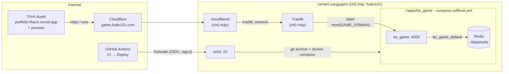

# be_game — Tự host và tự động deploy

Tài liệu vận hành bản be_game chạy trên máy chủ riêng `vsmart-zangyapro`, public ở `https://game.fudio101.com`, deploy tự động từ GitHub Actions. Phần kiến trúc code, giao thức và luật chơi nằm ở [`GUIDE.md`](GUIDE.md). Khi đổi workflow, compose hay cấu hình server, cập nhật file này trong cùng commit.

Mục lục: [Sơ đồ](#sơ-đồ) · [Máy chủ](#máy-chủ-vsmart-zangyapro) · [Cấu hình](#cấu-hình-nằm-ở-đâu) · [Luồng deploy](#luồng-deploy) · [Vận hành](#vận-hành) · [Quy tắc máy dùng chung](#quy-tắc-trên-máy-dùng-chung) · [Xử lý sự cố](#xử-lý-sự-cố) · [Vì sao làm vậy](#vì-sao-làm-vậy)

---

## Sơ đồ



- Traffic public đi **Cloudflare Tunnel → Traefik → be_game**. Không cổng nào của be_game hay Redis được publish ra host.
- GitHub vào máy bằng Tailscale: runner gia nhập tailnet của chủ máy như một node tạm gắn `tag:ci`, rồi SSH vào.
- Bản trên Vercel (`be-game-omega.vercel.app`) vẫn còn và dùng được để quay lại khi cần.

## Máy chủ `vsmart-zangyapro`

- Là một **điện thoại Vsmart Active 1** chạy Nura (fork postmarketOS, nền Alpine, musl), **arm64**, RAM 3,6 GB, chỉ có WiFi. Image Docker phải có bản `linux/arm64`.
- Máy **dùng chung**: chủ máy là `fudio101` (chạy Home Assistant, Traefik, cloudflared, quản lý Tailscale, firewall, kernel). Mình là user `zonenop`, chỉ làm trong `/home/zonenop`.
- Máy cắm sạc liên tục, pin giữ 70–80%. Mất điện hoặc lỗi sạc thì máy **tắt cứng**; chỉ chủ máy bật lại được. Vì vậy mọi service phải có `restart: unless-stopped` và ghi dữ liệu xuống đĩa.
- Vào máy: `ssh vsmart-zangyapro` (user `zonenop`, đăng nhập bằng key, qua Tailscale).

## Cấu hình nằm ở đâu

| Nơi | Tên | Giá trị / ý nghĩa | Ai quản lý |
|---|---|---|---|
| Server `~/apps/be_game/.env` | `GAME_DOMAIN` | `game.fudio101.com` — bắt buộc, Traefik route theo tên này | zonenop |
| Server `~/apps/be_game/.env` | `ALLOWED_ORIGIN` | `https://portfolio-thach.vercel.app,https://portfolio-*-thachs-projects-48e5eaf9.vercel.app,http://localhost:3000` | zonenop |
| GitHub env `self-hosted` (secret) | `TS_OAUTH_CLIENT_ID`, `TS_AUDIENCE` | Trusted credential (workload identity federation) của Tailscale; `TS_AUDIENCE` = `api.tailscale.com/<client ID>` | chủ máy tạo, zonenop đặt |
| GitHub env `self-hosted` (secret) | `DEPLOY_HOST`, `DEPLOY_USER`, `DEPLOY_PATH`, `DEPLOY_PORT`? | IP tailnet của server, `zonenop`, `/home/zonenop/apps/be_game`, mặc định 22 | zonenop |
| GitHub env `self-hosted` (secret) | `DEPLOY_SSH_KEY`, `DEPLOY_KNOWN_HOSTS` | Private key `be_game-deploy@github-actions`; host key đã ghim bằng `ssh-keyscan` | zonenop |
| GitHub env `self-hosted` (variable) | `GAME_DOMAIN`, `TS_TAGS`? | `game.fudio101.com` (bật bước kiểm tra health public); tag mặc định `tag:ci` | zonenop |
| Server `~/.ssh/authorized_keys` | `be_game-deploy@github-actions` | Giới hạn `restrict,from="100.64.0.0/10,fd7a:115c:a1e0::/48"`: chỉ từ tailnet, không pty, không forward | zonenop |
| Vercel project `portfolio` | `NEXT_PUBLIC_TIENLEN_SERVER_URL` | `https://game.fudio101.com` (production, preview, development). Gắn vào bundle **lúc build**: đổi thì phải redeploy | zonenop |
| Tailscale admin | `tag:ci` + ACL | `tag:ci` chỉ được vào `vsmart-zangyapro:22` | chủ máy |
| Traefik, cloudflared | `traefik_network`, entrypoint `web`, tunnel | Hạ tầng public | chủ máy |

### `ALLOWED_ORIGIN`

- Danh sách cách nhau dấu phẩy; `*` khớp `[a-z0-9-.]+` (`isAllowedOrigin` trong `src/server/hub.ts`). Request không có `Origin` (client không phải trình duyệt) luôn được nhận.
- URL preview của portfolio có hai dạng, cùng khớp `https://portfolio-*-thachs-projects-48e5eaf9.vercel.app`:
  - từng bản deploy: `portfolio-<hash>-thachs-projects-48e5eaf9.vercel.app`
  - link theo nhánh: `portfolio-git-<nhánh>-thachs-projects-48e5eaf9.vercel.app`
- **Không** dùng `https://*.vercel.app`: ai có tài khoản Vercel cũng tạo được subdomain đó.
- Origin bị từ chối nhận HTTP **403** từ be_game, nhưng qua Traefik/Cloudflare thường hiện thành **502** (be_game cắt kết nối ngay). Thấy 502 lúc mở WebSocket thì kiểm tra origin trước.
- Đổi xong: `docker compose -f compose.selfhost.yml up -d` (tạo lại container để đọc `.env`).

## Luồng deploy

Workflow: [`.github/workflows/deploy.yml`](../.github/workflows/deploy.yml). Chạy khi **CI pass trên một lần push vào `main`** (gồm cả merge PR), hoặc bấm tay trên `main` (Actions → Deploy → Run workflow). CI của PR không bao giờ deploy.

1. **Check configuration**: thiếu `TS_OAUTH_CLIENT_ID` / `TS_AUDIENCE` / `DEPLOY_HOST` / `DEPLOY_USER` / `DEPLOY_PATH` thì bỏ qua kèm notice, không báo lỗi.
2. **Checkout** đúng commit CI đã test (`workflow_run.head_sha`).
3. **Join the tailnet**: `tailscale/github-action@v4` đổi token OIDC của GitHub (`id-token: write`) lấy auth key tạm, node tự xoá sau job. Không có secret Tailscale nào lưu trên GitHub.
4. **Upload the release**: `git archive` commit đó, gửi qua SSH thành `$DEPLOY_PATH/.release.tar.gz`.
5. **Build and restart on the server** (script `REMOTE` trong workflow, chạy `bash` với `set -euo pipefail`):
   1. Từ chối dọn nếu thư mục có nội dung mà không phải bản be_game (`DEPLOY_PATH` sai).
   2. Xoá mọi thứ trừ `data/` và `.env`, giải nén bản mới, ghi `REVISION` = SHA.
   3. Ghi lại ID image `be_game:local` cũ → `docker compose up -d --build --remove-orphans` → nếu image cũ còn tồn tại và khác image mới thì `docker image rm` đúng ID đó.
   4. Chờ tối đa 60 giây cho `/api/health` trả `"ok":true`, hỏi **từ trong container** (`docker compose exec be_game node -e "fetch(...)"`). Không lên thì in 50 dòng log và fail.
6. **Public health check** (khi có variable `GAME_DOMAIN`): `https://$GAME_DOMAIN/api/health` qua Cloudflare.

Thời gian: build có cache khoảng 10 giây, build lại `npm ci` khoảng 1–2 phút (CPU điện thoại chậm). Container chỉ được tạo lại khi image hoặc cấu hình thực sự đổi; lúc tạo lại có vài giây gián đoạn, client tự kết nối lại, phòng vẫn còn trong Redis.

## Vận hành

Mọi lệnh dưới đây chạy trên server trong `~/apps/be_game` (`ssh vsmart-zangyapro`, rồi `cd ~/apps/be_game`). Đặt bí danh cho gọn: `alias dc='docker compose -f compose.selfhost.yml'`.

| Việc | Lệnh |
|---|---|
| Trạng thái | `dc ps` · `cat REVISION` |
| Health (trong container) | `dc exec -T be_game node -e "fetch('http://127.0.0.1:4000/api/health').then(r=>r.text()).then(console.log)"` |
| Health (public) | `curl https://game.fudio101.com/api/health` (từ máy bất kỳ) |
| Log | `dc logs -f --tail 100 be_game` |
| Khởi động lại be_game | `dc restart be_game` |
| Áp dụng `.env` mới | `dc up -d` |
| Tình trạng máy | `bash scripts/status.sh` của skill `zangyapro-host` (chạy từ máy mình) |

**Deploy tay** (khi Actions không dùng được), từ thư mục repo trên máy mình — gửi đúng commit đang checkout rồi build:

```bash
git archive HEAD | ssh vsmart-zangyapro "tar -xf - -C ~/apps/be_game && cd ~/apps/be_game && echo manual-$(git rev-parse --short HEAD) > REVISION && docker compose -f compose.selfhost.yml up -d --build"
```

Lệnh này không xoá file đã bị xoá khỏi repo; ưu tiên chạy lại workflow.

**Quay lại bản trước**: revert commit trên `main` (deploy tự chạy), hoặc chạy Deploy bằng tay sau khi `main` đã trỏ về bản tốt. Quay hẳn về Vercel: đổi `NEXT_PUBLIC_TIENLEN_SERVER_URL` của portfolio về `https://be-game-omega.vercel.app` rồi redeploy portfolio.

**Sao lưu**: phòng và bảng xếp hạng nằm trong `./data/redis` (bind mount, AOF bật). Chủ máy sao lưu `/home`, nên thư mục này được backup; Docker named volume thì không. Thư mục do uid 999 (redis) sở hữu, đọc bằng `docker exec be_game-redis-1 …`.

## Quy tắc trên máy dùng chung

Theo skill `zangyapro-host` (bắt buộc với người và với AI agent):

- Chỉ làm trong `/home/zonenop` và container/image/compose project của mình. Đồ của chủ máy (Home Assistant, Traefik, cloudflared, `/home/fudio101`, service `vsmart-zangyapro-homeserver-*`) chỉ được xem.
- **Không bao giờ** `docker system prune`, `docker volume prune`, `docker image prune -a`, `docker builder prune` — chúng xoá cả đồ của chủ máy. Dọn theo tên/ID.
- Hỏi trước (để báo chủ máy): restart Docker daemon, reboot, `apk add`.
- Không đụng: `apk upgrade`, kernel, `/boot`, firewall (`/etc/nftables*`), sshd, Tailscale, NetworkManager/WiFi, `/sys/class/power_supply`.
- **Chủ máy có thể sửa file trực tiếp trong `~/apps/be_game`** (đã từng sửa compose, workflow, README). Trước mỗi lần deploy từ repo, so bản trên server với repo; khác thì đưa thay đổi của họ vào repo trước, nếu không deploy sẽ ghi đè.

## Xử lý sự cố

| Triệu chứng | Nguyên nhân thường gặp | Cách xử lý |
|---|---|---|
| Deploy "skipped" kèm notice | Thiếu secret trong environment `self-hosted` | Đặt đủ secret ở bảng trên |
| Fail ở "Join the tailnet" | Điều kiện subject của trusted credential không khớp. Job chạy trong environment, nên subject là `repo:ThachHuynhIT/be_game:environment:self-hosted` | Nhờ chủ máy sửa subject cho khớp |
| SSH timeout | Máy tắt (thường do pin/mất điện), hoặc ACL `tag:ci` | `tailscale status \| grep vsmart`; offline thì báo chủ máy |
| `Host key verification failed` | Server cài lại sshd / đổi key | Đối chiếu fingerprint với chủ máy rồi cập nhật `DEPLOY_KNOWN_HOSTS` |
| Script thoát mã 141 | `pipefail` + một lệnh đọc sớm đóng pipe (`\| head`, `\| grep -q`) | Không pipe vào lệnh thoát sớm; lấy output vào biến rồi so |
| CI fail ở "Validate compose files" | `compose.selfhost.yml` bắt buộc `GAME_DOMAIN` | Bước CI phải truyền `GAME_DOMAIN=game.example.com` |
| Deploy xong container không được tạo lại | Image mới cùng manifest với image đang chạy (code không đổi) | Bình thường; đổi code thì sẽ tạo lại |
| `docker image rm` báo "No such image" | Máy dùng containerd image store, image cũ đã tự dọn khi tag chuyển | Script đã kiểm tra tồn tại trước khi xoá |
| WebSocket 502 khi mở | Origin không có trong `ALLOWED_ORIGIN` | Thêm origin, `dc up -d` |
| CI thỉnh thoảng đỏ ở test fuzz | Test/code còn chỗ dùng ngẫu nhiên không inject | Sửa cho tất định; deploy chỉ chạy khi CI xanh |

## Vì sao làm vậy

- **`git archive` thay cho `git pull` trên server**: repo private, server không giữ credential GitHub; và deploy đúng commit CI đã test.
- **Không publish cổng, đi qua Traefik**: firewall của host chặn tailnet tới cổng Docker publish kiểu bridge; chủ máy đã có Traefik + Cloudflare Tunnel cho mọi app public.
- **Health check trong container**: không còn cổng 4000 trên host; image không có `curl` nên dùng `fetch` của Node.
- **Không prune**: host dùng chung; xoá đúng image cũ theo ID.
- **OIDC thay cho OAuth secret**: không có secret Tailscale lâu dài nào trên GitHub.
- **Key deploy riêng, bị giới hạn**: lộ key thì chỉ dùng được từ trong tailnet, không mở được shell tương tác hay forward cổng.
