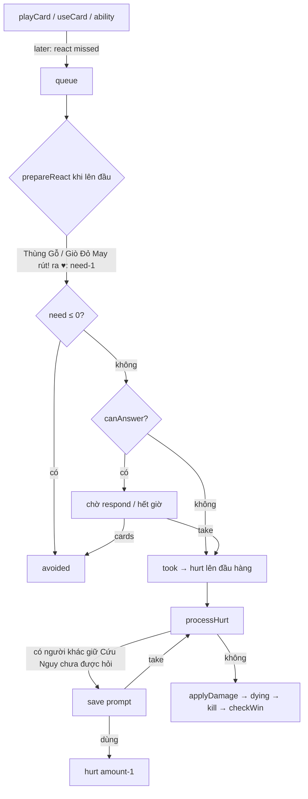
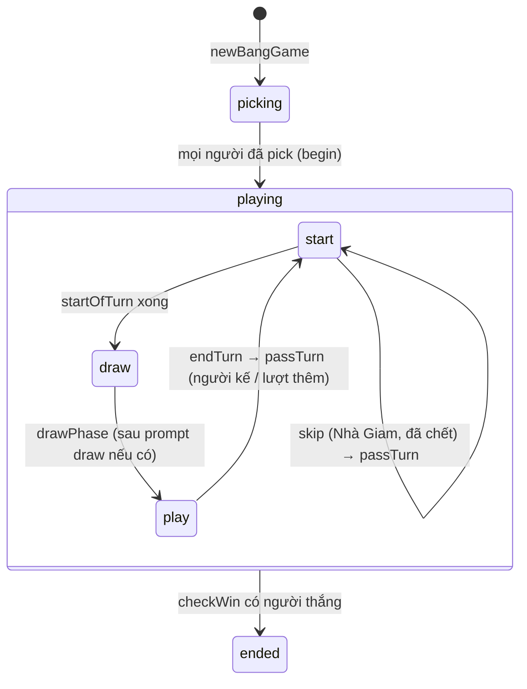

# Đấu Súng (`bang`)
> Lối chơi Bang! (vai trò ẩn, bắn nhau theo khoảng cách) kèm 7 bản mở rộng · 3–8 người · frontend `/bang` · `/api/bang/ws`, `/api/bang/rooms`, `/api/bang/leaderboard`

Hạ tầng chung (hub, adapter, store, giao thức WS, chat, emoji, khán giả, bảng xếp hạng) xem [`../GUIDE.md`](../GUIDE.md). Danh mục đầy đủ lá bài, nhân vật, sự kiện, trang bị (kèm cách code xử lý từng lá) ở [`bang-cards.md`](bang-cards.md). Tên lá / nhân vật / lời mô tả là của riêng dự án (tiếng Việt); trong code dùng khoá tiếng Anh (`CardKey`, `CharKey`, `EventKey`, `GearKey`).

## Tệp

| File | Vai trò |
|---|---|
| `src/bang/cards.ts` | Dữ liệu thuần: `PACKS`, `EXPANSIONS`, `CARD_TYPES` (71 loại lá), `DECK_SPEC` → `CARDS` (167 lá vật lý, id = vị trí), `CARD_PACK`, `deckFor`, `ROLES_FOR`, `THREE_PLAYER_TARGET`, `CHARACTERS` (63), `EVENTS` (38), `GEAR` (12) + `GEAR_DECK`, tuỳ chọn cài đặt. Chép nguyên sang zonenop-game (`src/lib/bang/cards.ts`), **không import gì** |
| `src/bang/game.ts` | Lõi máy trạng thái `BangState`: chọn nhân vật (`pickCharacter`/`begin`), lượt (`startTurn`, `startOfTurn`, `drawPrompt`, `drawPhase`, `passTurn`), hàng chờ `queue` và vòng xử lý `run()`, phản ứng (`prepareReact`, `canAnswer`, `avoided`, `took`), sát thương / chết / thắng (`processHurt`, `applyDamage`, `dying`, `kill`, `checkWin`, `finish`), rút! (`flip`, `effSuit`), khoảng cách (`distance`, `weaponRange`, `handLimit`), sự kiện (`revealEvent`), `tickGame`, `forfeitPlayer` |
| `src/bang/actions.ts` | Mọi thứ người chơi làm: `playCard` (+ `validate`, `resolve`), `applyEffect`, `useCard`, `useAbility`, `buyGear` (+ `checkGear`, `gainGear`), `drawCommand`, `respond` (+ `answerReact`), `endTurn`, tự chơi `autoAnswer`/`autoDiscard`, `bangsLeft`, `abilityList` |
| `src/bang/room.ts` | Vòng đời phòng `BangRoom` (8 ghế), `bangCommand` (lọc kiểu tham số), cài đặt, kick, ghi kết quả, `tickBang`, `nextBangTickAt`, view riêng từng người (`gameView`, `promptView`, `bangView`), `bangSummary` |
| `src/bang/protocol.ts` | Kiểu dây (chép sang zonenop-game): `BangSettings`, `BangPlayerView`, `PromptView`, `DrawMode`, `BangGameView`, `BangRoomView`, `PickSpec`, `BangCommand`, `BANG_WS_PATH` |
| `src/server/adapters.ts` | `bangAdapter` |
| `test/bang.test.ts` | Test |

## Luật chơi (như code đang chạy)

### Vai trò và mục tiêu

| Số người | Vai (`ROLES_FOR`, xáo rồi chia theo thứ tự ghế) |
|---|---|
| 3 | `deputy`, `outlaw`, `renegade` (biến thể 3 người, `s.three = true`, không có Cảnh sát trưởng) |
| 4 | `sheriff`, `renegade`, `outlaw` ×2 |
| 5 | `sheriff`, `renegade`, `outlaw` ×2, `deputy` |
| 6 | `sheriff`, `renegade`, `outlaw` ×3, `deputy` |
| 7 | `sheriff`, `renegade`, `outlaw` ×3, `deputy` ×2 |
| 8 | `sheriff`, `renegade` ×2, `outlaw` ×3, `deputy` ×2 |

`checkWin` (chạy sau mỗi cái chết; "sống" = `!dead`, hồn ma không tính):
- Sự kiện `wildwestshow` đang hiệu lực: thắng khi chỉ còn ≤ 1 người sống (người đó thắng).
- 3 người: kẻ giết thắng ngay nếu nạn nhân đúng vai mục tiêu của mình (`THREE_PLAYER_TARGET`: Phó → Kẻ phản bội → Kẻ cướp → Phó); nếu không, ai còn sống cuối cùng thắng.
- Bình thường: Cảnh sát trưởng chết → nếu chỉ còn đúng 1 người sống và là `renegade` thì người đó thắng, ngược lại **mọi** `outlaw` (kể cả đã chết) thắng. Cảnh sát trưởng sống mà không còn `outlaw`/`renegade` sống → `sheriff` + mọi `deputy` (kể cả đã chết) thắng.

Thưởng/phạt khi giết (`kill`, chỉ khi có kẻ giết khác nạn nhân và kẻ giết còn trong ván): giết `outlaw` → rút 3 lá (trừ biến thể 3 người); Cảnh sát trưởng giết `deputy` → bỏ hết bài trên tay và trước mặt; nạn nhân có Truy Nã (`wanted`) → kẻ giết rút 2 lá + 1 vàng.

### Chuẩn bị

`newBangGame(players, now, { packs, turnMs?, respondMs? }, random)`:
- `packs` luôn có `"base"` cộng các bản mở rộng đã bật. Bộ bài = `deckFor(packs)` xáo (mỗi dòng `DECK_SPEC` thuộc một phần base/dodge/valley/armed; `highnoon`, `fistful`, `wws`, `goldrush` không thêm lá chơi).
- Mỗi người được chia **2 nhân vật** (từ các nhân vật thuộc pack đã bật), `status = "picking"`, hạn `PICK_MS = 30_000`. Nhân vật còn lại lưu ở `alt` (dùng cho sự kiện Danh Tính Mới). Danh sách đã chia nằm ở `usedChars`.
- Ghế giữ **thứ tự join** (không xáo); vai trò xáo.
- Sự kiện: nếu có pack sự kiện (`highnoon`/`fistful`/`wws`), `eventDeck` lấy tối đa `EVENT_DECK_SIZE = 12` lá không-final đã xáo + **1** lá final (chọn ngẫu nhiên trong các final của pack đã bật) đặt cuối.
- Cơn Sốt Vàng: `shopDeck = shuffle(GEAR_DECK)` (12 món × 2), lật `SHOP_SLOTS = 3` vào `shop`.
- Khi mọi người đã chọn (`begin`): `max = life của nhân vật (+1 nếu sheriff)`, `life = max`, rút `life` lá (Ông Bự `bigspencer`: 5 lá); Rinh-gô Đỏ `redringo` có 4 đạn trên thẻ. Người đi đầu: Cảnh sát trưởng, hoặc `order[0]` ở biến thể 3 người.

### Lượt

`TurnInfo.step`: `"start" → "draw" → "play"`, rồi `endTurn` → `passTurn`.

**Đầu lượt** (`startOfTurn`, mỗi bước một lần, theo `startStep`):
0. Nếu là lượt của "leader" (Cảnh sát trưởng, hoặc `order[0]` khi 3 người), không phải lượt thêm, còn lá sự kiện và sự kiện hiện tại chưa phải final → lật sự kiện mới (`revealEvent`, có hiệu ứng tức thì của vài sự kiện). Vì vậy sự kiện đầu tiên lật ngay lượt đầu ván.
1. Người đã chết (không phải hồn ma): nếu `ghosttown` → về 1 lượt như hồn ma (`townGhost`); không thì `skip`.
2. `highnoon`: mất 1 máu. `fistful`: bị "bắn" 1 phát (react cần Trượt!) cho mỗi lá trên tay. `valentine`: bỏ hết bài trên tay, rút lại đúng chừng ấy.
3. Thuốc Nổ (`dynamite`, nếu đang có tác dụng): rút!, ra ♠ 2–9 → nổ, mất 3 máu (không có thủ phạm), lá bị bỏ; ngược lại chuyền cho người sống kế tiếp chưa có Thuốc Nổ.
4. Nhà Giam (`jail`): luôn bị gỡ & bỏ; nếu lá trước mặt đang có tác dụng thì rút!: ♥ → thoát, không thì mất lượt (`skip`).
5. Rắn Chuông (`rattlesnake`): rút!, ra ♠ → mất 1 máu.
6. Vê Bắt Chước (`vera`): prompt `copy` chọn nhân vật của 1 người khác (không phải vera). Xám Nhiều Mặt (`greygory`): mượn 2 nhân vật ngẫu nhiên chưa nằm trong `usedChars`.
7. Du Cười Toe (`youl`): mỗi người có nhiều bài hơn hắn đưa hắn 1 lá ngẫu nhiên.

**Rút bài** (`drawPrompt` / `drawPhase`): nếu người chơi có lựa chọn thật (nhân vật Giét/Pê/Pát/Ê-vơ-lin, sự kiện Rượu Mạnh/Nấm Ảo Giác/Danh Tính Mới/Anh Em Kết Nghĩa) thì xếp prompt `draw` và chờ lệnh `draw`; không thì rút thường ngay. Số lá thường `drawCount`: 2; Tí Hon 3; Bin Mặt Trơ `1 + máu đã mất` (ghi đè); Tu Cô +2 nếu trước mặt không có lá xanh dương; `train` +1; `thirst` −1; Cuốc Chim +1; hồn ma Thị Trấn Ma luôn 3. Các chế độ (`DrawMode`): `normal`, `jesse`, `pedro`, `pat`, `evelyn`, `liquor`, `peyote` — chi tiết ở bảng lệnh và [`bang-cards.md`](bang-cards.md). Với `normal`: Kít xem `n+1` giữ `n` (trả phần còn lại lên **đầu** chồng bài); Đát xem `n`, giữ `n−1`, bỏ 1, +1 vàng; `mine` lấy từ đống bỏ nếu đủ `n` lá; Cờ Đen lật lá thứ 2, ♥/♦ (chất thật) thì rút thêm 1; `lawwest` rút thêm 1 lá (ghi vào log).

**Đánh bài** (`step = "play"`): đánh bao nhiêu lá tuỳ ý với các giới hạn:
- **BANG!** (lá có `isBang`: `bang`, `punch`, `fanning`, `quickshot`, `flintlock`) giới hạn bởi `bangsLeft` = `1 + extraBangs (+1 nếu shootout) − bangs`; vô hạn (trả về 99) với Uy Nhóc `willy` hoặc Súng Liên Thanh; 0 khi `sermon`.
- Chỉ đánh/hành động khi hàng chờ trống (`myMove`: `queue.length === 0`).
- Lá xanh dương / xanh lá đặt trước mặt (mình, hoặc người khác với `placeOn`). Mỗi người chỉ có 1 lá mỗi loại; súng mới thay súng cũ. Lá xanh lá mang cờ `fresh`, chỉ dùng được từ lượt sau của chủ (cờ xoá ở `passTurn`).

**Kết thúc lượt** (`endTurn`): phải bỏ xuống còn `handLimit` = máu hiện tại (hồn ma: `max`), Sơn Ôm Bài tối thiểu 10, Át Chủ Bài +2. Có Cơn Sốt Vàng thì được bỏ **nhiều hơn** mức cần, mỗi lá bỏ được 1 vàng. Ga Nhặt Nhạnh (`gary`, người khác) nhận các lá bị bỏ thay vì đống bỏ. Sau đó `passTurn`: `susanna` (đánh < 3 lá → mất 1 máu), `vendetta` (rút! ♥ → thêm lượt), Đông Chuông (rút! ♥/♦ → thêm lượt); lượt thêm không sinh lượt thêm. Hồn ma Thị Trấn Ma bỏ hết bài khi hết lượt. Người kế tiếp: theo chiều ghế (ngược chiều khi `reverse`), bỏ qua người chết (trừ hồn ma, hoặc mọi người chết khi `ghosttown`).

### Khoảng cách và tầm

`distance(a, b)`: số ghế ngắn nhất giữa hai người trong vòng **những người còn trong ván** (`presentIds`: sống, hoặc hồn ma); `+1` nếu `b` có Ngựa Hoang / Hang Ẩn Nấp / là Phôn Né Tránh; `−1` nếu `a` có Ống Ngắm / Ống Nhòm / là Rô Mắt Ưng; tối thiểu 1. Sự kiện `ambush`: luôn 1. `weaponRange` = tầm súng đang đặt (không súng: 1). Lá trước mặt chỉ có tác dụng khi `gearActive(owner)`: không có `lasso`, và không phải đang trong lượt của Cô Ngôi Sao `belle` (người khác).

Kiểm tra mục tiêu `checkTarget` theo `aim` của lá: `range` ≤ tầm súng, `dist1` ≤ 1, `dist2` ≤ 2, `any` = người khác bất kỳ còn trong ván, `anyone` = người sống bất kỳ kể cả mình. Tháp Chuông (`bellTower`) bỏ qua khoảng cách cho lá kế tiếp. Miễn nhiễm (`immune`, với lá do người khác đánh): Thổ Dân Trẻ `apache` và Tẩu Hoà Bình `calumet` miễn lá chất ♦; Bà Á-bi `abigail` miễn lá tấn công (`ATTACKS`) có số J–A.

### Hàng chờ và luồng phản ứng (quan trọng nhất)

Mọi thứ chờ người chơi trả lời là **dữ liệu** trong `s.queue` (JSON thuần, vì state nằm trong Redis). `run()` xử lý từ đầu hàng (tối đa `MAX_STEPS = 500` bước mỗi lần) cho tới khi cần người chơi nhập:
- `now_()` chèn lên đầu (chạy trước những gì đang chờ), `later()` nối vào cuối.
- Mục **tương tác** (`INTERACTIVE`: `react`, `save`, `store`, `pick`, `keep`, `discard`, `copy`, `draw`) có `to` và `deadline`; đồng hồ (`respondMs`) chỉ bắt đầu khi mục **lên đầu hàng** (`started`).
- Mục không tương tác: `hurt` (sát thương), `effect` (hiệu ứng sau cửa sổ né), `pokerEnd`.
- Nếu người phải trả lời không còn trong ván, mục bị `salvage`: Tạp Hoá chuyển cho người kế, lá Kít/Đát xem bị bỏ, cửa sổ Cứu Nguy biến lại thành `hurt`.
- Hàng trống: tiếp máy trạng thái lượt (đầu lượt → rút → chờ đánh).

`react` (`answer`):
- `"missed"`: bị bắn — trả bằng `need` lá Trượt! (`missedCards`: lá `isMissed` trên tay, mọi lá với Ê-lê-na, BANG! với Cô Tai Ương hoặc khi `showdown`, lá xanh lá `isMissed` trước mặt đã hết `fresh`; Ông Bự không có lá nào).
- `"bang"`: Da Đỏ! / Đấu Tay Đôi / Cơn Giận Đô-rô-ti — trả bằng 1 lá BANG! (`beatCards`: `isBang`, Trượt! với Cô Tai Ương, mọi lá khi `showdown`).
- `"evade"`: cửa sổ né trước Hoảng Loạn / Quậy Phá / Bẻ Khoá / Giật Đồ / Chai Rượu / Bạn Đồng Hành — chỉ tạo khi mục tiêu có Chuồn (`escape`) hoặc là Mích (`mick`) có lá Trượt!.
- Cờ phụ: `shot` (là phát bắn kiểu BANG!: Treo Thưởng, Súng Hoa Cải, Mê-ri Máu, Súng Nòng Dài, Súng Kíp áp dụng), `unmissable` (Súng Hai Nòng + BANG! ♦, hoặc BANG! của Cô-lô-ra-đô rút! ra ♠), `noGear` (Súng Săn Lớn), `evadable` (Chuồn/Mích hủy được: Da Đỏ!, chỉ prompt Đấu Tay Đôi đầu tiên — các lượt đáp qua lại không còn cờ này), `duel`, `group`, `targetCard` (Đạn Nảy), `card` (lá gây ra).

Trình tự một phát bắn:

- `prepareReact`: chỉ với `answer = "missed"` và không `unmissable`; số lần rút! = Thùng Gỗ (nếu không `noGear` và đang có tác dụng) + Giò Đỏ May; mỗi lần ♥ (`effSuit`) giảm `need` 1. Rồi đặt hạn; nếu `!canAnswer` thì chịu đòn ngay (không chờ). Nghĩa là người không có lá phù hợp **không** thấy prompt.
- `avoided`: `evade` → bỏ cả nhóm (`dropGroup`); Đấu Tay Đôi → đẩy prompt sang người còn lại; Cò Quay Nga → chuyền cho người sống kế tiếp (lời nhắc kế tiếp luôn có `need: 1`; đặt 0 làm cả bàn "né" miễn phí và ván treo); phát bắn `shot` bị né → Mê-ri Máu rút 1, Súng Nòng Dài tốn 1 đạn bắt người kia bỏ ngẫu nhiên 1 lá, Súng Kíp quay về tay.
- `took`: `evade` → không làm gì (hiệu ứng phía sau cứ thế chạy); Đạn Nảy → mất lá bị nhắm; còn lại → `hurt` lên đầu hàng.
- Khi trả lời bằng Né / Kinh Thánh: rút 1; Cúi Đầu!: nếu thẻ nhân vật còn đạn thì tốn 1 viên và lấy lá về tay; Phản Đòn: xếp phát bắn ngược vào kẻ bắn. Mô-li rút 1 lá cho mỗi lá đánh ngoài lượt.

**Sát thương / chết** (`applyDamage`): mỗi máu mất: Ba Lì Đòn rút 1; Si Mê Vàng / Bùa May +1 vàng; Gã Ngoại Quốc lấy ngẫu nhiên 1 lá trên tay kẻ gây ra. Sau đó nếu `shot`: Treo Thưởng trên nạn nhân → kẻ bắn rút 1; kẻ bắn có Súng Hoa Cải → nạn nhân bỏ ngẫu nhiên 1 lá trên tay. Giu-li (còn sống, do người khác) rút! ♥/♦ → bắn trả. Hồn ma / người đã chết không mất máu. Về ≤ 0 → `dying`: tự uống Bia (nếu Bia có tác dụng; Tê Nghiện Rượu +2), rồi Ly Cuối, rồi Sít bỏ 2 lá đầu tay, lặp tới khi > 0; không cứu được → `kill`: Tê Rèn Lì rút! không ♠ → sống lại 1 máu + 1 lá; ngược lại chết, lộ vai, bài trên tay + trước mặt về Kền Kền (người sống đầu tiên theo ghế) hoặc đống bỏ; trang bị vàng mất; thưởng/phạt; Thợ Đào Mộ +2 máu, Thợ Săn Cỏ rút 2; mục chờ của người chết bị salvage; `checkWin`. Người chết đúng lượt mình → `skip`.

### Bản mở rộng

| Pack | Thêm gì | Ghi chú cơ chế |
|---|---|---|
| `base` (luôn có) | 80 lá, 16 nhân vật | |
| `dodge` — Thị trấn Né Đạn | 40 lá (gồm lá xanh lá và lá `cost`), 15 nhân vật | `cost`: phải bỏ kèm 1 lá khác trên tay (`play.extra[0]`). Bật sẵn trong cài đặt mặc định |
| `highnoon` — Giữa Trưa | 14 sự kiện (final: `highnoon`) | Không thêm lá chơi |
| `fistful` — Nắm Bài | 15 sự kiện (final: `fistful`) | Không thêm lá chơi |
| `wws` — Gánh Xiếc Miền Tây | 9 sự kiện (final: `wildwestshow`), 8 nhân vật | |
| `goldrush` — Cơn Sốt Vàng | 8 nhân vật, cửa hàng 12 món × 2 | Vàng: bỏ bài cuối lượt (1/lá), Đát, Si Mê Vàng, Bùa May, Truy Nã. Lệnh `buy`. Trang bị vàng (`gear`) **không** bị Dây Thòng Lọng / Cô Ngôi Sao vô hiệu, không bị lấy |
| `valley` — Thung Lũng Bóng Ma | 24 lá, 8 nhân vật | Hồn ma, Cứu Nguy, Chuồn… |
| `armed` — Trang Bị Tận Răng | 23 lá, 8 nhân vật | Đạn (`cubes`): tối đa 4 trên mỗi lá có `load` và 4 trên thẻ nhân vật |

Chỉ một sự kiện có hiệu lực tại một thời điểm (`s.event`); lá final ở lại tới hết ván.

## Cài đặt phòng

Lệnh `settings` (chỉ chủ phòng, khi không có ván hoặc ván đã `ended` — kể cả đang `picking` cũng bị chặn), kiểm tra ở `setSettings` (`room.ts`); giá trị hiện hành `bangSettingsOf(room)` = `DEFAULT_BANG_SETTINGS` + `room.settings`; áp dụng khi `start`.

| Trường | Kiểu / tuỳ chọn | Mặc định | Tác dụng | Kiểm tra ở |
|---|---|---|---|---|
| `packs` | mảng con của `EXPANSIONS = ["dodge","highnoon","fistful","wws","goldrush","valley","armed"]` | `["dodge"]` | Bản mở rộng bật thêm (base luôn có). Được chuẩn hoá theo thứ tự `EXPANSIONS`, bỏ trùng | `setSettings` (`"Bộ mở rộng không hợp lệ"`) |
| `turnSeconds` | `TURN_SECONDS_OPTIONS = [45, 60, 90, 120]` | `DEFAULT_TURN_SECONDS = 60` | Hạn pha đánh bài (`turnMs`), **gia hạn lại sau mỗi hành động** | `setSettings` |
| `respondSeconds` | `RESPOND_SECONDS_OPTIONS = [10, 15, 20, 30]` | `DEFAULT_RESPOND_SECONDS = 15` | Hạn mỗi prompt (kể cả prompt rút bài) | `setSettings` |
| `first` | số nguyên 1…20 | `2` | Điểm mỗi người thắng | `checkRankPoints` |
| `second` | số nguyên 0…`first` (tự kẹp về `first` nếu lớn hơn) | `1` | Điểm hạng Nhì trong `scoreByRank` | `checkRankPoints` |

Hạn chọn nhân vật cố định `PICK_MS = 30s`, không đổi được.

## State

`BangState` (`game.ts`), trong `BangRoom.current`:

| Trường | Ý nghĩa |
|---|---|
| `order` | Thứ tự ghế (chiều kim đồng hồ), **gồm cả người chết**; Quý Bà Hoa Hồng có thể đổi chỗ |
| `ps[id]: BPlayer` | `role`, `char`, `alt`, `life`, `max`, `hand` (id lá), `play: InPlay[]` (`{id, cubes?, fresh?}`), `gear: {key, from?}[]`, `gold`, `cubes` (đạn trên thẻ nhân vật), `dead`, `ghost?` (lá Hồn Ma), `townGhost?` (Thị Trấn Ma), `borrowed?` (nhân vật mượn), `diedAt?` |
| `packs` | `["base", ...]` |
| `status` | `"picking" → "playing" → "ended"` |
| `picks[id]` | 2 lựa chọn nhân vật; key bị xoá khi đã chọn |
| `deck`, `discard` | Chồng rút (phần tử 0 là trên cùng) và đống bỏ (cuối mảng là trên cùng). Hết chồng thì xáo đống bỏ (`takeTop`) |
| `turn: TurnInfo` | `player`, `step`, `startStep`, `bangs`, `extraBangs`, `played` (đếm cho `susanna`), `uses` (đếm số lần dùng kỹ năng trong lượt), `bellTower?`, `bigFifty?`, `extra?`, `lastBrown?` (cho Li Bắn Lại), `skip?`, `deadline?` |
| `queue: QEntry[]` | Hàng chờ (xem trên) |
| `phaseAt`, `deadline` | Lúc bắt đầu chờ (cho người vắng mặt) và hạn hiện tại (của prompt đầu hàng, hoặc của pha đánh, hoặc của pha chọn nhân vật) |
| `events`, `event` | Chồng sự kiện còn lại; sự kiện đang hiệu lực |
| `shop`, `shopDeck` | 3 món đang bán; chồng trang bị |
| `winners`, `finished` | Người thắng; xếp hạng khi kết thúc |
| `groupSeq`, `deaths` | Bộ đếm nhóm (né theo nhóm) và số người đã chết (`diedAt`) |
| `three` | Biến thể 3 người |
| `last` | Cho animation: `{ seq, player, card, kind: "play" \| "flip" \| "hit" \| "die" \| "event", target? }` |
| `log` (tối đa `LOG_LIMIT = 30`), `logSeq`, `recorded?`, `turnMs`, `respondMs`, `forfeited?`, `usedChars` | |

Lúc nào hàng chờ khác rỗng thì máy trạng thái lượt đứng chờ hàng chờ.

## Lệnh (client → server)

Qua `bangCommand(room, token, msg, now)`; tham số được lọc kiểu (`num`, `str`, `nums`, `pickOf`) trước khi vào game. `PickSpec = { zone: "hand" } | { zone: "play", card }` (trên tay = lá **ngẫu nhiên**; trước mặt = lá chỉ định).
Lỗi chung: `"Bạn không còn trong phòng"`, `"Chưa bắt đầu ván"` (không có ván hoặc đã `ended`), `"Bạn không chơi ván này"`, `"Lệnh không hợp lệ"`. Các lệnh trong lượt dùng `myMove`: `"Ván chưa bắt đầu hoặc đã kết thúc"`, `"Chưa tới lượt bạn"`, `"Bạn đã bị loại"`, `"Hãy rút bài trước"`, `"Đang chờ người khác trả lời"`.

| `type` | Trường | Khi nào được | Tác dụng | Lỗi thường gặp |
|---|---|---|---|---|
| `start` | — | Chủ phòng, không có ván chưa kết thúc, ≥ 3 người ngồi | `newBangGame` với cài đặt hiện hành | `"Chỉ chủ phòng mới bắt đầu được"`, `"Ván đang diễn ra"`, `"Cần ít nhất 3 người"` |
| `settings` | `packs?`, `turnSeconds?`, `respondSeconds?`, `first?`, `second?` | Chủ phòng, không có ván chưa kết thúc | Cập nhật `room.settings` | `"Bộ mở rộng không hợp lệ"`, `"Thời gian lượt không hợp lệ"`, `"Thời gian trả lời không hợp lệ"` |
| `kick` | `playerId` | Chủ phòng; mục tiêu offline | Trong ván: `forfeitPlayer` (chết không có kẻ giết); ngoài ván: giải phóng ghế | `"Chỉ kích được người đã mất kết nối"` |
| `pick` | `char` | `status = "picking"`, chưa chọn | Chọn 1 trong 2 nhân vật; người cuối chọn xong thì bắt đầu ván | `"Đã chọn nhân vật xong"`, `"Bạn đã chọn rồi"`, `"Nhân vật không hợp lệ"` |
| `draw` | `mode?` (mặc định `normal`), `target?` (jesse, pat), `card?` (pat: lá trước mặt `target`), `targets?` (evelyn: 1–2 người trong tầm, ≤ số lá rút), `color?: "red"\|"black"` (peyote), `swap?: true` (newidentity), `blood?: playerId` (bloodbrothers: mất 1 máu, người đó hồi 1) | Đầu hàng là prompt `draw` của mình và `mode ∈ options` | Rút giai đoạn 1. Lỗi thì state được **khôi phục từ snapshot** | `"Không phải lúc rút bài"`, `"Cách rút không hợp lệ"`, `"Chọn người có bài trên tay"`, `"Đống bài bỏ đang trống"`, `"Chọn 1 lá trước mặt người khác"`, `"Chọn 1–2 người trong tầm"`, `"Người đó ngoài tầm"`, `"Đoán Đỏ hoặc Đen"` |
| `play` | `card`, `target?`, `target2?` (fanning, quickshot), `pick?` (panic, catbalou, ragtime, squaw; BANG! nhắm lá trước mặt khi `ricochet`), `extra?: number[]` (lá bỏ kèm của lá `cost`; hoặc Nhắm Kỹ / BANG! thứ hai khi `sniper` đi kèm lá BANG!), `as?: "bang"` (Cô Tai Ương / Súng Hai Cỡ / `showdown`), `mode?` (`"take"` cho Giật Đồ) | `myMove` | Đánh 1 lá trên tay (xem `bang-cards.md`) | `"Bạn không có lá đó"`, `"… chỉ dùng khi bị bắn"`, `"… chỉ dùng ngoài lượt"`, `"Nhắm Kỹ phải đánh cùng 1 lá BANG!"`, `"Bạn đã bắn đủ BANG! trong lượt này"`, `"Ngoài tầm súng (…)"`, `"Phải ở khoảng cách 1 (…)"`, `"Không thể giam Cảnh sát trưởng"`, `"Đã có … ở đó rồi"`, `"…: chọn thêm 1 lá trên tay để bỏ kèm"`, `"Lá đi kèm không hợp lệ"`, `"Bạn đang đầy máu"`, `"Chỉ còn 2 người: Bia vô dụng"`, lỗi sự kiện (`"Quan Toà: …"`, `"Bài Giảng: …"`, `"Mục Sư: …"`, `"Say Xỉn: …"`) |
| `use` | `card`, `target?`, `pick?` (cancan, conestoga) | `myMove`, lá trước mặt mình đang có tác dụng | Lá xanh lá (bỏ đi để dùng; không được khi `fresh`) hoặc lá có đạn (`bandolier`, `belltower`, `bigfifty`: tốn 1 đạn) | `"Lá đó không ở trước mặt bạn"`, `"Lá trước mặt đang mất tác dụng"`, `"Lá này hết đạn"`, `"Lá này tự kích hoạt"`, `"Lá xanh lá chỉ dùng được từ lượt sau"`, `"Lá này không kích hoạt được"` |
| `ability` | `name`, `target?`, `cards?`, `card?`, `pick?` | `myMove` (trừ `sid`: bất cứ lúc nào khi còn sống) | Kỹ năng nhân vật / Chảo Đãi Vàng / sự kiện. `name ∈ sid, chuck, doc, jose, flint, leevan, jacky, mexicali, josh, raddie, goldpan, blackflower, derspot, bass, frankie, redringo, dorothy, ladyrose, ranch` — tham số từng kỹ năng ở `bang-cards.md` | `"Bạn không có sức mạnh này"`, `"Mỗi lượt 1 lần"`, `"Tối đa 2 lần mỗi lượt"`, `"Cần 2 vàng"`, `"Sức mạnh không hợp lệ"` |
| `buy` | `slot` (0–2), `target?`, `pick?`, `mode?` (bottle: `panic`/`beer`/`bang`; pardner: `store`/`duel`/`cat`) | `myMove`, pack `goldrush` | Mua món ở `shop[slot]`, bù slot từ `shopDeck`, `played += 1` | `"Không chơi Cơn Sốt Vàng"`, `"Không có món đó"`, `"Cần N vàng"`, `"Bạn đã có món này"`, `"Chọn cách dùng …"`, `"Chọn người để treo Truy Nã"` |
| `respond` | `cards?`, `card?`, `take?: true`, `choice?` | Đầu hàng là prompt tương tác gửi cho mình (trừ `draw`) | Trả lời prompt (bảng dưới) | `"Không có gì cần bạn trả lời"`, `"Cần N lá Trượt!"`, `"Cần đánh 1 lá BANG!"`, `"Phát này không thể né"`, `"Chọn lá để đỡ, hoặc chịu đòn"` |
| `end` | `discard?: number[]` | Lượt mình, `step = "play"`, hàng chờ trống | Bỏ bài xuống `handLimit` rồi qua lượt | `"Phải bỏ N lá (giữ tối đa M)"`, `"Chỉ cần bỏ N lá"` (khi không có goldrush), `"Lá bỏ không hợp lệ"`, `"Chưa thể kết thúc lượt"` |

Trả lời từng loại prompt (`respond`):

| Prompt | Trả lời |
|---|---|
| `react` `missed` | `cards` = đúng `need` lá trong `missedCards` (trên tay hoặc lá xanh lá trước mặt); hoặc `take: true` chịu đòn |
| `react` `bang` | `cards` = 1 lá trong `beatCards`; hoặc Chuồn/Mích nếu `evadable`; hoặc `take` |
| `react` `evade` | 1 lá Chuồn (hoặc Trượt! nếu là Mích); `take` = để hiệu ứng xảy ra |
| `save` | `take: true` = không cứu; **bất kỳ** trả lời nào khác = dùng lá Cứu Nguy |
| `store` | `card` = 1 lá trong `cards` (mặc định lá đầu) |
| `pick` (Ẩu Đả) | `card` = id lá trước mặt người kia; bỏ trống = lá ngẫu nhiên trên tay họ |
| `keep` (Kít, Đát) | `cards` = đúng `keep` lá trong `cards` |
| `discard` `bandidas` | `cards` = đúng `count` lá, hoặc `take: true` mất `orLose` máu (tự mất máu nếu không đủ bài) |
| `discard` `poker` | `card` = 1 lá úp vào pot |
| `keep` `poker` | `cards` = đúng 2 lá chọn từ pot (người đánh Xì Phé; hết giờ lấy 2 lá đầu) |
| `copy` (Vê) | `choice` = 1 `CharKey` trong `options` |

## View (server → client)

`bangView(room, seat | null, now)` → `BangRoomView` (`gameView(g, me)` + `promptView(g, me)`):
- Chung: `game: "bang"`, `code`, `meId`, `role`, `serverTime`, `settings`, `seats[]`, `history` (10 ván cuối), `spectators`, `reactions`, `chat`; `abilities` (danh sách tên kỹ năng có thể bấm — `abilityList`, "lỏng", server kiểm tra lại) chỉ có khi người xem đang trong ván.
- `current.players[]` theo `order`: `char` (`null` khi người đó chưa chọn), `life`, `max`, `handCount`, `play` (`{id, cubes?, fresh?}`), `gear`, `gold`, `cubes`, `dead`, `ghost` (= `ghost || townGhost`), `borrowed`, `dist` (khoảng cách từ mình tới họ; `null` cho chính mình / khán giả / khi một bên không còn trong ván / khi không `playing`).
- **Bị giấu theo người xem:**
  - `role`: chỉ thấy vai của chính mình, của `sheriff`, của người đã chết, và của mọi người khi ván kết thúc.
  - `hand`: chỉ thấy bài của mình; thấy tất cả khi sự kiện `sacagaway` hoặc khi ván kết thúc; còn lại `null` (có `handCount`).
  - `picking`: 2 lựa chọn nhân vật của chính mình (rỗng với người khác); `picked` = ai đã chọn.
  - `prompt` kiểu `keep`: chỉ người được hỏi thấy `cards`; người khác thấy `count`.
  - Thứ tự `deck`, lá trong pot Xì Phé, `alt`, `events` còn lại (chỉ có `eventsLeft`), `shopDeck` (chỉ số lượng) không gửi.
- Công khai: `status`, `turn`, `step`, `deadline`, `prompt` (đầu hàng, ai cũng thấy — gồm `store.cards`), `queued` (số prompt tương tác còn chờ sau prompt hiện tại), `deckCount`, `discardTop`, `discardCount`, `event`, `eventsLeft`, `shop`, `shopDeck`, `winners`, `finished`, `last`, `log`.
- Riêng người xem: `bangsLeft` (99 = vô hạn), `range` (tầm súng của mình).
- `last.seq` tăng mỗi lần `mark()`; `kind`: `play` (đánh/đặt/dùng lá; `target` = mục tiêu), `flip` (lá rút!), `hit` (mất máu; `player` = thủ phạm, `target` = nạn nhân), `die`, `event`.

## Timer, hết giờ, mất kết nối

- Hằng số: `PICK_MS = 30_000`, `TURN_MS = 60_000`, `RESPOND_MS = 15_000` (hai cái sau bị cài đặt ghi đè qua `turnMs`/`respondMs`), `ABSENT_MS = 2_500`.
- `s.deadline` luôn là hạn của thứ đang chờ: pha chọn nhân vật; prompt đầu hàng (đặt khi lên đầu); hoặc pha đánh bài (`turn.deadline`, được `busy()` đẩy lùi `turnMs` sau mỗi `play`/`use`/`ability`/`buy` **thành công**; lệnh bị từ chối không gia hạn).
- `tickGame`:
  - `picking`: hết `PICK_MS` (hoặc người vắng mặt quá `ABSENT_MS` tính từ `phaseAt`) → chọn ngẫu nhiên 1 trong 2 cho người đó.
  - `playing`: lặp tối đa 50 lần: người đang được chờ (`waitingFor`: `to` của prompt đầu hàng, hoặc người có lượt) nếu quá hạn hoặc vắng mặt quá `ABSENT_MS` → `autoAnswer` rồi `run()`.
- `autoAnswer` ("hợp lý, không thông minh"): react `missed` → đỡ nếu đủ lá (ưu tiên lá xanh lá trước mặt, rồi Trượt! thật, rồi lá khác), không thì chịu; react `bang` → đánh BANG! nếu có; `evade` → dùng Chuồn nếu có; `save` → không cứu; `store` → lá đầu; `pick` → ngẫu nhiên trên tay, không có thì lá trước mặt đầu tiên; `keep` → các lá đầu; `discard` bandidas → mất máu nếu `life > 1` hoặc thiếu bài, không thì bỏ các lá đầu; poker → lá đầu tay; `copy` → ngẫu nhiên; `draw` → `normal`; hết giờ pha đánh → `endTurn` với `autoDiscard` (bỏ các lá **cuối** trên tay).
- Vắng mặt = không có ghế hoặc `!isOnline` (đã `leave` hoặc quá `PRESENCE_TIMEOUT_MS = 25s`, xem `../GUIDE.md`). Người `leave` giữa ván vẫn giữ ghế và bị chơi hộ.
- Kick người offline → `forfeitPlayer`: thêm vào `forfeited`; nếu còn đang `picking` thì chọn hộ nhân vật đầu; nếu chưa chết thì `kill(…, null)` (không có kẻ giết → không thưởng/phạt), rồi `run()`.

## Kết thúc ván & tính điểm

- `finish(winners)`: `finished` = người thắng rồi người thua; trong mỗi nhóm người còn sống đứng trước, người chết sau đứng trên người chết trước (`diedAt`). `queue`, `turn`, `deadline` bị xoá.
- Chấm điểm: `afterChange` gọi `scoreByRank(finished, {first, second})` (dùng chung với splendor/typhu). `finished` = phe thắng (sống lâu hơn xếp trên) rồi phe thua theo thứ tự chết (chết muộn xếp trên); người bị kick tính như người chết. Nhất/Nhì lấy từ cài đặt phòng, hai hạng cuối bị trừ đối xứng, tổng luôn bằng 0.
- `afterChange` (room): cộng `points`, `games`, `wins` (mọi người trong `winners`, không chỉ hạng 0); `GameRecord { id: "<code>-<gameSeq>-<at>", at, instantWin: null, results[{id, name, rank (= vị trí trong finished), delta}] }`; hub ghi bảng xếp hạng.

## Test

`test/bang.test.ts`:
- Dữ liệu: 80 lá base, 40 dodge, 25 BANG!, 12 Trượt!; vai 3–8 người.
- Chọn nhân vật, máu Cảnh sát trưởng +1, Cảnh sát trưởng đi trước; tự chọn khi hết giờ.
- BANG!/Trượt!, tầm, giới hạn BANG!, Sờ Lép, Súng Liên Thanh, Thùng Gỗ, Ngựa Hoang / Ống Ngắm.
- Bia tự cứu, thưởng giết Kẻ cướp, phạt Cảnh sát trưởng giết Phó, các điều kiện thắng, Kền Kền.
- Rút/bỏ bài, Kít, Nhà Giam, Thuốc Nổ, lá xanh lá dùng từ lượt sau.
- Đấu Tay Đôi, Da Đỏ!, Tạp Hoá, Hoảng Loạn + Chuồn, Cứu Nguy, lá `cost`.
- Giữa Trưa, Phục Kích, Cò Quay Nga, Cơn Sốt Vàng, Đai Đạn, kỹ năng Chắc Liều.
- Hết giờ / vắng mặt; đồng hồ prompt chỉ chạy khi lên đầu hàng; Tạp Hoá chuyển khi người chọn chết.
- View giấu vai và bài.
- **150 ván ngẫu nhiên** (bot ngẫu nhiên, mọi tổ hợp pack, 3–8 người): không lỗi, `conserved()` kiểm tra mọi lá nằm đúng một chỗ (deck, discard, tay, trước mặt, `store`/`keep`/`pokerEnd` trong hàng chờ), > 100 ván kết thúc.

Viết test tất định:
- Dùng helper `rig(chars, roles, packs, random)` trong file test: tạo ván, ép nhân vật & vai, xoá tay / trước mặt, đặt `deck = deckFor(packs)` theo thứ tự cố định, tắt sự kiện, rồi `startTurn(s, "a", T, false); s.turn.step = "play"`.
- `give(s, id, key, suit?)` lấy lá theo loại từ deck lên tay; `put(...)` đặt trước mặt; `top(s, suit, rankTest)` đặt lá lên đầu chồng để điều khiển kết quả rút! (Thùng Gỗ, Nhà Giam, Thuốc Nổ…).
- Mọi hàm game/actions nhận `random` (mặc định `Math.random`); `bangCommand` thì không — test luồng chi tiết nên gọi thẳng `playCard`/`respond`/… và `names = (id) => id`.
- Sau thao tác, kiểm tra `s.queue[0]` (`toMatchObject({ kind, to, answer })`) để biết đang chờ ai; gọi `conserved(s)` để bắt lỗi mất/nhân đôi lá.

## Lưu ý / bẫy thường gặp

- **State phải là JSON thuần**: hiệu ứng chờ là dữ liệu trong `queue`, không phải closure. Thêm cơ chế mới = thêm `QEntry` kind + xử lý trong `run()` / `respond()` / `autoAnswer()` / `salvage()` / `promptView()` (và `conserved()` trong test nếu mục giữ lá).
- `id` lá = vị trí trong `CARDS` (thứ tự `DECK_SPEC`). Chèn/xoá dòng giữa `DECK_SPEC` sẽ đổi id của mọi lá sau đó → hỏng ván đang lưu. Ranh giới pack trong `buildCards` dựa vào khoá dòng đầu mỗi phần (`punch` → dodge, `aim` → valley, `reload` → armed). Số lá mỗi phần: 80 / 40 / 24 / 23.
- `cards.ts` và `protocol.ts` được chép sang frontend: sửa thì đồng bộ.
- `second` (Nhì) được dùng khi tính điểm (xem `scoreByRank` ở mục chấm điểm). 8 người chơi được chỉ với bộ gốc (`MAX_PLAYERS = 8`, bộ gốc có đúng 16 nhân vật = 8 × 2), nên blurb Thị trấn Né Đạn không còn nói "tới 8 người".
- Giốt Mua Chịu mua Truy Nã: tự gắn lên người sống đầu tiên khác mình (lá trên cùng `shopDeck` không lộ nên không thể chọn mục tiêu trước).
