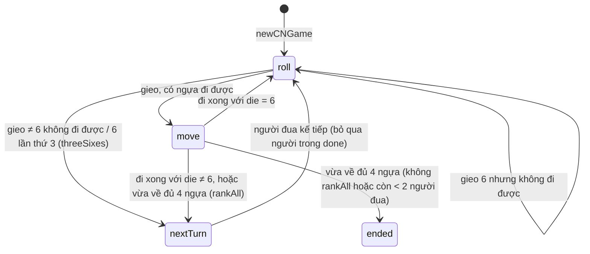

# Cờ Cá Ngựa (`cangua`)
> Cờ cá ngựa (ludo Việt): 1 xúc xắc, 4 ngựa mỗi người, đá ngựa về chuồng · 2–4 người · frontend `/co-ca-ngua` · `/api/cangua/ws`, `/api/cangua/rooms`, `/api/cangua/leaderboard`

Hạ tầng chung (hub, adapter, store, giao thức WS, chat, emoji, khán giả, bảng xếp hạng) xem [`../GUIDE.md`](../GUIDE.md). File này chỉ mô tả phần riêng của Cờ Cá Ngựa.

## Tệp

| File | Vai trò |
|---|---|
| `src/cangua/board.ts` | Dữ liệu bàn 15×15: `COLORS`, `COLOR_NAMES`, `TRACK` (56 ô), `HOME_CELLS`, `STABLE_ORIGIN`, `STABLE_CELLS`, hằng số (`TRACK_LEN`, `HOME_LEN`, `GATE`, `FINAL`, `STABLE`…), `COLORS_FOR_PLAYERS`, `startIndex`, `trackIndex`, `cellOf`. Chép nguyên sang zonenop-game (`src/lib/cangua/board.ts`) — **không import gì** |
| `src/cangua/game.ts` | Máy trạng thái thuần `CNState`: `newCNGame`, `rollDie`, `moveHorse`, `targetOf`, `legalMoves`, `forfeitPlayer`, `bestMove`, `tickGame`, `nextGameTickAt`, `DEFAULT_RULES` |
| `src/cangua/room.ts` | Vòng đời phòng `CNRoom`: `joinCN`, `leaveCN`, `cnHeartbeat`, `cnCommand`, cài đặt, kick, ghi kết quả, `tickCN`, `nextCNTickAt`, `cnView`, `cnSummary`, `isCNActive` |
| `src/cangua/protocol.ts` | Kiểu dây: `CNSettings`, `CNPlayerView`, `CNMove`, `CNGameView`, `CNRoomView`, `CNCommand`, `CANGUA_WS_PATH` |
| `src/server/adapters.ts` | `canguaAdapter` |
| `test/cangua.test.ts` | Test |

## Luật chơi (như code đang chạy)

**Bàn và vị trí** (`board.ts`)
- Màu `COLORS = ["red","blue","yellow","green"]` (chỉ số 0–3; tên `COLOR_NAMES`: Đỏ, Xanh dương, Vàng, Xanh lá). Số người → màu: `COLORS_FOR_PLAYERS = {2: [0,2], 3: [0,1,2], 4: [0,1,2,3]}` (2 người ngồi đối diện).
- Đường chung `TRACK` 56 ô (`TRACK_LEN`, `SIDE = 14` ô mỗi màu), theo chiều kim đồng hồ, bắt đầu tại ô xuất quân của đỏ. Ô xuất quân của màu `c` là `startIndex(c) = c × 14` (đỏ 0, xanh dương 14, vàng 28, xanh lá 42).
- Vị trí một ngựa = **tiến độ** tính từ ô xuất quân của màu nó:
  - `STABLE = -1`: trong chuồng;
  - `0..55`: trên đường chung, ô thực `trackIndex(color, p) = (startIndex(color) + p) % 56`; `GATE = 55` là ô ngay trước chuồng đích;
  - `56..61` (`GATE+1 .. FINAL`): bậc 1–6 của cột về đích (`HOME_LEN = 6`), `FINAL = 61` là bậc 6.
- `cellOf(color, progress, horse)` → `[row, col]` để vẽ (ngựa trong chuồng đứng ở `STABLE_CELLS[color][horse]`).

**Chuẩn bị** (`newCNGame`): 2–4 người (`MIN_PLAYERS`/`MAX_PLAYERS`, sai ném lỗi). Thứ tự xáo ngẫu nhiên; người thứ `i` nhận màu `COLORS_FOR_PLAYERS[n][i]`, nên lượt đi theo thứ tự màu tăng dần = theo chiều kim đồng hồ. 4 ngựa (`HORSES`) đều ở chuồng. `players[0]` gieo trước, `phase = "roll"`.

**Lượt** — 1 xúc xắc:
1. `roll`: giá trị `1 + min(5, floor(random() × 6))`. Gieo 6 thì `sixes += 1`.
   - Luật `threeSixes` bật và đây là lần 6 thứ 3 trong lượt → **mất lượt** ngay (không đi).
   - Không con nào đi được (`legalMoves` rỗng): ra 6 → được gieo lại; khác 6 → qua lượt.
   - Có nước đi: lưu `die`, `legal`, chuyển `phase = "move"`.
2. `move horse`: ngựa phải nằm trong `legal`. Đi **đúng** số điểm (không chia nhỏ). Ra 6 → gieo tiếp (cùng người, `sixes` giữ nguyên); khác 6 → qua lượt (`sixes` về 0 ở `nextTurn`).

**Ngựa đi được không** (`targetOf(s, id, h, d)`):
- Trong chuồng: cần `d === 6` (hoặc `d === 1` khi `exitOn1`) → ra ô tiến độ 0. Không được ra nếu ô đó có **ngựa của mình**; có ngựa đối thủ thì đá nó về chuồng.
- Trên đường, `to = p + d ≤ GATE`: với `noJump`, mọi ô trung gian `p+1 .. to−1` phải trống (**bất kỳ ngựa nào**, kể cả ngựa mình, đều chặn). Không được dừng trên ngựa mình; dừng trên ngựa đối thủ = đá (`kicked`). Mỗi ô đường chỉ có tối đa 1 ngựa.
- Từ đường vào cột đích (`to > GATE`):
  - `ladder` bật: chỉ vào được **đúng bậc 1** (`to === 56`), tức phải đúng số để tới bậc 1.
  - `ladder` tắt: vào bất kỳ bậc nào miễn `to ≤ FINAL`.
  - `noJump`: các ô đường `p+1 .. GATE` (kể cả ô `GATE`) và các bậc `56 .. to−1` phải trống.
  - Không dừng trên bậc đã có ngựa mình. Ngựa trong cột đích không bị đá.
- Trong cột đích (bậc `step = p − 55`):
  - `ladder` bật: chỉ lên đúng 1 bậc và cần `d === step + 1` (bậc n → n+1 cần đúng n+1); ở bậc 6 thì hết đi.
  - `ladder` tắt: `to = p + d ≤ FINAL`, `noJump` chặn bậc trung gian có ngựa mình.
  - Bậc đích phải trống.

**Về đích** (luật Việt Nam): một người **xong** khi 4 ngựa lấp đủ 4 bậc trên cùng của cột đích — mọi ngựa có tiến độ `>= GATE + HOME_DONE_STEP` (bậc 3–6, `HOME_DONE_STEP = 3`). Ngựa ở bậc 1–2 phải leo tiếp. Khi đó id vào `done`. Nếu `rankAll` tắt, hoặc còn < 2 người đang đua → kết thúc ván; ngược lại chuyển lượt và người đã xong bị bỏ qua.

## Cài đặt phòng

Lệnh `settings` (chỉ chủ phòng, không có ván `playing`), kiểm tra ở `setSettings` (`room.ts`); giá trị hiện hành `cnSettingsOf(room)` = `DEFAULT_CN_SETTINGS` (= `DEFAULT_RULES` + thời gian + điểm) + `room.settings`; áp dụng khi `start` (chép vào `CNState.rules`).

| Trường | Kiểu / tuỳ chọn | Mặc định | Tác dụng | Kiểm tra ở |
|---|---|---|---|---|
| `exitOn1` | `boolean` | `false` | Ra quân bằng 1 hoặc 6 (mặc định chỉ 6). Ra bằng 1 **không** được gieo thêm | `setSettings` (vòng `FLAGS`, phải là boolean, lỗi `"Luật không hợp lệ"`) |
| `noJump` | `boolean` | `true` | Không nhảy qua đầu bất kỳ ngựa nào | như trên |
| `ladder` | `boolean` | `true` | Vào chuồng đúng bậc 1, mỗi lần lên 1 bậc bằng đúng số bậc kế tiếp | như trên |
| `threeSixes` | `boolean` | `true` | Ba lần 6 liên tiếp trong lượt thì mất lượt | như trên |
| `rankAll` | `boolean` | `false` | Chơi tiếp sau người về đầu cho tới khi chỉ còn 1 người đua | như trên |
| `turnSeconds` | `TURN_SECONDS_OPTIONS = [10, 15, 20, 30]` | `DEFAULT_TURN_SECONDS = 15` | Hạn của **mỗi pha** (gieo hoặc chọn ngựa) | `setSettings` |
| `first` | số nguyên 1…20 | `2` | Điểm Nhất | `checkRankPoints` (`src/game/scoring.ts`) |
| `second` | số nguyên 0…`first` | `1` | Điểm Nhì | `checkRankPoints` |

## State

`CNState` (`game.ts`):

| Trường | Ý nghĩa |
|---|---|
| `players` | Thứ tự lượt; người bị loại bị xoá khỏi đây |
| `colors[id]` | Chỉ số màu 0–3 |
| `horses[id]` | 4 tiến độ (`-1`, `0..55`, `56..61`) |
| `turn`, `phase` | Người đang đi; `"roll"` hoặc `"move"` |
| `die`, `legal` | Xúc xắc đang chờ đi và các ngựa đi được (chỉ có giá trị ở pha `move`) |
| `sixes` | Số lần ra 6 trong lượt hiện tại |
| `phaseAt`, `deadline` | Lúc pha bắt đầu và hạn pha |
| `rules: CNRules` | `{ exitOn1, noJump, ladder, threeSixes, rankAll }` |
| `status` | `"playing" → "ended"` |
| `done` | Người đã về đủ 4 ngựa, theo thứ tự |
| `finished` | Xếp hạng đầy đủ khi kết thúc |
| `rollSeq`, `roll` | Bộ đếm và lần gieo gần nhất `{ seq, player, value }` |
| `last: CNMove` | Nước đi gần nhất `{ seq (= rollSeq), player, horse, from, to, kicked: {player, horse, from} \| null }` |
| `log` (tối đa `LOG_LIMIT = 20`), `logSeq`, `recorded?`, `turnMs?`, `forfeited?` | |

`CNRoom` (`room.ts`): 4 ghế `CNPlayer`, `hostId`, `current`, `settings?`, `history?`, `gameSeq?`, `spectators?`, `reactions?`, `chat?`.

## Lệnh (client → server)

`cnCommand(room, token, msg, now, random = Math.random)`. Lỗi chung: `"Bạn không còn trong phòng"`, `"Chưa bắt đầu ván"`, `"Bạn không chơi ván này"`, `"Lệnh không hợp lệ"`. Lệnh trong ván kiểm tra `check()`: `"Ván đã kết thúc"`, `"Chưa đến lượt bạn"`, sai pha → `"Hãy chọn ngựa để đi"` (gửi `roll` khi đang ở pha move) / `"Hãy gieo xúc xắc trước"` (gửi `move` khi đang ở pha roll).

| `type` | Trường | Khi nào được | Tác dụng | Lỗi thường gặp |
|---|---|---|---|---|
| `start` | — | Chủ phòng, không có ván `playing`, ≥ 2 người | `newCNGame` với luật & thời gian hiện hành | `"Chỉ chủ phòng mới bắt đầu được"`, `"Ván đang diễn ra"`, `"Cần ít nhất 2 người"` |
| `settings` | `exitOn1?`, `noJump?`, `ladder?`, `threeSixes?`, `rankAll?`, `turnSeconds?`, `first?`, `second?` | Chủ phòng, không có ván `playing` | Cập nhật `room.settings` | `"Chỉ chủ phòng mới đổi luật"`, `"Đổi luật khi ván đã kết thúc"`, `"Luật không hợp lệ"`, `"Thời gian lượt không hợp lệ"` |
| `kick` | `playerId` | Chủ phòng; mục tiêu offline | Trong ván: `forfeitPlayer`; ngoài ván: giải phóng ghế | `"Chỉ kích được người đã mất kết nối"`, `"Không thể tự kích mình"`, `"Không tìm thấy người chơi"` |
| `roll` | — | Lượt mình, `phase = "roll"` | Gieo xúc xắc (xem luật) | lỗi `check()` |
| `move` | `horse: 0-3` | Lượt mình, `phase = "move"`, `horse ∈ legal` | Đi ngựa, có thể đá ngựa đối thủ | `"Ngựa này không đi được"` |

## View (server → client)

`cnView(room, player | null, now)` → `CNRoomView`. Không có thông tin ẩn — mọi người nhận cùng `current`.
- Phần chung: `game: "cangua"`, `code`, `meId`, `role`, `serverTime`, `settings`, `seats[]`, `history` (10 ván cuối), `spectators`, `reactions`, `chat`.
- `current` (`CNGameView`): `status`, `turn`, `phase`, `deadline`, `die`, `sixes`, `legal` (ngựa người đang đến lượt được đi — client tô sáng), `roll`, `last`, `log`.
- `players[]` gồm cả người bị loại (`players` + `forfeited`): `{ id, color, horses, done, forfeited }`; ngựa của người bị loại đều ở `-1`.
- `finished`: khi đang chơi là `done` (người đã về theo thứ tự); khi kết thúc là xếp hạng đầy đủ.
- `roll.seq` tăng mỗi lần gieo (client dùng để biết có lần gieo mới, kể cả khi ra cùng số); `last.seq` = `rollSeq` của lần gieo dẫn tới nước đi đó.

## Timer, hết giờ, mất kết nối

- `TURN_MS = 15_000` (dùng `turnMs` từ cài đặt) cho mỗi pha; `ABSENT_MS = 2_500`.
- `tickGame` chạy `autoStep` khi `now ≥ deadline` hoặc người đến lượt vắng mặt (không có ghế / `!isOnline`: đã `leave` hoặc quá `PRESENCE_TIMEOUT_MS = 25s`) và `now ≥ phaseAt + ABSENT_MS`. `autoStep`: nếu đang `roll` thì gieo (dùng `random`); nếu sau đó vẫn là người đó ở pha `move` (hoặc vốn đang ở pha `move`) thì đi `bestMove`: ưu tiên đá ngựa (3000 + tiến độ) > vào/lên cột đích (2000 + đích) > ra quân (1000) > con đi xa nhất. Mỗi tick chỉ một `autoStep`; lần gieo lại sau 6 sẽ là tick sau.
- `nextGameTickAt` = min(`deadline`, `phaseAt + ABSENT_MS` nếu còn ở tương lai); hub dùng `nextCNTickAt`.
- `leave` giữa ván giữ ghế, bị chơi hộ. Chủ phòng kick người offline → `forfeitPlayer`: xoá khỏi `players` và `done`, đưa 4 ngựa về chuồng, thêm vào `forfeited`; còn < 2 người (hoặc < 2 người đang đua) thì kết thúc; nếu đang là lượt họ thì chuyển cho người đua kế tiếp.

## Kết thúc ván & tính điểm

- `finish()`: `finished = [...done, ...người còn đua xếp theo tiến độ, ...forfeited đảo ngược]`. Tiến độ `progressOf` = Σ (`p + 1`) của các ngựa không ở chuồng; hoà thì theo thứ tự lượt.
- `afterChange` (room): `scoreByRank(finished, settings)` (`src/game/scoring.ts`): 2 người `+f −f`; 3 người `+f +s −(f+s)`; 4 người `+f +s −s −f`. Cộng `points`, `games`, `wins` (hạng 0) cho ghế; push `GameRecord` (`id = "<code>-<gameSeq>-<at>"`) vào `history`; hub ghi bảng xếp hạng.

## Test

`test/cangua.test.ts`: hình học bàn (56 ô khác nhau, liền kề, cột đích kề ô `GATE`); ra quân bằng 6 / 1, gieo thêm sau 6; không ra lên ngựa mình, đá ngựa trên ô xuất quân; đi đúng số; `noJump` bật/tắt; không dừng trên ngựa mình; đá ngựa; vòng qua cuối đường; ba lần 6; 6 không đi được vẫn gieo lại; cột đích theo `ladder` và luật thường; thắng và xếp hạng theo tiến độ; `rankAll`; forfeit; tự gieo / tự đi khi hết giờ, ưu tiên đá; luồng phòng (cài đặt, start, roll, move, điểm, kick).

Viết test tất định:
- Xúc xắc cố định: `const dice = (...v) => { let i = 0; return () => (v[i++ % v.length] - 1) / 6 + 0.01; };` rồi `rollDie(s, id, T, names, dice(6))`.
- `newCNGame(players, T, { rules }, () => 0)` rồi ghi đè `s.players`, `s.colors` (2 người: `[0, 2]`), `s.turn` để biết ai màu gì; gán `s.horses[id] = [...]` để dựng thế cờ (tiến độ, không phải ô thực). Đổi giữa tiến độ của hai màu: cùng ô thực khi `(startIndex(c1)+p1) % 56 === (startIndex(c2)+p2) % 56` (ví dụ ô thực 0 = đỏ tiến độ 0 = vàng tiến độ 28).
- Qua room: `cnCommand(room, token, msg, now, dice(...))` và `tickCN(room, now, random)` đều nhận `random` (adapter thì không truyền, dùng `Math.random`).

## Lưu ý / bẫy thường gặp

- `horses` lưu **tiến độ theo màu**, không phải chỉ số ô; luôn đổi qua `trackIndex`/`cellOf` khi so sánh giữa các màu hay vẽ.
- Về đích cần 4 ngựa ở bậc 3–6; vì không được đứng chung bậc, ngựa thấp hơn chỉ lên được khi bậc trên trống — ván có `ladder` bật thường dài ở đoạn cuối.
- Với `noJump`, ngựa **của mình** cũng chặn đường; một ngựa bất kỳ (của ai cũng vậy) đứng trên ô `GATE` của màu X chặn mọi ngựa màu X muốn đi qua đó vào cột đích.
- `legal` được tính lúc gieo; `moveHorse` kiểm tra lại bằng `targetOf`.
- `board.ts` được chép sang frontend: giữ không có import, đổi bàn thì đổi cả hai nơi. `CNMove` được khai báo trùng ở `game.ts` và `protocol.ts` — sửa một nơi phải sửa nơi kia.
