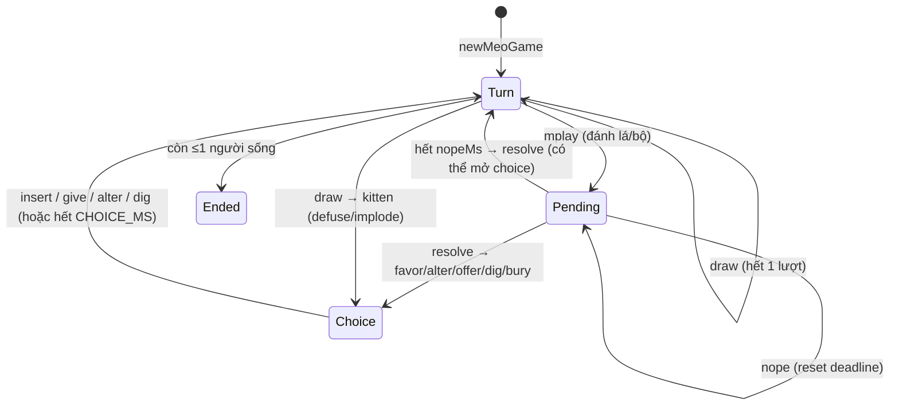

# Mèo Nổ (`meono`)
> Kiểu Exploding Kittens: rút bài né Mèo Nổ, "Không!" chặn nhau, 6 gói mở rộng / 16 chế độ dựng sẵn · 2–7 người (tuỳ chế độ) · frontend `/meo-no` · WS `/api/meono/ws`, `/api/meono/rooms`, `/api/meono/leaderboard`

Hạ tầng chung (hub, presence, chat, emoji, leaderboard): xem [GUIDE.md](../GUIDE.md).

## Tệp

| File | Vai trò |
|---|---|
| `src/meono/cards.ts` | `CardType`, `Expansion`, `EXPANSIONS`, `SELECTABLE_PACKS`, `MCard`, nhóm lá (`CAT_TYPES`, `WILD_CAT`, `KITTENS`, `ACTION_TYPES`, `NOW_TYPES`, `CLAIRVOYANCE`), số lượng (`BASE_COUNTS`, `PACK_COUNTS`, `ALL_TYPES`), `MIN_PLAYERS`, `MAX_SEATS`, `maxPlayers()`, `HAND_SIZE`, `cleanExpansions`, `shuffle`, `deal`, `PRESETS`, `PRESET_BY_ID` |
| `src/meono/game.ts` | Máy trạng thái ván: `newMeoGame`, `playCards`, `playNope`, `drawCard`, `insertKitten`, `giveCard`, `alterFuture`, `digDeeper`, `playClairvoyance`, `forfeitPlayer`, `tickGame`, `nextGameTickAt`, `insertRange`, `syncCurse`/`unblind`, `implodingAt`, `digCard`, `CARD_NAMES` |
| `src/meono/room.ts` | Phòng: `newMeoRoom`, `joinMeo`, `meoHeartbeat`, `leaveMeo`, `meoCommand` (gồm start/settings/kick), `tickMeo`, `nextMeoTickAt`, `meoView`, `meoSummary`, `isMeoActive`, `packsInPlay`, `playerRange`, `meoSettingsOf`, `TURN_SECONDS_OPTIONS`, `NOPE_SECONDS_OPTIONS`, `DEFAULT_MEO_SETTINGS` |
| `src/meono/protocol.ts` | `MEONO_WS_PATH`, `MeoRoomView`, `MeoGameView`, `MeoSeatView`, `MeoRoomSummary`, `MeoCommand`. Bản chỉnh tay ở portfolio `src/lib/meono/protocol.ts` (field optional cho server cũ, thêm `insertRange`, `MeoSettings`, options) |
| `src/server/adapters.ts` | `meonoAdapter` |

Portfolio `src/lib/meono/cards.ts` **không phải bản sao**: đó là catalogue UI (tên, hình, mô tả) chỉ dùng chung `CardType`.

## Luật chơi (như code đang chạy)

### Bộ bài & chia bài

`BASE_COUNTS`: `exploding` 4, `defuse` 6, `attack` 4, `skip` 4, `favor` 4, `shuffle` 4, `future` 5, `nope` 5, mèo `taco`/`melon`/`potato`/`beard`/`rainbow` mỗi loại 4.

`PACK_COUNTS` (cộng thêm vào bộ gốc):

| Gói (`Expansion`) | Lá thêm |
|---|---|
| `imploding` (Mèo Tự Huỷ) | `imploding` 1, `reverse` 4, `bottom` 4, `feral` 4, `alter` 4, `targeted` 3 |
| `streaking` (Streaking Kittens) | `streaking` 1, `superskip` 1, `future5` 1, `swap` 3, `garbage` 1, `catomic` 1, `mark` 3, `curse` 2 — **+1 Mèo Nổ** |
| `barking` (Barking Kittens) | `barking` 2, `potluck` 2, `ilt` 3, `alternow` 2, `bury` 2, `personal` 3, `share` 2 |
| `zombie` (Zombie Kittens) | `zombie` 4, `feed` 3, `dig` 4, `clone` 3, `grave` 2, `deadattack` 2, `clairvoyance` 2 |
| `attacking` (Attacking Kittens) | `slap` 4, `steal` 4, `annoy` 3, `alter` 2, `defuse` 1 — **+2 Mèo Nổ** |
| `defending` (Defending Kittens) | `reverse` 2, `future` 2, `future5` 2, `alter` 2, `shuffle` 2, `bottom` 1, `annoy` 1, `rollcall` 1, `corn` 1 |

`deal(players, expansions, random)`:
1. Gom mọi lá trừ kitten và defuse, xáo. Mỗi người nhận `HAND_SIZE = 7` lá + 1 `defuse`.
2. Số defuse tạo ra = `max(counts.defuse, số người)`. Defuse dư cho vào chồng: **tối đa 2** nếu ≤3 người, tất cả nếu ≥4.
3. Số kitten = `số người − 1` (+1 nếu có `streaking`, +2 nếu có `attacking`); có `imploding` thì 1 trong số đó là Mèo Tự Huỷ (`imploding`).
4. Xáo phần còn lại + kitten + defuse dư thành `deck` (`deck[0]` là lá trên cùng).

Người đi đầu: ngẫu nhiên (`random`). `turnsLeft = 1`, `dir = 1`.

Số người: `MIN_PLAYERS = 2`; `maxPlayers(expansions)` = 7 nếu có `attacking`, 6 nếu có gói bất kỳ, 5 nếu chỉ bộ gốc; `MAX_SEATS = 7`. Phòng dùng `playerRange(room)`: chế độ dựng sẵn → `[preset.minPlayers, preset.maxPlayers]`; `custom` → `[2, maxPlayers(packs)]`.

### Chế độ (`PRESETS`)

| `id` | Gói | Người |
|---|---|---|
| `classic` | — | 2–5 |
| `runaway` | streaking | 2–5 |
| `implosion` | imploding | 2–6 |
| `zombie` | zombie | 2–5 |
| `war` | attacking, defending | 3–7 |
| `catchaos` | streaking, imploding | 3–6 |
| `ultimatechaos` | streaking, imploding, barking | 3–6 |
| `aggressive` | attacking, streaking | 3–7 |
| `defchaos` | defending, imploding | 2–6 |
| `catfight` | barking, attacking | 3–7 |
| `zombiewar` | zombie, attacking | 3–7 |
| `undead` | zombie, defending | 2–6 |
| `zombierun` | zombie, streaking | 3–6 |
| `ultimatewar` | attacking, defending, streaking, imploding | 4–7 |
| `zombiechaos` | zombie, streaking, imploding, barking | 4–7 |
| `everything` | cả 6 gói | 4–7 |

(`group`: `basic` / `advanced` / `chaos` chỉ dùng cho UI.)

### Lượt

- Trong lượt mình: đánh 0..n lá/bộ (mỗi lần mở một **Nope window**), rồi **rút** lá trên cùng để kết thúc **một** lượt (`endTurn`: nếu `turnsLeft > 1` thì giảm 1, ngược lại chuyển cho người còn sống kế tiếp theo `dir`, nhận `turnsLeft = 1 + extra` (Tát)).
- Không thể làm gì khi đang có `pending` (`"Đang chờ người khác phản ứng"`) hoặc `choice` (`"Đang chờ lựa chọn"`) — kể cả lá "Now".
- Rút phải lá thường → vào tay, hết lượt. Rút phải `exploding`:
  - Có đủ Mèo Chạy Rông (`count(exploding) < count(streaking)` trong tay) → **giữ bí mật** trong tay, hết lượt.
  - Có `defuse` dùng được (không bị Nổi cáu) → bỏ defuse, mở `choice {kind:"defuse"}` để nhét kitten lại.
  - Không → nổ, bị loại (`eliminate`: cả tay vào chồng bỏ, vào `out`).
- Rút phải `imploding`: lần đầu (úp) → lật ngửa (`faceUp`), `choice {kind:"implode"}` để nhét lại; **lá ngửa** bị rút lần hai → bị loại ngay, defuse vô dụng. Vị trí lá ngửa công khai (`implodingAt`).
- **Nhét kitten** (`insertKitten`, `insertRange(deckLength)`): `margin = floor(len × 0.1)`; nếu `margin < 1` thì được nhét bất cứ đâu `[0, len]`, ngược lại chỉ trong `[margin, len − margin]` (không vào 10% trên/dưới). Ngoài khoảng → lỗi `"Chỉ được nhét từ lá thứ X đến lá thứ Y …"`; vị trí không phải số → lấy `min`. Nhét xong hết lượt (trừ trường hợp `endsTurn: false`, xem "giữ kitten" dưới).
- **Giữ kitten bị mất che chở** (`settleHeld`): bất cứ lúc nào không có `pending`/`choice`, người nào có nhiều `exploding` hơn `streaking` trong tay (bị cướp Mèo Chạy Rông, hoặc nhận kitten qua trộm/Xin xỏ) phải xử lý ngay: có defuse → `choice defuse` với `endsTurn: false` (chỉ reset timer, không mất lượt); không → nổ.
- Lá không đánh lẻ được: `nope` (`"Chỉ đánh “Không!” để chặn người khác"`), `streaking` (`"Mèo Chạy Rông chỉ cần giữ trong tay"`), `defuse` (`"Gỡ bom chỉ dùng khi rút phải Mèo Nổ"`), mèo/`feral` (`"Lá mèo phải đánh theo đôi hoặc bộ ba"` — `clairvoyance` đánh lẻ qua `mplay` cũng nhận thông báo này). `exploding` không bao giờ đánh được.

### Bộ (combo)

- **Đôi** (`pair`): 2 lá cùng loại **bất kỳ** (kể cả 2 lá hành động), hoặc mèo + `feral` (Mèo Hoang = wild) cùng một loại mèo. Kitten không bao giờ vào bộ. Hiệu ứng: trộm ngẫu nhiên 1 lá của mục tiêu.
- **Bộ ba** (`triple`): như đôi nhưng 3 lá, phải kèm `named` (một `CardType` hợp lệ trong `ALL_TYPES`); mục tiêu có lá đó thì phải đưa.
- **Năm lá khác nhau** (`five`): 5 loại khác nhau, `named` phải có trong chồng bỏ và không phải kitten → nhặt lá đó (lá cùng loại nằm trên cùng nhất).

### Không! (Nope)

- Mọi lá/bộ đánh ra tạo `pending {kind, by, target, named, cards, nopes, lastNoper, deadline}` với `deadline = now + nopeMs`.
- Ai **còn trong ván** có lá `nope` (không bị Nổi cáu) cũng có thể đánh `nope`, kể cả ngoài lượt, không giới hạn số lần; mỗi lá đặt lại deadline.
- **Không tự chặn**: không được chặn lá của chính mình — `nopeOwner(p)` = người đánh Không! gần nhất (`lastNoper`) hoặc người đánh lá gốc nếu chưa có. Người đánh lá gốc vẫn được Không! lại người vừa chặn mình. Lỗi `"Không thể tự chặn lá bài của chính mình"`.
- Hết deadline → `resolvePending`: số `nopes` lẻ → bị chặn (lá vẫn mất), chẵn → áp dụng hiệu ứng. Lá không được "Không!": rút bài, nhét kitten, defuse (không tạo pending).
- **Lịch sử lá** `plays: PlayRecord[]` (giữ 60): `{id, at, by, kind, cards: CardType[], target, named, nopes: string[] (ai Không!, theo thứ tự), result: "pending" | "done" | "blocked"}`. Log (`log`, giữ 60) có `play` trỏ tới `PlayRecord.id`.

### Mục tiêu

Các `kind` cần `target` (`TARGETED`): `favor`, `pair`, `triple`, `targeted`, `mark`, `curse`, `ilt`, `zombie`, `annoy`, `steal`. Mục tiêu phải là người khác, còn trong ván; phải còn bài trên tay **trừ** `targeted`, `curse`, `ilt` (`TARGET_ANY_HAND`). `zombie` thì ngược lại: mục tiêu phải đã bị loại và không thuộc `noRevive`.

### Hiệu ứng từng lá (khi không bị chặn)

| Lá | Hiệu ứng |
|---|---|
| `attack` Tấn công | Người kế tiếp chơi `attackTurns` lượt: 2, hoặc `turnsLeft + 2` nếu người đánh đang bị tấn công (cộng dồn) |
| `targeted` Tấn công chỉ định | Như `attack` nhưng chọn nạn nhân |
| `skip` Bỏ lượt | Kết thúc 1 lượt không rút |
| `superskip` Siêu bỏ lượt | Kết thúc mọi lượt còn lại, người kế tiếp 1 lượt |
| `favor` Xin xỏ | Mục tiêu chọn 1 lá đưa cho bạn (`choice favor`, lệnh `give`) |
| `shuffle` Xáo bài | Xáo chồng; bị khoá khi `noShuffle` (`"Xáo bài đang bị khoá"`) |
| `future` / `future5` | Xem 3 / 5 lá trên cùng (riêng bạn, tới khi hết lượt / rút bài) |
| `alter` Sửa tương lai | Lấy 3 lá trên cùng, sắp lại (`choice alter`, lệnh `alter`), rồi xem được chúng |
| `alternow` Sửa tương lai ngay | Như `alter` nhưng là lá **Now** (`NOW_TYPES`): đánh được ngoài lượt (vẫn bị chặn khi có pending/choice) |
| `share` Chia sẻ tương lai | Như `alter`, rồi người kế tiếp cũng thấy 3 lá đó (`shared`, `sharedBy: "shared"`) |
| `reverse` Đảo chiều | Đảo `dir` và kết thúc 1 lượt |
| `bottom` Rút từ đáy | Rút lá dưới cùng (xử lý như rút thường) |
| `swap` Đổi đầu đuôi | Đổi lá trên cùng với lá dưới cùng |
| `catomic` Bom Mèo Nguyên Tử | Mọi kitten lên đầu chồng, phần còn lại xáo; kết thúc 1 lượt |
| `garbage` Dọn rác | Lần lượt từ bạn theo vòng, mỗi người (có bài) bỏ 1 lá xuống **đáy** chồng (`choice offer`, lệnh `give`); xong thì xáo chồng |
| `potluck` Góp nồi | Như trên nhưng đặt lá lên **đầu** chồng, không xáo |
| `mark` Đánh dấu | 1 lá ngẫu nhiên chưa đánh dấu của mục tiêu thành công khai (`marked`) khi còn trên tay |
| `curse` Lời nguyền mông mèo | Mục tiêu chơi bài úp (mù) tới khi kết thúc lượt tiếp theo của họ |
| `barking` Mèo Sủa | Người **khác** đang giữ lá Mèo Sủa còn lại: mất lá đó + 1 defuse, không có defuse thì nổ |
| `ilt` Để đó cho tui | Lá **không phải kitten** mục tiêu rút lần tới về tay bạn (`claims`) — và vẫn hết lượt của họ |
| `bury` Chôn bài | Lấy lá trên cùng (không ai thấy) đặt lại vị trí bất kỳ (lệnh `insert`), kết thúc 1 lượt |
| `personal` Tự tấn công | `turnsLeft += 2` |
| `zombie` Mèo Xác Sống | Hồi sinh người đã bị loại, kèm tối đa 2 lá ngẫu nhiên không phải kitten từ chồng bỏ |
| `feed` Nuôi xác sống | Mỗi người lần lượt bỏ 1 lá vào chồng bỏ (`choice offer mode feed`) |
| `dig` Đào sâu | Xem lá trên cùng rồi giữ (rút nó) hoặc bỏ qua để rút lá thứ hai (lệnh `dig {keep}`) |
| `clone` Nhân bản | Sao chép lá trên cùng chồng bỏ nếu thuộc `CLONEABLE` (hành động không nhắm ai); `pending.kind` = loại được sao |
| `grave` Đào mộ | Mỗi người theo vòng nhặt 1 lá ngẫu nhiên không phải kitten từ chồng bỏ |
| `deadattack` Xác sống tấn công | Người kế tiếp chơi `attackTurns + số người đã bị loại` lượt |
| `clairvoyance` Thấu thị | Lệnh riêng `see` (không qua `mplay`): khi **người khác** đang nhét Mèo Nổ (`choice defuse`, không áp dụng `implode`), xem được vị trí họ nhét (`vision`, hiện 90 s) |
| `slap` Tát | Còn >1 lượt: bỏ 1 lượt của mình, người kế tiếp nợ thêm 1 lượt (`extra`, cộng khi tới lượt họ). Còn 1 lượt: người kế tiếp chơi 2 lượt |
| `annoy` Nổi cáu | 1 lá ngẫu nhiên của mục tiêu bị vô hiệu tới hết lượt tiếp theo của chủ lá (kể cả defuse, nope) |
| `steal` Cướp bài | Cướp ngẫu nhiên 1 lá |
| `rollcall` Điểm danh mèo | Mọi kitten lên đầu chồng (giữ thứ tự), kết thúc 1 lượt, người kế tiếp không được Xáo bài |
| `corn` Lời nguyền ngô pha lê | Không ai được Xáo bài tới hết lượt người kế tiếp |

`CLONEABLE`: attack, skip, shuffle, future, reverse, bottom, alter, superskip, swap, catomic, future5, garbage, potluck, alternow, bury, personal, share, feed, dig, grave, deadattack, slap, rollcall, corn.

Hiệu ứng "tới hết lượt" (`leaveTurn`): khi lượt rời một người → gỡ curse của họ, hết hạn `shared` dành cho họ, gỡ annoy trên lá của họ, mở khoá `noShuffle` nếu khoá theo họ.

## Cài đặt phòng

Lệnh `settings` (host, giữa các ván), validate trong `setMeoSettings` (`src/meono/room.ts`); đọc qua `meoSettingsOf(room)`. Chỉ field được gửi mới đổi.

| Field | Kiểu / giá trị | Mặc định | Tác dụng | Kiểm tra |
|---|---|---|---|---|
| `preset` | id trong `PRESETS` hoặc `"custom"` | `"classic"` | Quyết định gói (`packsInPlay`) và số người (`playerRange`) | `"Chế độ không hợp lệ"` |
| `expansions` | `Expansion[]` (lọc qua `cleanExpansions`; `"chaos"` cũ được đổi thành `streaking`) | `[]` | Chỉ dùng khi `preset === "custom"`. Gửi `expansions` mà **không** kèm `preset` → tự chuyển `preset = "custom"` | lọc im lặng |
| `turnSeconds` | `TURN_SECONDS_OPTIONS` = 15, 20, 30, 45, 60 | 30 | Thời gian mỗi lượt | `"Thời gian lượt không hợp lệ"` |
| `nopeSeconds` | `NOPE_SECONDS_OPTIONS` = 3.5, 5, 7, 10 | 7 | Nope window | `"Thời gian “Không!” không hợp lệ"` |
| `first`, `second` | như mọi game (`checkRankPoints`) | 2, 1 | Điểm Nhất/Nhì | `checkRankPoints` |

Lỗi chung: `"Chỉ chủ phòng mới đổi luật"`, `"Đổi luật khi ván đã kết thúc"`. `start` kiểm tra số ghế theo `playerRange`: `"Chế độ <name> cần ít nhất N người"` / `"… chỉ dành cho tối đa N người"` (custom: `"Bộ gói đã chọn …"`).

## State

```ts
interface MeoRoom { game: "meono"; code; hostId; seats: (MeoPlayer | null)[7]; current: MeoState | null;
  expansions?: Expansion[]; settings?: MeoSettings; history?; gameSeq?; spectators?; reactions?; chat? }
interface MeoState {
  players: string[]; expansions; hands: Record<id, MCard[]>; deck: MCard[] /* [0] = top */; discard: MCard[];
  turn; dir: 1 | -1; turnsLeft; turnDeadline; pending: Pending | null; choice: Choice | null;
  future: { player, cards } | null; out: string[] /* thứ tự bị loại */; status: "playing" | "ended";
  finished: string[]; log: LogEntry[]; logSeq; recorded?; turnMs?; nopeMs?;
  claims?; cursed?; curseOrder?; shared?; seers?; visions?; noRevive?; extra?; annoyed?; noShuffle?; plays?;
}
interface MCard { id: number; type: CardType; faceUp?; marked?; annoyed? /* chỉ trong view */ }
type Choice =
  | { kind: "defuse" | "implode"; player; kitten; deadline; endsTurn? }
  | { kind: "favor"; from; to; deadline }
  | { kind: "alter"; player; cards; deadline; share? }
  | { kind: "offer"; mode: "garbage" | "potluck" | "feed"; player; queue; deadline }
  | { kind: "dig"; player; deadline }
  | { kind: "bury"; player; card; deadline };
```



## Lệnh (client → server)

Mọi lệnh cần conn là player. Lệnh nước đi cần ván đã tạo (`"Chưa bắt đầu ván"`). Người bị nguyền gửi **vị trí mù** (số âm `-1, -2…`) thay cho id lá; `unblind` đổi lại id thật cho `mplay.cards`, `nope.card`, `give.card`, `see.card`.

| `type` | Field | Khi nào | Tác dụng | Lỗi thường gặp |
|---|---|---|---|---|
| `start` | — | Host, giữa các ván, đủ người theo `playerRange` | Chia bài theo `packsInPlay`, áp `turnSeconds`/`nopeSeconds` | `"Chỉ chủ phòng mới bắt đầu được"`, `"Ván đang diễn ra"`, số người |
| `settings` | xem bảng | Host, giữa các ván | | xem bảng |
| `kick` | `playerId` | Host, mục tiêu offline | Trong ván → `forfeitPlayer` (bị loại, thêm vào `noRevive`) | như mọi game |
| `mplay` | `cards: number[]`, `target?`, `named?` | Lượt mình (lá `alternow` lẻ: bất kỳ lúc nào), không pending/choice | Đánh lá/bộ → pending | `"Chọn bài để đánh"`, `"Bạn đã bị loại"`, `"Bạn không có lá bài này"`, `"Chưa đến lượt bạn"`, `"Lá này đang bị Nổi cáu…"`, `"Bộ bài không hợp lệ"`, `"Chọn người chơi để nhắm tới"`, `"Người đó không còn lá nào"`, `"Chọn loại lá muốn lấy"`, `"Chồng bài đã đánh không có lá đó"`, `"Nhân bản cần một lá hành động…"` |
| `nope` | `card` | Có pending, còn trong ván | Thêm 1 Không! | `"Không có gì để chặn"`, `"Bạn không có lá “Không!”"`, `"Không thể tự chặn lá bài của chính mình"` |
| `draw` | — | Lượt mình, không pending/choice | Rút lá trên cùng | `"Chưa đến lượt bạn"`, `"Đang chờ…"` |
| `insert` | `position` (0 = trên cùng) | Có `choice` defuse/implode/bury của mình | Nhét kitten (giới hạn `insertRange`) / chôn lá (bất kỳ đâu) | `"Không có Mèo Nổ để nhét lại"`, ngoài khoảng 10% |
| `give` | `card` | `choice favor` (bạn là `from`) hoặc `choice offer` tới lượt bạn | Đưa lá | `"Không ai xin bài của bạn"`, `"Bạn không có lá bài này"` |
| `alter` | `order: number[]` (id lá, đầu = trên cùng) | `choice alter` của mình | Đặt lại 3 lá | `"Bạn không sửa tương lai lúc này"`, `"Thứ tự không hợp lệ"` |
| `dig` | `keep: boolean` | `choice dig` của mình | Giữ lá trên / rút lá thứ hai | `"Bạn không đào bài lúc này"` |
| `see` | `card` (id lá `clairvoyance`) | Người khác đang có `choice defuse` | Thấu thị | `"Chỉ dùng khi người khác đang nhét Mèo Nổ"`, `"Bạn không có lá Thấu thị"` |

Sau mọi lệnh (kể cả lỗi) gọi `syncCurse(g)`; lệnh thành công gọi `afterChange` (chấm điểm nếu ván vừa kết thúc).

## View (server → client)

`meoView(room, player | null, now): MeoRoomView`:

| Field | Nội dung / ẩn gì |
|---|---|
| `game: "meono"`, `code`, `meId`, `role`, `serverTime` | |
| `expansions` | `room.expansions` (gói đã **tick**, kể cả khi đang dùng preset — xem bẫy) |
| `settings` | `{preset, turnSeconds, nopeSeconds, first, second}` |
| `minPlayers`, `maxPlayers` | Từ `playerRange(room)` |
| `seats[7]` | `id, name, connected, isHost, inGame, out, kicked, cardCount, marked: CardType[] (lá bị Đánh dấu — công khai), cursed, points, games, wins` |
| `current` | `null` hoặc `{status, turn, turnsLeft, dir, expansions (gói thật của ván), implodingAt, turnDeadline, deckCount, discard: CardType[] (công khai), pending (cards → types, gồm target/named/nopes/lastNoper/deadline), choice (**không** lộ kitten/cards/queue: chỉ kind, player/from/to, mode, deadline, share), claims, shuffleLocked, finished, log, plays}` |
| `hand` | **Chỉ tay của mình**; lá bị Nổi cáu có `annoyed: true`; khi bị nguyền mỗi lá thành `{id: -(i+1), type: "hidden"}` theo thứ tự mù |
| `future` | Lá trên cùng bạn đang được xem (Xem tương lai/sau Sửa tương lai), hoặc lá được chia sẻ cho bạn |
| `sharedBy` | `"shared"` khi `future` đến từ Chia sẻ tương lai |
| `dig` | Lá trên cùng khi bạn đang Đào sâu |
| `vision` | Kết quả Thấu thị (90 s) |
| `alter` | `MCard[]` (có id) bạn đang sắp xếp |
| `history`, `spectators`, `reactions`, `chat` | Như mọi game |

Khán giả không có `hand`/`future`/`dig`/`vision`/`alter`. Bài trong deck không bao giờ lộ (trừ vị trí Mèo Tự Huỷ ngửa). Summary: `{code, status, expansions: packsInPlay(room), players, spectators, games}`.

## Timer, hết giờ, mất kết nối

| Hằng số | Giá trị | Dùng cho |
|---|---|---|
| `TURN_MS` | 30 000 (mặc định; `turnSeconds × 1000` lưu ở `s.turnMs`) | Mỗi lượt. **Được đặt lại** sau mỗi lá được resolve, mỗi lần đưa lá / sửa tương lai |
| `NOPE_WINDOW_MS` | 7 000 (mặc định; `s.nopeMs`) | Mỗi pending, đặt lại sau mỗi Không! |
| `CHOICE_MS` | 15 000 (cố định) | Mọi `choice` |

`tickGame(s, now, nameOf, absent, random)` (tối đa 20 bước/tick, chạy `settleHeld` trước):
- `pending` hết hạn → resolve (người vắng **không** rút ngắn Nope window).
- `choice` hết hạn **hoặc chủ choice offline** → tự chọn: defuse/implode → vị trí ngẫu nhiên trong `insertRange`; alter → giữ nguyên thứ tự; bury → vị trí ngẫu nhiên bất kỳ; dig → giữ lá trên; favor/offer → đưa lá ngẫu nhiên.
- Lượt hết giờ **hoặc người tới lượt offline** → **rút bài** thay (không bao giờ tự đánh lá).

`nextGameTickAt`: `pending.deadline` › `choice.deadline` › `turnDeadline`. Phòng (`nextMeoTickAt`) thêm presence/khán giả/emoji như mọi game. Rejoin **không** đặt lại timer lượt (khác Tiến Lên).

## Kết thúc ván & tính điểm

- `checkEnd` sau mỗi lần loại: còn ≤1 người → `status = "ended"`, `finished = [người sống, ...out đảo ngược]` (bị loại sau xếp trên). Người được hồi sinh bị gỡ khỏi `out`.
- `afterChange` (một lần, cờ `recorded`): `scoreByRank(finished, settings)` (Nhất/Nhì đối xứng, tổng 0), `points += delta`, `games += 1`, `wins += 1` cho hạng 0; `GameRecord` với `instantWin: null`.
- Bị kick giữa ván = bị loại như nổ (`forfeitPlayer`), không hồi sinh được.

## Test

`test/meono.test.ts` (50 test): chia bài & số kitten, lượt / Nope (lẻ chặn, chẵn qua, không tự chặn, lịch sử `plays`), defuse / nổ / kết thúc, cộng dồn attack, đôi/ba/Mèo Hoang, favor, năm lá, timeout & người vắng, từng gói (Mèo Tự Huỷ, Đảo chiều, Rút từ đáy, Sửa tương lai, Tấn công chỉ định, Siêu bỏ lượt, Bom Nguyên Tử, Mèo Chạy Rông, ×5, Dọn rác, Đánh dấu + Lời nguyền, Mèo Sủa, Để đó cho tui, Sửa tương lai ngay, Chôn bài, Tự tấn công + Chia sẻ, Xác Sống, kick không hồi sinh, Đào sâu, Nhân bản, Nuôi xác sống + Đào mộ, Xác sống tấn công, Thấu thị, Tát, Nổi cáu, Cướp bài, Điểm danh, Ngô pha lê), phòng & settings & preset, chạy qua hub, giới hạn 10% khi nhét.

Viết test xác định bằng helper `rig` trong file test:

```ts
// tay và deck dựng tay (deck: đầu mảng = trên cùng), người đầu tiên đi trước
const s = rig({ a: ["attack", "nope"], b: ["nope", "defuse"] }, ["taco", "exploding", "melon"], ["imploding"]);
expect(playCards(s, "a", ids(s, "a", "attack"), {}, T, names).ok).toBe(true);
settle(s);   // tickGame(s, T + NOPE_WINDOW_MS * 2 + 500, names, never, () => 0) — qua Nope window
```
Truyền `random` (`() => 0`) cho `newMeoGame`, `tickGame`, `giveCard`, `syncCurse` để kết quả cố định; `absent = () => false` (`never`) để không ai bị coi là offline.

## Lưu ý / bẫy thường gặp

- `view.expansions` là `room.expansions` (gói **tick** cho custom) chứ không phải gói đang dùng; khi preset ≠ `custom` hai giá trị có thể khác nhau. Gói thật: `current.expansions` (trong ván) hoặc `packsInPlay(room)` (summary).
- Mọi lá **trùng loại** đều tạo được đôi/ba (`isSet`), không chỉ lá mèo.
- `alternow` là lá Now nhưng vẫn bị chặn bởi `busy()` khi đang có pending/choice — không dùng để "phản ứng" giữa Nope window được.
- Nhân bản copy **lá trên cùng chồng bỏ** tại thời điểm đánh (có thể là một lá Không! hay lá mèo → bị từ chối).
- `choice` kiểu defuse giữ kitten **ngoài** deck; nếu chủ choice bị loại, kitten/lá được trả lại đầu chồng (`eliminate`).
- Bài người bị nguyền: `curseOrder` phải được `syncCurse` sau mọi thay đổi tay — `meoCommand` và `tickMeo` đã gọi; code mới thay đổi tay ngoài hai đường này phải tự gọi.
- Log giới hạn `LOG_LIMIT = 60`, `plays` giới hạn 60; client không nên giả định có lịch sử đầy đủ.
- Defuse phát theo `max(6 + gói, số người)` nên với 7 người vẫn đủ mỗi người một lá.
