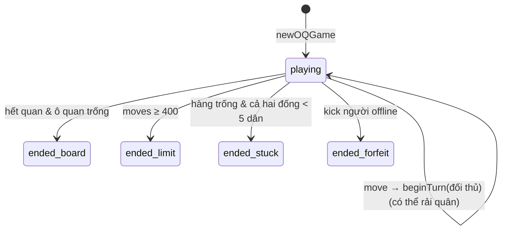

# Ô Ăn Quan (`oanquan`)
> Trò rải quân dân gian trên vòng 12 ô · đúng 2 người · frontend `/o-an-quan` · `/api/oanquan/ws`, `/api/oanquan/rooms`, `/api/oanquan/leaderboard`

Hạ tầng chung (hub, adapter, store, giao thức WS, chat, emoji, khán giả, bảng xếp hạng) xem [`../GUIDE.md`](../GUIDE.md). File này chỉ mô tả phần riêng của Ô Ăn Quan.

## Tệp

| File | Vai trò |
|---|---|
| `src/oanquan/board.ts` | Bố cục bàn và hằng số: `CELLS`, `QUAN_CELLS`, `ROWS`, `START_DAN`, `QUAN_NON_MIN`, `RESEED`, `MAX_MOVES`, tuỳ chọn cài đặt; helper `isQuanCell`, `quanIndex`, `sideOfCell`, `nextCell` |
| `src/oanquan/game.ts` | Máy trạng thái thuần `OQState`: `newOQGame`, `makeMove` (+ `sow` nội bộ), `legalMoves`, `scoreOf`, `forfeitPlayer`, `tickGame`, `nextGameTickAt` |
| `src/oanquan/room.ts` | Vòng đời phòng `OQRoom`: `joinOQ`, `leaveOQ`, `oqHeartbeat`, `oqCommand`, cài đặt, kick, ghi kết quả, `tickOQ`, `nextOQTickAt`, `oqView`, `oqSummary`, `isOQActive` |
| `src/oanquan/protocol.ts` | Kiểu dây: `OQSettings`, `OQStep`, `OQMove`, `OQReseed`, `OQRoomView`/`OQGameView`/`OQPlayerView`, `OQCommand`, `OANQUAN_WS_PATH` |
| `src/server/adapters.ts` | `oanquanAdapter` |
| `test/oanquan.test.ts` | Test |

## Luật chơi (như code đang chạy)

**Bàn** (`board.ts`) — 12 ô thành vòng; nhìn từ phía người 0, chỉ số tăng từ trái sang phải ở hàng dưới (1→5), lên ô 6, rồi phải sang trái ở hàng trên (7→11), về ô 0:

```
            11  10   9   8   7          ← side 1 (players[1]) giữ ô 7–11
     (0)                          (6)   ← ô quan trái / phải
             1   2   3   4   5          ← side 0 (players[0]) giữ ô 1–5
```

- `QUAN_CELLS = [0, 6]`; `quan[0]` / `quan[1]` (`quanIndex`) cho biết quân quan còn trên ô 0 / ô 6 không.
- `ROWS[0] = [1..5]`, `ROWS[1] = [7..11]`. `dir = +1` đi tới ô chỉ số lớn hơn (= "phải" theo góc nhìn người đang đi, vì bàn của side 1 được xoay 180°), `dir = −1` là "trái". `nextCell(c, dir) = (c + dir + 12) % 12`.
- Khởi đầu: mỗi ô dân `START_DAN = 5` dân (tổng 50 dân), ô quan 0 dân + 1 quân quan.
- Một ô là **trống** (`isEmpty`) khi 0 dân **và** (không phải ô quan hoặc quân quan đã bị ăn). Ô quan chỉ còn quân quan (0 dân) **không trống**.

**Chuẩn bị**: `newOQGame` cần đúng 2 người (`MIN_PLAYERS = MAX_PLAYERS = 2`, sai thì ném lỗi). Thứ tự ngẫu nhiên (`random() < 0.5` giữ nguyên hoặc đảo); `players[0]` (side 0) đi trước.

**Một nước đi** `makeMove(cell, dir)` — chỉ ô dân bên mình (`sideOfCell(cell) === side`) và không rỗng; hàm nội bộ `sow`:
1. Bốc hết dân ở `cell`, rải lần lượt mỗi ô 1 viên theo `dir` (ô quan cũng nhận dân).
2. Hết dân trên tay, xét ô kế tiếp `n1`:
   - `n1` **không trống**: nếu là ô quan → **dừng, mất lượt** (không bốc ô quan). Nếu là ô dân (của bất kỳ bên nào) → bốc hết rồi rải tiếp (quay lại bước 1).
   - `n1` **trống**: xét ô sau đó `t`:
     - `t` trống (hai ô trống liền) → dừng, không ăn gì.
     - `t` là ô quan còn quân quan, bật **quan non** (`quanNon`) và `dan[t] < QUAN_NON_MIN (5)` → dừng, không ăn.
     - Ngược lại **ăn** ô `t`: cộng `dan[t]` vào `captured[id].dan`; nếu `t` còn quân quan thì ăn luôn quân quan (`captured[id].quan += 1`, `quan[...] = false`). Rồi xét `gap = next(t)`: nếu `gap` trống thì lặp lại với ô sau `gap` (**ăn liên tiếp** kiểu trống → đầy → trống → đầy…), không trống thì dừng.
3. Vòng lặp được chặn bởi `MAX_STEPS = 2_000` lượt bốc/rải lại (chống lặp vô hạn; về lý thuyết không xảy ra).
4. Mỗi bước được ghi vào `steps` (`pick` / `sow` / `capture`) cho client diễn hoạt.

**Sau nước đi** (`endTurn`):
- Nếu cả hai quân quan đã bị ăn **và** cả hai ô quan 0 dân → `finishBoard("board")`.
- Nếu `moves ≥ MAX_MOVES (400)` → `finishBoard("limit")`.
- Ngược lại `beginTurn(đối thủ)`.

**Rải quân khi hàng trống** (`beginTurn`): nếu đầu lượt cả 5 ô dân của người sắp đi đều 0:
- Nếu `captured[id].dan + captured[opp].dan < RESEED (5)` → người đó **thua** ngay (`endReason = "stuck"`, đối thủ thắng — **không so điểm**).
- Ngược lại lấy 5 dân đặt mỗi ô 1 viên: dùng dân đã ăn của mình trước, thiếu `borrow = max(0, 5 − own)` thì lấy từ đống của đối thủ; `borrowed[id] += borrow`. Quân quan đã ăn không dùng để rải. `lastReseed = { seq, player, borrowed }`.

**Điểm** `scoreOf(id) = captured.dan + captured.quan × quanValue − borrowed[id] + borrowed[đối thủ]` (khoản vay là nợ: người vay bị trừ, người cho vay được cộng lại).

**Kết thúc theo bàn** (`finishBoard`): mỗi bên thu hết dân còn trên hàng mình vào `captured.dan`. Với `"limit"`, dân còn trên ô quan và quân quan chưa bị ăn **không tính cho ai**. So `scoreOf` hai bên: bằng nhau → hoà (`winner = null`).

## Cài đặt phòng

Lệnh `settings` (chỉ chủ phòng, không có ván `playing`), kiểm tra ở `setSettings` (`room.ts`); giá trị hiện hành `oqSettingsOf(room)` = `DEFAULT_OQ_SETTINGS` + `room.settings`; áp dụng khi `start`.

| Trường | Kiểu / tuỳ chọn | Mặc định | Tác dụng | Kiểm tra ở |
|---|---|---|---|---|
| `quanValue` | `QUAN_VALUE_OPTIONS = [5, 10]` | `DEFAULT_QUAN_VALUE = 10` | Một quân quan = bao nhiêu dân khi tính điểm | `setSettings` |
| `quanNon` | `boolean` | `true` | Ô quan còn quân quan mà < 5 dân thì không ăn được | `setSettings` (`typeof === "boolean"`) |
| `turnSeconds` | `TURN_SECONDS_OPTIONS = [15, 20, 30, 45]` | `DEFAULT_TURN_SECONDS = 30` | Hạn mỗi lượt | `setSettings` |
| `first` | số nguyên 1…20 | `2` | Điểm xếp hạng người thắng | `checkRankPoints` (`src/game/scoring.ts`) |
| `second` | số nguyên 0…`first` | `1` | Kiểm tra cho đồng bộ với game khác; **không dùng** khi tính điểm 2 người | `checkRankPoints` |

## State

`OQState` (`game.ts`):

| Trường | Ý nghĩa |
|---|---|
| `players` | `[side0, side1]` |
| `turn`, `phaseAt`, `deadline` | Người đang đi, lúc lượt bắt đầu, hạn lượt |
| `dan: number[12]` | Số dân mỗi ô (kể cả ô quan) |
| `quan: [boolean, boolean]` | Quân quan còn ở ô 0 / ô 6 |
| `captured[id]` | `{ dan, quan }` đã ăn (dân bị trừ khi rải quân) |
| `borrowed[id]` | Tổng dân đã vay đối thủ |
| `quanValue`, `quanNon` | Luật bàn chép từ cài đặt |
| `moves` | Số nước đã đi |
| `status`, `finished`, `winner`, `endReason` | `"playing" → "ended"`; `endReason ∈ "board" \| "stuck" \| "forfeit" \| "limit"`; `winner = null` là hoà |
| `lastMove`, `lastReseed` | Cho animation (xem View) |
| `log` (tối đa `LOG_LIMIT = 30`), `logSeq`, `recorded?`, `turnMs?` | |



`OQRoom` (`room.ts`) giống các game khác: 2 ghế (`OQPlayer`), `hostId`, `current`, `settings?`, `history?`, `gameSeq?`, `spectators?`, `reactions?`, `chat?`.

## Lệnh (client → server)

`oqCommand(room, token, msg, now)`. Lỗi chung: `"Bạn không còn trong phòng"`, `"Chưa bắt đầu ván"`, `"Bạn không chơi ván này"`, `"Lệnh không hợp lệ"`.

| `type` | Trường | Khi nào được | Tác dụng | Lỗi thường gặp |
|---|---|---|---|---|
| `start` | — | Chủ phòng, không có ván `playing`, đủ 2 người | `newOQGame` với cài đặt hiện hành | `"Chỉ chủ phòng mới bắt đầu được"`, `"Ván đang diễn ra"`, `"Cần đủ 2 người"` |
| `settings` | `quanValue?`, `quanNon?`, `turnSeconds?`, `first?`, `second?` | Chủ phòng, không có ván `playing` | Cập nhật `room.settings` | `"Chỉ chủ phòng mới đổi luật"`, `"Đổi luật khi ván đã kết thúc"`, `"Giá trị quan không hợp lệ"`, `"Luật quan non không hợp lệ"`, `"Thời gian lượt không hợp lệ"` |
| `kick` | `playerId` | Chủ phòng; mục tiêu offline | Trong ván: `forfeitPlayer` → người còn lại thắng; ngoài ván: giải phóng ghế | `"Chỉ kích được người đã mất kết nối"`, `"Không thể tự kích mình"`, `"Không tìm thấy người chơi"` |
| `move` | `cell: 1–5 \| 7–11`, `dir: 1 \| -1` | Lượt mình | Rải / ăn như trên, chuyển lượt | `"Ván đã kết thúc"`, `"Chưa đến lượt bạn"`, `"Chọn hướng rải trái hoặc phải"`, `"Chỉ được chọn ô dân bên mình"`, `"Ô này đang trống"` |

## View (server → client)

`oqView(room, player | null, now)` → `OQRoomView`. Không có thông tin ẩn: mọi người (kể cả khán giả) nhận cùng `current`; chỉ `meId`/`role` khác nhau.
- Phần chung: `game: "oanquan"`, `code`, `meId`, `role`, `serverTime`, `settings`, `seats[]`, `history` (10 ván cuối), `spectators`, `reactions`, `chat`.
- `current` (`OQGameView`): `status`, `turn`, `deadline`, `dan`, `quan`, `quanValue`, `quanNon`, `moves`, `finished`, `winner`, `endReason`, `log`, và:
  - `players[]`: `{ id, side: 0|1, captured, borrowed, score }` — `score` = `scoreOf` tại thời điểm hiện tại (sau khi kết thúc thì đã gồm dân thu về từ hàng).
  - `lastMove: OQMove` = `{ seq, player, cell, dir, before: { dan, quan }, steps, auto? }`. `before` là bàn **ngay trước nước đi** (sau khi đã rải quân đầu lượt nếu có). `steps` theo đúng thứ tự: `{k:"pick", cell, n}`, `{k:"sow", cell}`, `{k:"capture", cell, dan, quan}`. Client tua lại từ `before` theo `steps` là ra bàn ngay sau nước đi (chưa gồm bước rải quân đầu lượt của người kế tiếp, hay bước thu dân về khi ván kết thúc). `auto: true` khi máy đi hộ. `seq = logSeq + 1` lúc đi (trùng id dòng log của nước đó).
  - `lastReseed: OQReseed | null` = `{ seq, player, borrowed }` của lần rải quân gần nhất.

## Timer, hết giờ, mất kết nối

- `TURN_MS = 30_000` (dùng `turnMs` từ cài đặt), `ABSENT_MS = 2_500`.
- `tickGame` đi hộ khi `now ≥ deadline` hoặc người đến lượt vắng mặt (không có ghế / `!isOnline`: đã `leave` hoặc quá `PRESENCE_TIMEOUT_MS = 25s`) và `now ≥ phaseAt + ABSENT_MS`: chọn **ngẫu nhiên** một nước trong `legalMoves` (mỗi ô dân không rỗng × 2 hướng), `makeMove(..., auto = true)`.
- `nextGameTickAt` = min(`deadline`, `phaseAt + ABSENT_MS` nếu còn ở tương lai); hub dùng `nextOQTickAt`.
- `leave` giữa ván giữ ghế và bị đi hộ; chủ phòng kick người offline → `forfeitPlayer` → đối thủ thắng (`endReason = "forfeit"`).

## Kết thúc ván & tính điểm

- `finish(reason, winner)`: `finished = [winner, loser]`, hoặc `[players[0], players[1]]` khi hoà.
- `afterChange` (room): thắng/thua → `scoreByRank(finished, settings)` = `+first / −first`; **hoà → cả hai 0 điểm**, `rank = 0` cho cả hai trong `GameRecord`, không ai được `wins`. Record `{ id: "<code>-<gameSeq>", at, instantWin: null, results }` vào `history`; hub ghi bảng xếp hạng.

## Test

`test/oanquan.test.ts`: bàn khởi đầu; nước hợp lệ (chỉ ô bên mình, cả 2 hướng); rải + rải tiếp + ăn (kiểm tra `lastMove.before`/`steps`); rải sang trái vòng qua ô 0; dừng trước ô quan không trống; dừng khi 2 ô trống; ăn liên tiếp kể cả ô quan; ăn quân quan; quan non bật/tắt; ô quan chỉ còn quân quan không trống; rải quân bằng dân của mình, vay đối thủ, thua khi không đủ; kết thúc theo bàn, hoà; đi hộ khi hết giờ / offline; **60 ván ngẫu nhiên** luôn kết thúc và bảo toàn 50 dân; luồng phòng (cài đặt, start, move, điểm, hoà = 0, kick → forfeit).

Viết test tất định:
- `const s = newOQGame(["a","b"], T, { quanValue: 10, quanNon: true }, () => 0); s.players = ["a","b"]; s.turn = "a";`
- Dựng bàn tuỳ ý bằng cách gán `s.dan = [...12 số]`, `s.quan = [bool, bool]`, `s.captured[id] = {dan, quan}`; tổng dân bảo toàn = `Σ dan + Σ captured.dan` (dùng để kiểm tra).
- `tickGame(s, now, names, absent, random)` nhận `random` để chọn nước đi hộ; room `tickOQ` không nhận `random` (dùng `Math.random`).

## Lưu ý / bẫy thường gặp

- Hướng `dir` là theo **chỉ số ô**, không theo màn hình: client của side 1 xoay bàn 180° nên `+1` vẫn là "phải" với họ.
- Ô quan chỉ còn quân quan (0 dân) **chặn** cả rải tiếp lẫn chuỗi ăn (không trống). Dân rơi vào ô quan đã mất quân quan vẫn ăn được bình thường (quan non không áp dụng).
- Ván chỉ kết thúc theo bàn khi **cả hai** ô quan vừa mất quân quan vừa hết dân — dân rải vào ô quan sau khi quân quan bị ăn sẽ kéo dài ván.
- Thua vì "stuck" không xét điểm: người không đủ dân để rải quân luôn thua, kể cả khi điểm cao hơn.
- `second` trong cài đặt không ảnh hưởng điểm (chỉ có 2 hạng).
- Với `"limit"` (400 nước) phần trên ô quan bị bỏ; tổng điểm hai bên có thể < 50 + 2 × `quanValue`.
