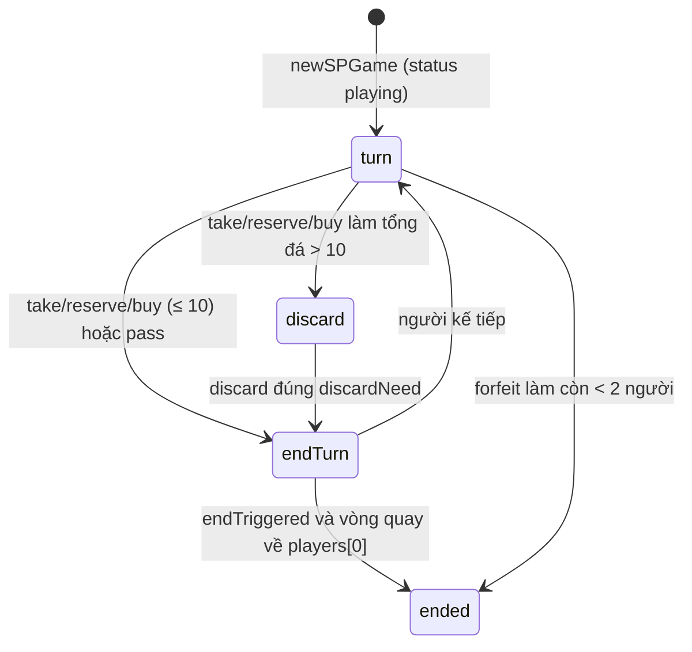

# Đá Quý (`splendor`)
> Lối chơi Splendor: lấy đá, mua thẻ phát triển, đón quý tộc · 2–4 người · frontend `/splendor` · `/api/splendor/ws`, `/api/splendor/rooms`, `/api/splendor/leaderboard`

Hạ tầng chung (hub, adapter, store, giao thức WS `join`/`ack`/`state`, chat, emoji, khán giả, bảng xếp hạng) xem [`../GUIDE.md`](../GUIDE.md). File này chỉ mô tả phần riêng của Đá Quý.

## Tệp

| File | Vai trò |
|---|---|
| `src/splendor/cards.ts` | Dữ liệu: `GEMS`, `Token`, `GEM_NAMES`, 90 thẻ `CARDS` (sinh từ mẫu chi phí), 10 quý tộc `NOBLES`, hằng số luật và tuỳ chọn cài đặt. Chép nguyên sang portfolio (`src/lib/splendor/cards.ts`), **không được import gì** |
| `src/splendor/game.ts` | Máy trạng thái thuần (`SPState`): `newSPGame`, `takeGems`, `reserveCard`, `buyCard`, `discardTokens`, `passTurn`, `forfeitPlayer`, tự chơi `tickGame` / `nextGameTickAt`, giá trị suy ra `bonuses`, `pointsOf`, `paymentFor` |
| `src/splendor/room.ts` | Vòng đời phòng (`SPRoom`): join/leave/heartbeat, `spCommand`, cài đặt, kick, ghi kết quả (`afterChange`), `tickSP`, `nextSPTickAt`, `spView`, `spSummary`, `isSPActive` |
| `src/splendor/protocol.ts` | Kiểu dữ liệu gửi qua dây: `SPSettings`, `SPRoomView`/`SPGameView`/`SPPlayerView`, `SPCommand`, `SPLENDOR_WS_PATH` |
| `src/server/adapters.ts` | `splendorAdapter` nối các hàm trên vào hub |
| `test/splendor.test.ts` | Test |

## Luật chơi (như code đang chạy)

**Bộ bài** (`cards.ts`)
- 5 màu đá `GEMS = ["white","blue","green","red","black"]` + `"gold"` (vàng, joker). Tên hiển thị trong `GEM_NAMES`.
- 90 thẻ phát triển: cấp 1 = 40 (id 1–40), cấp 2 = 30 (id 41–70), cấp 3 = 20 (id 71–90); mỗi màu 18 thẻ (8/6/4 mỗi cấp). Sinh bởi `build()` từ các mẫu `TIER1` / `TIER2` / `TIER3` (khoá `"own"` = màu thưởng của chính thẻ, `1..4` = các màu khác, xoay vòng theo chỉ số mẫu). Điểm: cấp 1 có 0 hoặc 1, cấp 2 có 1–3, cấp 3 có 3–5. Id cố định (thứ tự cấp → màu → mẫu) nên client có thể tra `CARD_BY_ID`.
- 10 quý tộc (`NOBLES`, id 1–10), mỗi vị 3 điểm: id 1–5 cần 4+4 thưởng của hai màu liền nhau, id 6–10 cần 3+3+3 của ba màu liền nhau (thứ tự `GEMS`, vòng tròn).

**Chuẩn bị** (`newSPGame`)
- Số người `MIN_PLAYERS = 2` … `MAX_PLAYERS = 4` (ngoài khoảng này `newSPGame` ném lỗi).
- Ngân hàng: mỗi màu `GEMS_FOR_PLAYERS[n]` viên (2 người: 4, 3 người: 5, 4 người: 7) + `GOLD_TOKENS = 5` vàng.
- Mỗi cấp xáo riêng, lật `BOARD_SLOTS = 4` thẻ; lật `n + 1` quý tộc (`nobleRow`).
- Thứ tự chơi được xáo ngẫu nhiên (`order = shuffle(players)`); `players[0]` đi trước và là mốc kết thúc vòng.

**Lượt** — đúng 1 hành động, chỉ khi `status === "playing"`, `turn === bạn`, `phase === "turn"`:
1. **Lấy đá** `takeGems`:
   - 2 viên cùng màu: chỉ khi chồng màu đó còn **≥ 4 viên trước khi lấy**.
   - Ngược lại phải là các màu khác nhau, 1–3 viên, mỗi màu còn ≥ 1 viên, và phải lấy **đủ `min(3, số màu còn trong ngân hàng)`** màu (chỉ được lấy ít hơn 3 khi ngân hàng không còn đủ 3 màu). Ví dụ `["white","white","blue"]` và `["white","blue"]` (khi còn ≥ 3 màu) đều bị từ chối.
   - Không lấy được vàng bằng lệnh này.
2. **Giữ thẻ** `reserveCard`: tối đa `MAX_RESERVED = 3` thẻ đang giữ. Hoặc `card` = id một thẻ ngửa trên bàn (ô trống được bù bằng lá trên cùng của chồng cùng cấp, hết chồng thì ô thành `null`), hoặc `tier` 1–3 = rút úp lá trên cùng chồng đó. Nếu ngân hàng còn vàng thì nhận 1 vàng.
3. **Mua thẻ** `buyCard`: thẻ ngửa trên bàn hoặc thẻ mình đang giữ. Chi phí `paymentFor`: với mỗi màu, cần `max(0, cost − bonus)`; trả bằng đá màu đó trước, phần thiếu bù bằng vàng; thiếu vàng thì không mua được. Đá trả về ngân hàng. Thẻ vào `owned` (cho +1 thưởng vĩnh viễn màu `bonus` và `points` điểm).
4. **Bỏ lượt** `passTurn`: chỉ khi `hasLegalMove` sai — không lấy được đá, không giữ được thẻ (đủ 3 hoặc hết bàn/chồng) và không mua nổi thẻ nào; ngược lại lỗi `"Bạn vẫn còn nước đi — lấy đá, giữ hoặc mua thẻ"`. Tự chơi khi hết giờ dùng `skipTurn` nội bộ.

**Sau hành động** (`afterAction` → `endTurn`)
- Nếu tổng đá (tính cả vàng) > `MAX_TOKENS = 10`: chuyển `phase = "discard"`, `discardNeed = số dư`, hạn lượt đặt lại. Người chơi phải gửi `discard` trả **đúng** `discardNeed` viên (có thể trả cả vàng). Sau đó mới tới bước dưới.
- Quý tộc: duyệt `nobleRow` theo thứ tự, vị **đầu tiên** mà thưởng (`bonuses`) đủ yêu cầu sẽ tự đến (mỗi lượt tối đa 1 vị, người chơi không được chọn — giản lược có chủ ý, ghi ở đầu `game.ts`). `last.kind = "noble"`.
- Nếu chưa `endTriggered` và `pointsOf(người vừa đi) ≥ target`: bật `endTriggered`, log "chơi nốt vòng này".
- Người kế tiếp là `players[(i+1) % n]`; nếu `endTriggered` và người kế tiếp là `players[0]` thì `finish()` (mọi người có số lượt bằng nhau).

**Điểm** `pointsOf` = tổng `points` thẻ đã mua + 3 × số quý tộc.

## Cài đặt phòng

Gửi bằng lệnh `settings` (chỉ chủ phòng, chỉ khi không có ván `playing`), kiểm tra ở `setSettings` trong `room.ts`. Giá trị hiện hành = `spSettingsOf(room)` = `DEFAULT_SP_SETTINGS` ghi đè bởi `room.settings`. Áp dụng từ ván sau (`startSP` đọc khi bắt đầu).

| Trường | Kiểu / tuỳ chọn | Mặc định | Tác dụng | Kiểm tra ở |
|---|---|---|---|---|
| `target` | `TARGET_OPTIONS = [10, 12, 15, 18, 21]` | `DEFAULT_TARGET = 15` | Điểm kích hoạt vòng cuối (`SPState.target`) | `setSettings` |
| `turnSeconds` | `TURN_SECONDS_OPTIONS = [30, 45, 60, 90]` | `45` | `turnMs = turnSeconds × 1000` cho mỗi lượt và mỗi pha trả đá | `setSettings` |
| `first` | số nguyên 1…`MAX_RANK_POINTS` (20) | `2` | Điểm xếp hạng cho Nhất (xem dưới) | `checkRankPoints` (`src/game/scoring.ts`) |
| `second` | số nguyên 0…`first` | `1` | Điểm cho Nhì | `checkRankPoints` |

## State

`SPState` (`game.ts`) — nằm trong `SPRoom.current`:

| Trường | Ý nghĩa |
|---|---|
| `players` | Thứ tự chơi (đã xáo); người bị loại (forfeit) bị xoá khỏi đây |
| `turn` | id người đang đi, `null` khi kết thúc |
| `phase` | `"turn"` hoặc `"discard"`; `discardNeed` = số đá phải trả |
| `phaseAt`, `deadline` | Lúc pha bắt đầu (cho người vắng mặt) và hạn của pha |
| `bank`, `tokens[id]` | `Record<Token, number>` |
| `owned[id]`, `reserved[id]`, `nobles[id]` | id thẻ đã mua / đang giữ / id quý tộc |
| `decks[tier-1]` | Chồng úp (phần tử 0 là lá trên cùng); `board[tier-1]` = 4 ô ngửa, `null` = ô trống |
| `nobleRow` | Quý tộc còn trên bàn |
| `target`, `endTriggered` | Điểm mục tiêu; đã có người chạm mục tiêu chưa |
| `status` | `"playing"` → `"ended"`; `finished` = thứ hạng khi kết thúc |
| `last` | Hành động gần nhất cho animation (`seq`, `player`, `kind: take/reserve/buy/noble`, `card?`, `noble?`, `gems?`) |
| `log` (tối đa `LOG_LIMIT = 16`), `logSeq` | Nhật ký |
| `turnMs?`, `recorded?`, `forfeited?` | Thời lượng lượt; đã ghi lịch sử chưa; người bị loại theo thứ tự rời |

Máy trạng thái của một lượt:

`SPRoom` (`room.ts`): `seats` (4 ghế, `SPPlayer | null`, mỗi người có `id`, `token`, `name`, `lastSeen`, `left?`, `kicked?`, `wins`, `points`, `games`), `hostId`, `current`, `settings?`, `history?` (tối đa `HISTORY_LIMIT`), `gameSeq?`, `spectators?`, `reactions?`, `chat?`.

## Lệnh (client → server)

Mọi lệnh đi qua `spCommand(room, token, msg, now)`. Lỗi chung: `"Bạn không còn trong phòng"` (token không ngồi ghế), `"Chưa bắt đầu ván"` (chưa có `current`), `"Bạn không chơi ván này"`, `"Lệnh không hợp lệ"`. Các lệnh trong ván kiểm tra thêm `check()`: `"Ván đã kết thúc"`, `"Chưa đến lượt bạn"`, `"Hãy trả bớt đá trước"` (đang ở pha discard).

| `type` | Trường | Khi nào được | Tác dụng | Lỗi thường gặp |
|---|---|---|---|---|
| `start` | — | Chủ phòng, không có ván `playing`, ≥ 2 người ngồi (sau khi dọn ghế đã rời) | `newSPGame` với `target`, `turnSeconds` hiện hành | `"Chỉ chủ phòng mới bắt đầu được"`, `"Ván đang diễn ra"`, `"Cần ít nhất 2 người"` |
| `settings` | `target?`, `turnSeconds?`, `first?`, `second?` | Chủ phòng, không có ván `playing` | Cập nhật `room.settings` | `"Chỉ chủ phòng mới đổi luật"`, `"Đổi luật khi ván đã kết thúc"`, `"Điểm thắng không hợp lệ"`, `"Thời gian lượt không hợp lệ"`, lỗi của `checkRankPoints` |
| `kick` | `playerId` | Chủ phòng; mục tiêu đang **mất kết nối** | Đang trong ván: `forfeitPlayer` + đánh dấu `kicked`; ngoài ván: giải phóng ghế | `"Chỉ kích được người đã mất kết nối"`, `"Không thể tự kích mình"`, `"Không tìm thấy người chơi"` |
| `take` | `gems: Gem[]` | Lượt mình, `phase = "turn"` | Lấy đá (luật ở trên) | `"Chọn đá không hợp lệ"`, `"Chỉ lấy 2 <màu> khi còn ít nhất 4 viên"`, `"Lấy 3 viên khác màu, hoặc 2 viên cùng màu"`, `"Hãy lấy đủ 3 màu khác nhau"`, `"Hết đá màu này"` |
| `reserve` | `card?: id` **hoặc** `tier?: 1-3` (`card` được ưu tiên) | Như trên | Giữ thẻ, +1 vàng nếu còn | `"Chỉ giữ tối đa 3 thẻ"`, `"Thẻ không có trên bàn"`, `"Chồng bài này đã hết"`, `"Chọn thẻ để giữ"` |
| `buy` | `card: id` | Như trên | Mua thẻ trên bàn hoặc trong tay giữ | `"Thẻ không hợp lệ"`, `"Thẻ không có trên bàn hoặc trong tay bạn"`, `"Không đủ đá (cần …)"` |
| `discard` | `tokens: Partial<Record<Token, number>>` | Lượt mình, `phase = "discard"` | Trả đá về ngân hàng rồi kết thúc lượt | `"Không cần trả đá lúc này"`, `"Số đá trả không hợp lệ"`, `"Hãy trả đúng N viên"` |
| `pass` | — | Lượt mình, `phase = "turn"`, không còn nước đi | Kết thúc lượt (vẫn xét quý tộc / kết thúc) | lỗi của `check()`, `"Bạn vẫn còn nước đi…"` |

## View (server → client)

`spView(room, player | null, now)` → `SPRoomView` (`player = null` cho khán giả):
- `game: "splendor"`, `code`, `meId` (`""` cho khán giả), `role`, `serverTime`, `settings` (đã ghép mặc định), `seats[]` (`connected`, `isHost`, `inGame`, `kicked`, `points`, `games`, `wins`), `history` (10 ván cuối), `spectators` (tên còn online), `reactions` (còn hạn `REACTION_TTL_MS`), `chat`.
- `current` (`SPGameView`) gần như công khai toàn bộ: `status`, `turn`, `phase`, `discardNeed`, `deadline`, `bank`, `board`, `deckCounts` (chỉ số lá còn mỗi chồng — thứ tự chồng bị giấu), `nobleRow`, `target`, `endTriggered`, `finished`, `last`, `log`.
- `current.players[]` gồm cả người đã bị loại (`players` + `forfeited`), mỗi người: `tokens`, `owned`, `bonuses` (suy ra), `nobles`, `prestige` (= `pointsOf`), `reserved`.
- **Bị giấu:** chính chủ thấy mọi thẻ đang giữ; người khác (và khán giả) thấy id của thẻ giữ **từ bàn** (vốn đã ngửa), còn thẻ rút úp (`SPState.blind`) là `null`. Ván cũ không có `blind` → giấu hết như trước.
- `last`: `seq = logSeq + 1` tại thời điểm hành động, tức trùng `id` của dòng log tương ứng; giữ thẻ úp thì `card` không có; giữ thẻ ngửa thì có `card` (lá đó vốn đã công khai).

## Timer, hết giờ, mất kết nối

- `TURN_MS = 45_000` (thực tế dùng `turnMs` từ cài đặt), `ABSENT_MS = 2_500`.
- `tickGame` (gọi từ `tickSP`) tự đi **một bước** khi `now ≥ deadline`, hoặc khi người đến lượt "vắng mặt" và `now ≥ phaseAt + ABSENT_MS`. "Vắng mặt" = không còn ghế hoặc `!isOnline` (đã `leave`, hoặc `lastSeen` quá `PRESENCE_TIMEOUT_MS = 25s`, hằng số chung trong `src/game/room.ts`).
- `autoStep`:
  - pha discard: trả lần lượt từng viên của màu (không phải vàng) đang giữ nhiều nhất; hết đá màu mới trả vàng;
  - pha turn: mua thẻ đắt điểm nhất mua được (trên bàn + thẻ đang giữ); không thì lấy tới 3 màu còn nhiều nhất trong ngân hàng; không thì bỏ lượt.
- `nextGameTickAt` = min(`deadline`, `phaseAt + ABSENT_MS` nếu còn ở tương lai). Hub dùng `nextSPTickAt` (gồm cả hạn presence của ghế, khán giả, reaction).
- `leave` giữa ván: ghế vẫn giữ (`left = true`), người đó bị chơi hộ; muốn loại hẳn thì chủ phòng `kick` (chỉ khi họ offline) → `forfeitPlayer`: trả đá về ngân hàng và thẻ đang giữ về **đáy chồng** cùng cấp, xoá khỏi `players`, thêm vào `forfeited`; còn < 2 người thì kết thúc ngay; nếu đang là lượt họ thì chuyển cho `players[idx % n]` — nếu `endTriggered` và người kế là `players[0]` thì kết thúc ván như `endTurn`.
- Join lại bằng cùng token: lấy lại ghế (không đổi tên khi đang chơi). Người bị kick không join lại được (`"Bạn đã bị chủ phòng mời ra khỏi ván này"`).

## Kết thúc ván & tính điểm

- `finish()`: xếp `players` còn lại theo điểm giảm dần → ít thẻ đã mua hơn → thứ tự chơi; sau đó nối `forfeited` đảo ngược (người rời trước đứng cuối). `status = "ended"`, `turn = deadline = null`.
- `afterChange` (room) ghi một lần (`recorded`): điểm phòng = `scoreByRank(finished, settings)` (`src/game/scoring.ts`, `mirroredRankPoints`): 2 người `+first −first`; 3 người `+first +second −(first+second)`; 4 người `+first +second −second −first`. Cộng `points`, `games`, `wins` (hạng 0) cho ghế; push `GameRecord { id: "<code>-<gameSeq>-<at>", at, instantWin: null, results[{id,name,rank,delta}] }` vào `history`. Hub thấy record mới và ghi bảng xếp hạng (xem `../GUIDE.md`).

## Test

`test/splendor.test.ts` bao phủ: phân bố bộ thẻ / quý tộc; chia bàn & ngân hàng; luật lấy đá (2 cùng màu chỉ từ chồng ≥ 4); trả đá khi > 10; trả tiền (thưởng → đá → vàng); giữ ngửa / úp, tối đa 3, mua thẻ đang giữ; giấu thẻ giữ trong view; quý tộc & vòng cuối; chơi hộ người offline; cài đặt phòng áp vào ván và điểm xếp hạng.

Cách viết test tất định:
- Gọi thẳng hàm trong `game.ts` với `random` cố định: `newSPGame(players, T, { target: 15 }, () => 0)`, rồi **ghi đè** `s.players` / `s.turn` để biết ai đi trước (hàm room `startSP` luôn dùng `Math.random`).
- Có thể chỉnh trực tiếp `s.tokens[id]`, `s.owned[id]`, `s.board`, `s.nobleRow` để dựng tình huống; `names = (id) => id`; `tickGame(s, now, names, absent)` với `absent` tuỳ ý.
- Qua room: `joinSP(room, "token-aaaa", "An", T, () => "p1")` (token ≥ 8 ký tự), rồi `spCommand`.

## Lưu ý / bẫy thường gặp

- `cards.ts` được chép nguyên sang frontend: đổi dữ liệu thẻ phải đổi cả hai nơi, và giữ file không có import.
- Id thẻ phụ thuộc thứ tự mẫu trong `TIER1/2/3` và `GEMS`; sắp xếp lại mẫu sẽ đổi id → làm hỏng phòng đang lưu trong Redis.
- Quý tộc tự đến theo thứ tự `nobleRow`, không cho chọn khi đủ điều kiện nhiều vị.
- Hai người chơi: mỗi màu chỉ có 4 viên, nên "lấy 2 cùng màu" chỉ được khi chồng còn nguyên.
- Mọi kiểm tra hợp lệ nằm trong `game.ts`; `room.ts` chỉ định tuyến và không lọc kiểu của `gems`/`tokens` (game tự kiểm tra).
