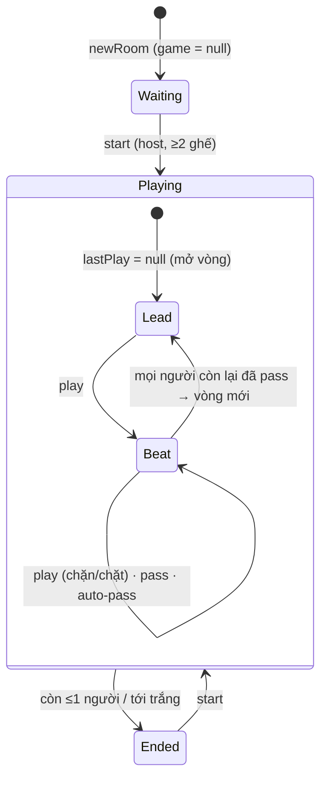

# Tiến Lên Miền Nam (`tienlen`)
> Đánh bài 52 lá kiểu miền Nam: chặt heo, chặt chồng, chết cháy, tới trắng · 2–4 người · frontend `/tien-len` · WS `/api/ws`, `/api/rooms`, `/api/leaderboard`

Hạ tầng chung (hub, presence, chat, emoji, leaderboard): xem [GUIDE.md](../GUIDE.md).

## Tệp

| File | Vai trò |
|---|---|
| `src/game/cards.ts` | Mã hoá lá bài (`Card = rank*4 + suit`), `newDeck`, `shuffle(items, random)`, `sortCards`, `parseCard`/`parseCards` (cho test). Chép nguyên sang portfolio `src/lib/tienlen/cards.ts` |
| `src/game/combos.ts` | `detectCombo`, `canBeat` (gồm luật chặt), `isChop`, `comboName`, `COMBO_NAMES`. Chép nguyên sang portfolio |
| `src/game/rules.ts` | Tới trắng: `detectInstantWin`, `INSTANT_WIN_NAMES`. Chép nguyên sang portfolio |
| `src/game/game.ts` | Máy trạng thái một ván: `newGame`, `play`, `pass`, `autoAction`, `forfeit`, `hasBeatingPlay`, `isAnytimeChop`, `activePlayers` |
| `src/game/scoring.ts` | `scoreTienLen`, `chopPoints`, `tienlenRankPoints`, cùng các hàm điểm dùng chung mọi game (`mirroredRankPoints`, `scoreByRank`, `checkRankPoints`) |
| `src/game/room.ts` | Vòng đời phòng Tiến Lên **và** các helper xã hội dùng chung mọi game (`watchRoom`, `react`, `sendChat`, `pruneSpectators`, `pruneReactions`, `cleanName`, `randomCode`, hằng presence) |
| `src/game/protocol.ts` | `RoomView`, `SeatView`, `GameView`, `GameRecord`, `ChatMessage`, `Reaction`, `RoomSummary`, `LeaderboardEntry`, `ClientMessage`, `ServerMessage`, hằng `TURN_SECONDS`, `EMOJIS`, cooldown… Bản chỉnh tay ở portfolio `src/lib/tienlen/protocol.ts` |
| `src/server/adapters.ts` | `tienlenAdapter` |

## Luật chơi (như code đang chạy)

**Lá bài** (`cards.ts`): `Card` là số 0..51 = `rank * 4 + suit`, so sánh số = so sức mạnh.
- `rank`: 0 = "3" … 11 = "A", 12 = "2" (heo) — `RANK_TWO = 12`.
- `suit`: 0 ♠ bích < 1 ♣ chuồn < 2 ♦ rô < 3 ♥ cơ. `isRed(c)` = suit ≥ 2. `THREE_OF_SPADES = 0`.

**Chia bài** (`newGame`): `HAND_SIZE = 13` lá mỗi người, `MIN_PLAYERS = 2`, `MAX_PLAYERS = 4` (ngoài khoảng → throw `"Cần 2-4 người chơi"`). Bài trên tay được sort tăng dần. Ít hơn 4 người thì phần bài thừa không dùng.

**Bộ bài hợp lệ** (`detectCombo`, `ComboType`): lá trùng → `null`.

| `type` | Tên (`COMBO_NAMES`) | Điều kiện |
|---|---|---|
| `single` | Rác | 1 lá |
| `pair` / `triple` / `quad` | Đôi / Sám cô / Tứ quý | 2/3/4 lá cùng rank (heo được) |
| `straight` | Sảnh N | ≥3 lá rank liên tiếp, **không có heo** (không có sảnh vòng, A là cao nhất) |
| `pairSeq` | N đôi thông | ≥3 đôi rank liên tiếp (≥6 lá chẵn), **không có heo** |

`Combo = {type, length, top, cards}`; `top` = lá lớn nhất, dùng để so.

**Chặn** (`canBeat(prev, next)`):
- `prev === null` (mở vòng): đánh gì cũng được.
- Cùng `type` **và** cùng `length` → `next.top > prev.top` (rank trước, chất phân định khi bằng rank).
- **Chặt** (khác type/length):
  - 3 đôi thông → chặt **1 heo lẻ** (không chặt được đôi heo).
  - Tứ quý → chặt heo lẻ, đôi heo, 3 đôi thông.
  - 4 đôi thông → chặt heo lẻ, đôi heo, 3 đôi thông, tứ quý.
  - Ngoài ra không gì chặt được (5+ đôi thông chỉ chặn được đôi thông cùng độ dài; tam heo không bị chặt).
- `isChop(prev, next)` = chặn được và khác type/length.

**Chặt ngoài lượt** (`isAnytimeChop`): đôi thông ≥ 4 đôi (`length >= 8`) mà là chặt so với bài trên bàn được đánh **bất kỳ lúc nào**, kể cả ngoài lượt và kể cả khi đã bỏ lượt vòng này — trừ khi bài trên bàn là của chính mình. Người chặt được gỡ khỏi `passed`, lượt tiếp tục từ sau người đó. Các bom khác phải chờ lượt.

**Ván đầu & người mở** (`newGame`):
- Có `starter` (người thắng ván trước, `room.lastWinner`, nếu còn trong ván) → người đó đi trước, đánh tự do.
- Không có → người giữ lá nhỏ nhất được chia (3♠ khi đủ 4 người) đi trước và nước đầu **phải chứa** lá đó (`mustInclude`; lỗi `"Nước đầu tiên phải có lá nhỏ nhất (3♠)"` — thông báo luôn ghi 3♠ dù với 2–3 người lá nhỏ nhất có thể khác).

**Vòng chơi** (`play` / `pass` / `advance`):
- Đánh: phải đúng lượt (trừ chặt ngoài lượt), có đủ lá, bộ hợp lệ, có `mustInclude` nếu cần, `canBeat` bài trên bàn.
- Bỏ lượt: chỉ khi trên bàn có bài (`"Bạn đang mở vòng, không được bỏ lượt"`). Đã bỏ thì bị khoá tới hết vòng (`passed`).
- Khi mọi người còn lại đều bỏ → vòng mới: người đánh cuối mở vòng; nếu người đó đã về (hết bài) thì người kế tiếp (theo ghế, bỏ qua người đã ra) mở.
- **Tự bỏ lượt** (`autoPassHopeless`, khi `autoPass !== false`): đến lượt ai mà `hasBeatingPlay(hand, lastPlay.combo)` là false thì server bỏ lượt hộ ngay (ghi vào `autoPassed`), lặp tiếp cho người sau.
- Hết bài → vào `finished`. Còn ≤1 người trong ván → kết thúc: `finished` += người còn lại, rồi người chết cháy, rồi người bị forfeit (người bị kick **đầu tiên** xếp **cuối cùng**).

**Chết cháy** (`burned`): đúng lúc người **đầu tiên** về, ai còn đủ 13 lá thì bị cháy: dừng chơi ngay, gỡ khỏi `passed`, xếp sau những người còn chơi.

**Tới trắng** (`detectInstantWin`, kiểm tra ngay khi chia, duyệt theo **thứ tự ghế** — người đầu tiên có bài trắng thắng):

| `InstantWinReason` | Tên | Điều kiện trên 13 lá |
|---|---|---|
| `fourTwos` | Tứ quý heo | 4 lá heo |
| `dragon` | Sảnh rồng | đủ 12 rank 3→A |
| `sixPairs` | 6 đôi | Σ floor(số lá mỗi rank / 2) ≥ 6 (tứ quý tính 2 đôi, có thể gồm heo) |
| `fivePairSeq` | 5 đôi thông | 5 rank liên tiếp (không gồm heo) mỗi rank ≥ 2 lá |

Thứ tự kiểm tra như bảng. Tới trắng → `status = "ended"` ngay, `finished = [người thắng, ...những người khác theo ghế]`.

**Chặt heo / chặt chồng** (`play` + `chopPoints`): khi một nước là chặt (`chop`) lên bài của người khác, ghi `ChopScore {from: người bị chặt, to: người chặt, points}` vào `s.chops`:
- Bài bị chặt là **chặt chồng** (bản thân nó là một nước chặt có `chopPoints > 0`) → `points = chopPoints cũ × 2`.
- Ngược lại `chopPoints(prev)`: tổng heo trong bộ bị chặt, heo đen (♠ ♣) `BLACK_TWO_POINTS = 1`, heo đỏ (♦ ♥) `RED_TWO_POINTS = 2`; bộ không có heo (3 đôi thông / tứ quý đánh thường) → `CHOP_BOMB_POINTS = 2`.
- Điểm chặt chỉ được cộng/trừ khi chấm điểm cuối ván.

**Forfeit** (`forfeit`, do host kick người offline giữa ván): bị đưa vào `forfeited`, gỡ khỏi `passed`, nếu đang giữ `mustInclude` thì bỏ ràng buộc đó; nếu đang là lượt của họ thì lượt chuyển tiếp, không thì giữ nguyên lượt.

## Cài đặt phòng

Lệnh `settings` (host, chỉ giữa các ván), đọc qua `settingsOf(room) = {...DEFAULT_SETTINGS, ...room.settings}`, kiểm tra trong `updateSettings` (`src/game/room.ts`). Chỉ field được gửi mới đổi.

| Field | Kiểu / giá trị | Mặc định | Tác dụng | Kiểm tra |
|---|---|---|---|---|
| `autoPass` | boolean (`=== true`, giá trị khác → false) | `true` | Server tự bỏ lượt khi không có bài chặn được | `updateSettings` |
| `first` | số nguyên 1–20 (`MAX_RANK_POINTS`) | 2 | Điểm Nhất | `updateSettings`: `"Điểm Nhất từ 1 đến 20"` |
| `second` | số nguyên 0–`first` | 1 | Điểm Nhì | `updateSettings`: `"Điểm Nhì từ 0 đến điểm Nhất"` |

Lỗi khác: `"Chỉ chủ phòng mới đổi luật"`, `"Đổi luật khi ván đã kết thúc"`. Settings được chép vào `GameState.autoPass` / `GameState.points` lúc `start`.

## State

```ts
interface RoomState {               // src/game/room.ts
  code; hostId; seats: (RoomPlayer | null)[4]; game: GameState | null;
  turnDeadline: number | null;      // deadline lượt nằm ở room, không ở game
  lastWinner: string | null;        // người mở ván sau
  history?; gameSeq?; spectators?; reactions?; chat?; settings?: TienLenSettings;
}
interface RoomPlayer { id; token; name; lastSeen; left?; kicked?; wins; points?; games? }
interface GameState {               // src/game/game.ts
  players: string[];                // id theo thứ tự ghế = thứ tự lượt
  hands: Record<id, Card[]>; turn: string | null; lastPlay: LastPlay | null;
  passed: string[]; finished: string[]; mustInclude: Card | null;
  status: "playing" | "ended"; instantWin: {playerId, reason} | null;
  forfeited?; chops?: ChopScore[]; burned?; autoPassed?; autoPass?; points?: {first, second};
}
interface LastPlay { playerId; combo: Combo; chop: boolean; chopped?: Combo | null; chopPoints?; choppedPlayer? }
```

Phòng không có phase riêng; trạng thái suy ra từ `game`:



## Lệnh (client → server)

Ngoài các lệnh chung (`create`, `join`, `watch`, `leave`, `emoji`, `chat`, `ping` — xem GUIDE). Mọi lệnh dưới cần conn là player; ghế không tìm thấy → `"Bạn không còn trong phòng"`; `type` lạ → `"Lệnh không hợp lệ"`.

| `type` | Field | Khi nào | Tác dụng | Lỗi thường gặp |
|---|---|---|---|---|
| `start` | — | Host, không có ván đang chạy | Dọn ghế vắng (`dropGoneSeats`), chia bài cho mọi ghế còn lại (2–4), áp settings, đặt timer | `"Chỉ chủ phòng mới bắt đầu được"`, `"Ván đang diễn ra"`, `"Cần ít nhất 2 người"` |
| `play` | `cards: Card[]` | Lượt mình (hoặc chặt ngoài lượt bằng ≥4 đôi thông) | Đánh bộ bài; số không nguyên / ngoài 0..51 bị lọc bỏ | `"Chưa bắt đầu ván"`, `"Ván đã kết thúc"`, `"Bạn không còn trong ván"`, `"Chưa đến lượt bạn"`, `"Bạn không có lá bài này"`, `"Bộ bài không hợp lệ"`, `"Nước đầu tiên phải có lá nhỏ nhất (3♠)"`, `"Bài không chặn được"` |
| `pass` | — | Lượt mình, trên bàn đã có bài | Bỏ lượt tới hết vòng | `"Chưa đến lượt bạn"`, `"Bạn đang mở vòng, không được bỏ lượt"` |
| `kick` | `playerId` | Host; mục tiêu đang offline | Giữa ván → `forfeit` + `kicked`; ngoài ván → bỏ ghế | `"Chỉ chủ phòng mới kích được người chơi"`, `"Không tìm thấy người chơi"`, `"Không thể tự kích mình"`, `"Chỉ kích được người đã mất kết nối"` |
| `settings` | `autoPass?`, `first?`, `second?` | Host, giữa các ván | Xem bảng trên | Xem bảng trên |

Sau mỗi `play`/`pass` thành công: `afterAction` → nếu ván kết thúc thì chấm điểm, nếu không thì `turnDeadline = now + TURN_SECONDS*1000`.

Lưu ý: kiểu `ClientMessage` trong `protocol.ts` **không liệt kê** `settings` và `chat` dù server xử lý cả hai.

## View (server → client)

`roomView(room, player | null, now): RoomView` (không có field `game: "tienlen"` như các game khác):

| Field | Nội dung |
|---|---|
| `code`, `meId` (rỗng với khán giả), `role`, `serverTime` | `serverTime` để client bù lệch đồng hồ khi đếm ngược |
| `seats[4]` | `SeatView \| null`: `id, name, connected, isHost, inGame, cardCount, passed, autoPassed, wins, points, kicked, games` |
| `game` | `null` hoặc `{status, turn, turnDeadline, lastPlay, finished, mustInclude, instantWin, burned}` — `lastPlay` gồm cả `combo.cards`, `chop`, `chopped`, `chopPoints`, `choppedPlayer` |
| `hand` | **Chỉ bài của chính mình**; khán giả nhận `[]`. Bài người khác chỉ lộ qua `cardCount` |
| `history` | 10 `GameRecord` gần nhất |
| `spectators` | Tên khán giả còn online |
| `reactions`, `chat` | Emoji còn hạn, 40 tin chat |
| `settings` | `{autoPass, first, second}` hiện tại của phòng |

Summary lobby (`roomSummary`): `{code, status, players: [{name, connected, points}], spectators, games}`.

## Timer, hết giờ, mất kết nối

- `TURN_SECONDS = 30`: `room.turnDeadline` được đặt lại sau mỗi nước, khi lượt đổi do kick, và khi người tới lượt **quay lại online** (join/heartbeat lúc đang offline mà đang là lượt họ → timer mới).
- `tick(room, now)` lặp tối đa 16 lần: nếu lượt hết giờ **hoặc** người tới lượt offline / không còn ghế → `autoAction`: trên bàn có bài thì **bỏ lượt**, đang mở vòng thì đánh **lá lẻ nhỏ nhất** (hoặc lá `mustInclude`). Nhiều người vắng liên tiếp được tự đi trong một tick.
- Sau đó: chuyển host nếu host offline, dọn ghế quá `SEAT_GRACE_MS` khi không có ván đang chạy, dọn khán giả và emoji.
- `nextTickAt`: `turnDeadline` (khi đang chơi), thời điểm từng ghế online sẽ thành offline, thời điểm ghế offline hết hạn ân hạn (`lastSeen + SEAT_GRACE_MS + 1`), hạn của khán giả và emoji.
- `leave` giữa ván: giữ ghế, `left = true` → bị tự đi ngay ở tick (`leaveRoom` gọi `tick`).

## Kết thúc ván & tính điểm

`afterAction` khi `status === "ended"`: `turnDeadline = null`, `lastWinner = finished[0]`, `wins++` cho người Nhất, rồi `recordGame` → `scoreTienLen(finished, instantWinner, chops, burned, points)`:

1. **Tới trắng**: `each = first × 2`; người thắng `+each × (n − 1)`, mỗi người khác `−each`.
2. **Bình thường**: `tienlenRankPoints(n, points)` = `mirroredRankPoints` → 2 người `[+f, −f]`, 3 người `[+f, +s, −(f+s)]`, 4 người `[+f, +s, −s, −f]` (mặc định f = 2, s = 1).
3. **Chết cháy**: mỗi người cháy có delta âm thì trả **gấp đôi**, phần thêm cộng cho Nhất. Người cháy có delta ≥ 0 (ví dụ 3 người, 2 người cháy: người cháy thứ nhất xếp Nhì được `+s`) không bị nhân.
4. **Chặt**: mỗi `ChopScore` chuyển `points` từ `from` sang `to` (cộng sau bước 1–3).

Tổng luôn bằng 0. Mỗi ghế: `points += delta`, `games += 1`. `GameRecord` có `instantWin` (lý do) và `burned: true` cho người cháy. Hub ghi leaderboard (xem GUIDE).

## Test

| File | Nội dung |
|---|---|
| `test/combos.test.ts` | `detectCombo`, `canBeat`, bảng chặt, `detectInstantWin` |
| `test/game.test.ts` | Ván đầu & `mustInclude`, bỏ lượt / vòng mới, chặt heo, chặt chồng, chết cháy, tự bỏ lượt, kết thúc & xếp hạng, `autoAction`, tới trắng, chia ngẫu nhiên, tắt auto-pass, 4 đôi thông chặt ngoài lượt |
| `test/scoring.test.ts` | `scoreTienLen` (tổng 0, tới trắng, chặt, chết cháy), `chopPoints`, Nhất/Nhì tuỳ chỉnh, `mirroredRankPoints` |
| `test/room.test.ts` | Ghế / token / host, view chỉ có bài mình, tick hết giờ, người offline, chuyển host, leave, dọn ghế, `nextTickAt` |
| `test/features.test.ts` | Forfeit, kick, khán giả & emoji, điểm & history, summary không lộ bài, leaderboard qua hub, chat, settings |
| `test/hub.test.ts` | Toàn luồng WebSocket với `FakeSocket`, 2 hub chung store, ghi đồng thời |

Viết test xác định:

```ts
import { parseCards as c } from "../src/game/cards";
import { newGame, play, pass } from "../src/game/game";
const g = newGame(["a", "b"], { hands: { a: c("3♠ 4♠ 2♥"), b: c("5♦ 6♦ 7♦") } }); // hoặc { random: () => 0 }
expect(play(g, "a", c("3♠")).ok).toBe(true);           // a giữ lá nhỏ nhất nên mở và phải đánh 3♠
```
`parseCards` nhận ký hiệu chất hoặc chữ `s c d h` (`"10h"`). Ở mức phòng: `newRoom("ABCDE")`, `joinRoom(room, "token-0-xxxxxx", "P0", T0, id)`, `startGame`, rồi `tick(room, T0 + TURN_SECONDS * 1000)`.

## Lưu ý / bẫy thường gặp

- `turnDeadline` nằm ở **`RoomState`**, không ở `GameState` — đổi lượt trong `game.ts` không tự đặt timer; `room.ts` (`afterAction`, `freshTurnTimer`) mới làm việc đó.
- `canBeat` chỉ nhìn `type`, `length`, `top`; `hasBeatingPlay` dựa vào điều này để chỉ thử bộ mạnh nhất mỗi dạng. Nếu thêm luật chặn mới phụ thuộc lá cụ thể, phải sửa cả `hasBeatingPlay`.
- `src/game/room.ts` chứa helper xã hội của **mọi game** — sửa `watchRoom`/`react`/`sendChat`/hằng presence ảnh hưởng toàn bộ.
- `isOut` = đã về **hoặc** forfeited **hoặc** burned; người cháy vẫn có bài trên tay (`cardCount` 13) nhưng không còn lượt.
- `updateSettings` tự kiểm tra Nhất/Nhì (không dùng `checkRankPoints`) và khai báo lại `MAX_RANK_POINTS = 20` — đổi giới hạn phải sửa cả hai nơi.
- Thông báo lỗi `mustInclude` luôn nói "3♠" kể cả khi lá bắt buộc là lá khác (2–3 người).
- Hằng `TURN_SECONDS` không chỉnh được qua settings (khác các game khác).
- Lịch sử ván: `GameState.moves` (`TLMove[]`, tối đa `MOVES_LIMIT = 400`) do `record()` trong `game.ts` ghi ở mỗi `play` (kèm `chop`/`chopPoints`), `pass` (`auto: true` khi server bỏ hộ: hết giờ, vắng, hoặc `autoPassHopeless`), vòng mới (`round`, người mở vòng), về đích (`out` + `rank`), chết cháy (`burned`), bị kích (`forfeit`). View gửi `game.moves`; ván lưu trước đó không có field → `[]`.
- Portfolio `src/lib/tienlen/` có `cards.ts`, `combos.ts`, `rules.ts` (nguyên văn) + `protocol.ts` (bản chỉnh, tự khai báo `LastPlay`, `TienLenSettings`, `mirroredRankPoints`) + `index.ts`; không có `game.ts`/`scoring.ts`.
