# Cờ Tỷ Phú (`typhu`)
> Kiểu Monopoly với các tỉnh thành Việt Nam (tiền tính bằng "tr"), house rules tuỳ chỉnh, 3 cỡ bản đồ (40 / 48 / 56 ô) · 2–6 người · frontend `/co-ty-phu` · WS `/api/typhu/ws`, `/api/typhu/rooms`, `/api/typhu/leaderboard`

Hạ tầng chung (hub, presence, chat, emoji, leaderboard): xem [GUIDE.md](../GUIDE.md).

## Tệp

| File | Vai trò |
|---|---|
| `src/typhu/board.ts` | `BOARD` (bản đồ chuẩn 40 ô) và các bản đồ lớn (`MapSize`, `MAP_SIZES`, `MAP_LABEL`, `BOARDS`, `boardOf(map)`, `jailPos(board)`), `Square`/`Ownable`/`Group`, hằng (`JAIL_POS`, `GO_SALARY`, `JAIL_FINE`, `AIR_RENT`, `UTIL_MULT`, `MAX_HOUSES`), `CHANCE` (31 lá) / `CHEST` (32 lá), `groupPositions(group, board)`, helper giá (`PriceRules`, `houseCost`, `houseRefund`, `builtCost`, `builtRefund`, `mortgageValue`, `unmortgageCost`, `landSaleValue`), option settings. **Chép nguyên văn** sang portfolio `src/lib/typhu/board.ts` — không import gì |
| `src/typhu/game.ts` | Máy trạng thái (mọi hàm đọc bản đồ qua `B(s)` = `boardOf(s.map)`): `TPState`, `TPRules`, `DEFAULT_TP_RULES`, `rulesOf`, `newTPGame`, lệnh (`rollDice`, `buySquare`, `skipBuy`, `endTurn`, `payJail`, `payDebt`, `declareBankrupt`, `build`, `sellHouse`, `sellLand`, `mortgage`, `unmortgage`, `proposeTrade`, `answerTrade`, `forfeitPlayer`), `buildBlocker`/`sellBlocker`/`sellLandBlocker`, `rentFor`, `netWorth`, `landSalePrice`, `tickGame`, `nextGameTickAt` |
| `src/typhu/room.ts` | Phòng: `newTPRoom`, `joinTP`, `tpHeartbeat`, `leaveTP`, `tpCommand`, `tickTP`, `nextTPTickAt`, `tpView` (gồm `manage`), `pieceOf`, `ensureUniquePieces`, `tpSummary`, `isTPActive`, `tpSettingsOf`, `DEFAULT_TP_SETTINGS`, `STEP_SECONDS_OPTIONS` |
| `src/typhu/protocol.ts` | `TYPHU_WS_PATH`, `TPSettings`, `TPRoomView`, `TPGameView`, `TPPlayerView`, `TPSeatView`, `TPPiece`, `DEFAULT_PIECES`, `PIECE_EMOJIS`, `PIECE_COLORS`, `TPRoomSummary`, `TPCommand`. Bản chỉnh tay ở portfolio (tự khai báo `Phase`, `Deed`, `TradeSide`, `LogEntry`) |
| `src/server/adapters.ts` | `typhuAdapter` |

## Luật chơi (như code đang chạy)

### Bàn cờ (`BOARD`, 40 ô, `BOARD_SIZE`)

- 0 `go` Khởi hành · 10 `jail` Nhà tù (`JAIL_POS`) · 20 `parking` Nghỉ chân · 30 `gotojail` Vào tù.
- 22 `prop` trong 8 nhóm màu (`brown` 2 lô, `lightblue` 3, `pink` 3, `orange` 3, `red` 3, `yellow` 3, `green` 3, `darkblue` 2); mỗi lô có `price`, `house` (giá xây cơ bản 50/100/150/200), `rent[0..5]` (đất trống, 1–4 nhà, khách sạn). **Mọi ô đất là một tỉnh hoặc thành phố trực thuộc trung ương** (bộ 63 tỉnh thành quen thuộc; `name` là tên tỉnh, `region` là điểm nổi tiếng):

| Nhóm | Các ô (theo thứ tự đi) |
|---|---|
| `brown` | Cà Mau, Bạc Liêu |
| `lightblue` | Cần Thơ, An Giang, Bến Tre |
| `pink` | Bà Rịa-Vũng Tàu, Bình Thuận, Lâm Đồng |
| `orange` | Đắk Lắk, Bình Định, Khánh Hòa |
| `red` | Quảng Nam, Thừa Thiên Huế, Đà Nẵng |
| `yellow` | Ninh Bình, Lào Cai, Quảng Ninh |
| `green` | Hải Phòng, Thanh Hóa, Kiên Giang |
| `darkblue` | Hà Nội, TP. Hồ Chí Minh |

- 4 `air` sân bay (5, 15, 25, 35; giá 200), 2 `util` (12 Điện lực, 28 Nước; giá 150), `tax` (4: 200, 38: 100), `chance` (7, 22, 36), `chest` (2, 17, 33).
- Không đấu giá: ô không mua thì ở lại với ngân hàng. Nhà không giới hạn số lượng. Chỉ xây/bán/thế chấp **trong lượt mình**.
- Tiền thuê Hà Nội / TP.HCM đã được nâng (50…2200 và 70…2800) vì giá mua quá cao so với tiền thu được.

### Cỡ bản đồ (`MapSize`, setting `map`)

`boardOf(map)` trả về bản đồ của ván (thiếu `map` = `"std"`, nên ván cũ vẫn chạy). Bản đồ lớn **chèn thêm ô vào giữa mỗi cạnh**, bốn góc giữ nguyên (`jailPos(board)` tìm ô tù; ô tù luôn ở `n/4`):

| `map` | Số ô | Ô thêm |
|---|---|---|
| `std` | 40 | — |
| `large` | 48 | Sóc Trăng (nâu), Gia Lai (cam), Sơn La (vàng), Nghệ An (xanh lá) + 2 Khí vận, 1 Cơ hội và **Thuế môi trường 120tr** (dãy ngay sau Nhà tù, bên trái bàn). Bản 56 ô kế thừa ô này và thêm Thuế bất động sản 150tr ở dãy dưới |
| `huge` | 56 | Bố cục riêng (không phải `large` + thêm): mỗi dãy đúng **1 Cơ hội + 1 Khí vận**, đặt cách xa nhau; thêm 12 ô đất (Sóc Trăng, Long An, Tiền Giang, Ninh Thuận, Gia Lai, Quảng Bình, Hà Tĩnh, Sơn La, Nghệ An, Lạng Sơn, Bắc Ninh, Bình Dương) và 2 ô thuế: Thuế môi trường 120 (dãy sau Nhà tù) + Thuế bất động sản 150 (dãy dưới) |

Hệ quả: nhóm màu có thể có 3–4 lô; các ô chuẩn giữ thứ tự tương đối. Lá thẻ `goto` lưu vị trí của **bản đồ chuẩn** và được đổi sang vị trí trên bản đồ lớn bằng cách tìm theo **tên ô** (`applyEffect`), nên không cần dữ liệu thẻ riêng cho từng cỡ. Ván lưu `s.map` (chỉ khi ≠ `"std"`); `view.current.map` và `view.settings.map` báo cho client.

### Lượt (phase `roll` → (`buy` | `debt`) → `end`)

- `rollDice`: 2 xúc xắc (`1 + floor(random()*6)`), đặt `s.dice`, xoá `lastCard`.
  - **Trong tù** (`jail > 0`): đôi → ra tù và đi theo tổng (không được đổ lại). Không đôi: `jail` 1→2→3 rồi hết lượt (`phase = "end"`); lần thứ 3 thất bại (`jail >= 3`) → bắt nộp `JAIL_FINE` = 50 rồi đi theo tổng; thiếu tiền → nợ (`debt.thenMove = tổng`, đi sau khi trả).
  - **Ngoài tù**, `doubleRoll` bật: đôi → `doubles++`; đôi lần 3 liên tiếp → vào tù, hết lượt; ngược lại `rollAgain = true`.
- Đi: `moveTo` — qua hoặc dừng ở Khởi hành (vị trí mới < cũ, hoặc tới 0) nhận `goSalary` (×2 nếu `doubleGo` và dừng đúng ô 0, kể cả do thẻ). Lùi bằng thẻ / bị vào tù không nhận.
- `land` (ô đứng):
  - Ô sở hữu được, chưa ai mua → phase `buy` (`buy` / `skip`).
  - Của mình → không gì. Đang thế chấp → miễn tiền. Chủ đang ở tù và `jailRent = false` → miễn.
  - Thuê (`rentFor`): `prop` có nhà → `rent[houses]`; đất trống đủ nhóm (chỉ xét chủ sở hữu, kể cả lô thế chấp) → `rent[0] × 2`, không thì `rent[0]`. `air`: `AIR_RENT[n−1]` = 25/50/100/200 theo số sân bay chủ có (×2 khi tới từ thẻ "sân bay gần nhất"). `util`: tổng xúc xắc × 4 (1 công ty) / × 10 (cả 2) (`UTIL_MULT`); tới từ thẻ "gần nhất" thì **tung lại** và × 10.
  - `tax` → trả ngân hàng. `gotojail` → vào tù. `chance`/`chest` → rút thẻ. `parking` → nhận cả quỹ `pot` (nếu bật `parkingPot`).
- Sau khi giải quyết xong: phase `roll` nếu `rollAgain`, ngược lại `end`. `end` → lệnh `end` chuyển lượt (`nextTurn`: người kế tiếp chưa phá sản, reset `doubles`, `rollAgain`, `dice`, `debt`).
- `payJail` (phase `roll`, đang ở tù): `payjail` trả 50 hoặc `jailcard` dùng thẻ → ra tù, đặt lại deadline; sau đó vẫn phải `roll`.

### Thẻ (`CHANCE` 31, `CHEST` 32)

Mỗi bộ là mảng chỉ số đã xáo (`s.chance`, `s.chest`); rút lá đầu, đặt xuống cuối. Thẻ ra tù (`jailcard`) được giữ (`ps.jailCards`) và **ra khỏi bộ** cho tới khi dùng hoặc chủ phá sản. Hiệu ứng (`CardEffect`):
- `money` (âm → trả ngân hàng), `goto` (có thể qua Khởi hành; vị trí tính theo bản đồ chuẩn, xem trên), `back` n ô, `jail`, `jailcard`.
- `repairs` (`house`/nhà, `hotel`/khách sạn), `each` (dương: mọi người khác trả bạn; âm: bạn trả mọi người khác), `nearest` (`air` ×2 tiền thuê / `util` tung lại ×10).
- Mới: `forward` (tiến n ô rồi giải quyết ô đến), `rollagain` (được tung thêm một lượt, đặt `rollAgain`), `perprop` (± số tiền cho **mỗi ô đất đang sở hữu**), `nearestfree` (đi tới ô đất chưa ai mua gần nhất và được quyền mua), `poorest` (trả cho người **ít tiền nhất** còn trong ván), `richest` (người **nhiều tiền nhất** chia cho bạn).
- Chỉ **thêm cuối mảng** `CHANCE`/`CHEST`: bộ bài trong state lưu chỉ số, nên ván đang chơi không bị lệch.

### Tiền: trả, nợ, phá sản

- `charge(payer, amount, to | null, reason, split?)`: đủ tiền → trả ngay; thiếu → mở `debt {amount, to, split?, reason, thenMove?}`, phase `debt` (deadline `DEBT_MS` = 60 s). Chỉ áp dụng cho người đang đi lượt.
- Tiền trả cho ngân hàng (thuế, phạt, thẻ âm, sửa nhà, phạt ra tù) vào quỹ `pot` khi bật `parkingPot`; tiền trả cho người (`to`) hoặc chia đều (`split`, "khao mọi người") thì không.
- Trong `debt`: bán nhà (`sell`), thế chấp (`mortgage`), bán đất (`sellland`), trade… rồi `paydebt`; hoặc `bankrupt`. Không được `build`/`unmortgage` khi nợ. **Tự trả**: sau `sell`, `mortgage` hoặc `sellland` thành công mà tiền ≥ nợ → `tpCommand` gọi `payDebt` luôn.
- **Tự thanh lý** (`autoLiquidate`, khi hết giờ nợ, hoặc người **không đi lượt** phải trả tiền sinh nhật): bán nhà từ lô nhiều nhà nhất, từng căn (`houseRefund`), rồi thế chấp lô rẻ nhất trước, tới khi đủ hoặc hết tài sản. Mỗi lần bán nhà / thế chấp có một dòng log riêng kèm số tiền thu. Vẫn thiếu → phá sản (sinh nhật: phá sản cho người được mừng).
- **Phá sản** (`bankrupt(id, creditor)`): nhà bán lại `builtRefund` (cộng vào tiền mặt), rồi:
  - `bankruptTo = "creditor"` và chủ nợ là người chơi còn sống → **mọi đất** (giữ trạng thái thế chấp) về chủ nợ.
  - Ngược lại → đất bị xoá khỏi `deeds` (trở lại ngân hàng, ai cũng mua lại được).
  - Tiền mặt còn lại về chủ nợ nếu là người chơi (kể cả luật `bank`), không thì mất. Thẻ ra tù trả về bộ. Trade liên quan bị huỷ. Nếu chủ nợ của một khoản nợ đang mở chính là người phá sản / bị kick (`forfeitPlayer`), khoản nợ đó chuyển về **ngân hàng** (`debt.to = null`) — nếu không, tiền trả sẽ rơi vào ghế đã phá sản. Còn ≤1 người → kết thúc; nếu đang là lượt người đó → chuyển lượt.

### Xây nhà (`build`, `buildBlocker`)

Thứ tự kiểm tra (thông báo tiếng Việt khớp code): là `prop` → là của mình → `needGroup` thì phải đủ nhóm (`"Cần sở hữu cả nhóm màu mới được xây"`) → không lô nào **của mình** trong nhóm đang thế chấp → chưa có khách sạn (`MAX_HOUSES = 5`) → luật xây → **giới hạn 3 nhà khi chưa đủ nhóm** (`needGroup = false` và không sở hữu cả nhóm: `"Chưa đủ nhóm màu: tối đa 3 nhà, nhà 4 / khách sạn cần sở hữu cả nhóm"`; kiểm tra sau luật xây) → đủ tiền `houseCost(level)`.
- `buildRule = "even"`: lô đang xây không được nhiều nhà hơn lô ít nhất trong nhóm (`"Phải xây đều các ô trong nhóm"`). Lô không thuộc mình tính 0 nhà.
- `buildRule = "chain"` (`chainAllows`, xét nhóm sau khi xây): nhà 2 cần ≥2 lô có ≥1 nhà; nhà 3 cần ≥2 lô có ≥2 nhà; nhà 4 cần **mọi** lô ≥3; khách sạn cần mọi lô ≥4.
- Bán nhà (`sellBlocker`): `even` → phải bán từ lô nhiều nhà nhất; `chain` → sau khi bán mọi lô vẫn thoả `chainAllows`. Tiền nhận `houseRefund(level hiện tại)`.

### Thế chấp, chuộc, bán đất

- `mortgage`: nhận `mortgageValue = price / 2`. Chỉ bị chặn bởi **nhà của chính mình** trong nhóm (`"Bán hết nhà trong nhóm trước khi thế chấp"`); nhà của người khác cùng màu không chặn. Được làm cả khi nợ.
- `unmortgage`: trả `unmortgageCost`, không làm được khi nợ.
- `sellland` (khi `sellLand` bật): nhóm không còn nhà của mình → đất về ngân hàng. **Đất đang thế chấp bán được**: nhận `max(0, landSaleValue − mortgageValue)` (phần chênh, vì tiền thế chấp đã nhận trước đó); đất không thế chấp nhận `landSaleValue`. `landSalePrice(s, pos)` đã trừ sẵn phần này và là số `manage[pos].landPrice` gửi cho client.

### Helper giá (`board.ts`, `PriceRules = {risingCost?, unmortgageFee?, landSalePct?}`, thiếu = mặc định)

| Hàm | Công thức |
|---|---|
| `houseCost(sq, level, r)` | `risingCost === false` → `sq.house`; ngược lại `round(sq.house × (3 + level) / 20) × 5` (= base × (3+n)/4 làm tròn 5tr; nhà 1 = base, khách sạn = 2× base). Ví dụ base 50: 50/65/75/90/100; 100: 100/125/150/175/200; 150: 150/190/225/265/300; 200: 200/250/300/350/400 |
| `houseRefund(sq, level, r)` | `floor(houseCost(level) / 2)` |
| `builtCost(sq, houses, r)` / `builtRefund` | Tổng `houseCost` / `houseRefund` của các cấp 1..houses |
| `mortgageValue(sq)` | `price / 2` |
| `unmortgageCost(sq, r)` | `ceil(price/2 × (100 + unmortgageFee) / 100)` (fee mặc định 10) |
| `landSaleValue(sq, r)` | `floor(price × landSalePct / 100)` (mặc định 70) |

`netWorth` = tiền + giá đất (đất thế chấp tính `price/2`) + `builtCost`. Dùng để xếp hạng khi hết giờ và hiển thị.

### Trade (đổi đất)

- `trade {to, give: {props, cash}, get: {props, cash}}`: bất kỳ người chơi chưa phá sản, **bất kỳ lúc nào** (không cần lượt), mỗi lúc chỉ một trade trong cả ván. `props` lọc số nguyên duy nhất, tối đa 28; `cash` floor, ≥0. Phải có ít nhất 1 ô đất ở một trong hai bên. Mỗi bên phải sở hữu các ô của mình và đủ tiền.
- **Lô có nhà trade được, nhà đi theo đất**; lô thế chấp đi kèm trạng thái thế chấp (không phí).
- `loan {to, amount, rate}` / `loananswer {accept}`: **vay tiền**. Người vay xin `to` (người cho vay) `amount` (bội của 10tr, ≤ tiền người cho vay) với `rate` 10 hoặc 20 (%). Người cho vay đồng ý thì tiền chuyển ngay và tạo `Loan {lender, borrower, amount, rate, owed, left: 5}`; mỗi lần **người vay bắt đầu lượt** `left` giảm 1, về 0 thì tự trừ `owed` = gốc + lãi (không đủ tiền → thành nợ `debt` với chủ nợ là người cho vay: bán nhà / thế chấp hoặc phá sản). Tối đa 2 khoản vay mỗi người; không có lời mời trade và vay cùng lúc; hết hạn như trade (30 s). Giá trị ròng (`netWorth`) cộng khoản cho vay và trừ khoản đang nợ. Người phá sản thì các khoản vay liên quan bị xoá.
- `tradeanswer {accept}`: người nhận chấp nhận (kiểm tra lại cả hai bên; sai → huỷ trade và lỗi) hoặc từ chối; người đề nghị gửi `accept: false` để rút. Hết hạn sau `TRADE_MS` = 30 s hoặc ngay khi người nhận offline.

## Cài đặt phòng

`TPSettings` (validate trong `setSettings`, `src/typhu/room.ts`; đọc qua `tpSettingsOf`). Boolean: giá trị khác `true` → `false`. Chép vào ván lúc `start` (`stepMs`, `doubleGo`, `pot`, `rules`).

| Field | Kiểu / options | Mặc định | Tác dụng | Lỗi |
|---|---|---|---|---|
| `startCash` | `START_CASH_OPTIONS` 1000/1500/2000/2500 | 1500 | Tiền khởi đầu | `"Tiền khởi đầu không hợp lệ"` |
| `timeLimit` | `TIME_LIMIT_OPTIONS` 0/20/30/45/60 phút (0 = không giới hạn) | 30 | Hết giờ → người giàu nhất (`netWorth`) thắng | `"Thời gian không hợp lệ"` |
| `stepSeconds` | `STEP_SECONDS_OPTIONS` 15/20/30/45/60 | 30 | Deadline mỗi bước (roll/buy/end) | `"Thời gian mỗi bước không hợp lệ"` |
| `doubleGo` | boolean | false | Dừng đúng Khởi hành nhận gấp đôi | — |
| `map` | `MAP_SIZES`: `"std"`, `"large"`, `"huge"` | `"std"` | Cỡ bản đồ 40 / 48 / 56 ô (chép vào `s.map` lúc `start`) | `"Bản đồ không hợp lệ"` |
| `parkingPot` | boolean | false | Tiền trả ngân hàng dồn vào quỹ Nghỉ chân | — |
| `first`, `second` | `checkRankPoints` | 2, 1 | Điểm Nhất/Nhì | `checkRankPoints` |
| `buildRule` | `"even"` \| `"chain"` | `"even"` | Luật xây | `"Luật xây nhà không hợp lệ"` |
| `needGroup` | boolean | true | Phải đủ nhóm màu mới xây | — |
| `sellLand` | boolean | true | Cho bán đất lại ngân hàng | — |
| `bankruptTo` | `"bank"` \| `"creditor"` | `"bank"` | Đất của người phá sản về ngân hàng / về chủ nợ | `"Luật phá sản không hợp lệ"` |
| `goSalary` | `GO_SALARY_OPTIONS` 100/200/300/400 | 200 (`GO_SALARY`) | Tiền qua Khởi hành | `"Tiền qua Khởi hành không hợp lệ"` |
| `risingCost` | boolean | true | Mỗi căn đắt hơn căn trước | — |
| `unmortgageFee` | `UNMORTGAGE_FEE_OPTIONS` 0/10/20/30 (%) | 10 | Phí chuộc | `"Phí chuộc không hợp lệ"` |
| `landSalePct` | `LAND_SALE_OPTIONS` 50/70/90 (%) | 70 | Giá bán đất | `"Giá bán đất không hợp lệ"` |
| `jailRent` | boolean | true | Chủ đất ở tù vẫn thu tiền thuê | — |
| `doubleRoll` | boolean | true | Đổ đôi được đổ tiếp (3 đôi liên tiếp → tù). Tắt: đôi không có tác dụng gì ngoài ra tù | — |

`TPRules` trong state = 10 field cuối (`buildRule … doubleRoll`), mặc định `DEFAULT_TP_RULES`. **Luôn đọc qua `rulesOf(s)`**: ván cũ không có `s.rules` dùng `LEGACY_RULES` (`sellLand: false, bankruptTo: "creditor", risingCost: false, landSalePct: 50`) đè lên default; `s.rules` thiếu field nào thì field đó lấy default.

## State

```ts
interface TPPlayer { id; token; name; lastSeen; left?; kicked?; wins; points; games; piece?: { emoji; color } /* quân đã chọn */ }
interface TPRoom { game: "typhu"; code; hostId; seats: (TPPlayer | null)[6]; current: TPState | null;
  settings: TPSettings; history?; gameSeq?; spectators?; reactions?; chat? }
interface TPState {
  players: string[]; ps: Record<id, { pos; cash; jail /* 0 = tự do */; jailCards: ("chance"|"chest")[]; bankrupt }>;
  deeds: Record<pos, { owner; houses /* 0–4, 5 = khách sạn */; mortgaged }>;
  turn; phase: "roll" | "buy" | "debt" | "end"; phaseAt; deadline; dice; doubles; rollAgain;
  debt: { amount; to: id | null; split?; reason; thenMove? } | null;
  trade: { from; to; give; get; deadline } | null;
  chance: number[]; chest: number[]; lastCard; out: string[] /* thứ tự phá sản */;
  status: "playing" | "ended"; finished; startedAt; endsAt: number | null; log /* LOG_LIMIT = 150 */; logSeq;
  recorded?; stepMs?; doubleGo?; pot?: number | null; rules?: TPRules; map?: MapSize;
}
```



```mermaid
stateDiagram-v2
  [*] --> roll: newTPGame (người đầu ngẫu nhiên)
  roll --> buy: đứng ô chưa chủ
  roll --> debt: phải trả mà thiếu tiền
  roll --> roll: rollAgain (đổ đôi)
  roll --> end: đã giải quyết / ở tù không ra
  buy --> roll: buy|skip (rollAgain)
  buy --> end: buy|skip
  debt --> end: paydebt (roll nếu rollAgain; đi tiếp nếu thenMove)
  debt --> [*]: bankrupt → lượt người kế (roll)
  end --> roll: end → nextTurn
```

## Lệnh (client → server)

Cần conn là player; ngoài `start`/`settings`/`kick`/`pick` phải có ván (`"Chưa bắt đầu ván"`) và ghế phải thuộc ván (`"Bạn không chơi ván này"`). Lệnh lượt dùng `myTurn`: `"Ván đã kết thúc"`, `"Chưa đến lượt bạn"`, `"Không thể làm vậy lúc này"` (sai phase). Quản lý tài sản dùng `canManage`: `"Chỉ quản lý tài sản trong lượt của mình"`, `"Đây không phải đất của bạn"`.

| `type` | Field | Khi nào | Tác dụng | Lỗi riêng |
|---|---|---|---|---|
| `start` | — | Host, giữa ván, ≥2 ghế | Ván mới, mọi ghế hiện có | `"Cần ít nhất 2 người"` |
| `settings` | xem bảng | Host, giữa ván | | xem bảng |
| `pick` | `emoji, color` | Bất kỳ lúc nào (kể cả giữa ván), người chơi | Đổi quân cờ và màu nhà. `emoji` thuộc `PIECE_EMOJIS` (12), `color` thuộc `PIECE_COLORS` (8); **không được trùng emoji hoặc màu với người khác** (tính cả quân khởi đầu của ghế chưa chọn) | `"Quân cờ hoặc màu không hợp lệ"`, `"Quân này đã có người dùng"`, `"Màu này đã có người dùng"` |
| `kick` | `playerId` | Host, mục tiêu offline | Trong ván → `forfeitPlayer` = phá sản cho **ngân hàng** | như mọi game |
| `roll` | — | Lượt mình, phase `roll` | Tung & đi | |
| `buy` | — | phase `buy` | Mua ô đang đứng | `"Không đủ tiền (cần …)"`, `"Ô này không mua được"` |
| `skip` | — | phase `buy` | Không mua | |
| `end` | — | phase `end` | Chuyển lượt | |
| `payjail` / `jailcard` | — | phase `roll`, đang ở tù | Ra tù bằng 50tr / thẻ | `"Bạn không ở trong tù"`, `"Cần 50tr để nộp phạt"`, `"Bạn không có thẻ ra tù"` |
| `paydebt` | — | phase `debt` | Trả nợ | `"Còn thiếu …tr — hãy bán nhà hoặc thế chấp"` |
| `bankrupt` | — | phase `debt` | Tuyên bố phá sản cho `debt.to` | |
| `build` | `pos` | Lượt mình, không nợ | +1 nhà | `buildBlocker`, `"Đang nợ — không xây được"` |
| `sell` | `pos` | Lượt mình | −1 nhà | `sellBlocker` |
| `sellland` | `pos` | Lượt mình | Bán đất cho ngân hàng | `sellLandBlocker` (`"Luật bàn không cho bán đất"`, `"Bán hết nhà trong nhóm trước"`) |
| `mortgage` | `pos` | Lượt mình | Thế chấp | `"Đã thế chấp rồi"`, nhà của mình trong nhóm |
| `unmortgage` | `pos` | Lượt mình, không nợ | Chuộc | `"Đất này không thế chấp"`, `"Cần …tr để chuộc"`, `"Đang nợ — không chuộc được"` |
| `trade` | `to, give, get` | Bất kỳ lúc nào | Mở lời mời | `"Đang có một lời mời đổi khác"`, `"Chọn người để đổi"`, `"Giao dịch cần ít nhất một ô đất"`, `"Có ô không thuộc về người đổi"`, `"Không đủ tiền cho giao dịch"` |
| `loan` | `to, amount, rate` | Bất kỳ lúc nào | Xin vay | `"Đang có một lời mời khác"`, `"Số tiền vay tối thiểu 10tr"`, `"Lãi suất chỉ 10% hoặc 20%"`, `"… không đủ … để cho vay"`, `"Mỗi người chỉ vay tối đa 2 khoản cùng lúc"` |
| `loananswer` | `accept` | Người cho vay (hoặc người vay với `false`) | Đồng ý / từ chối / rút | `"Không có lời xin vay nào"`, `"Lời xin vay này không dành cho bạn"` |
| `tradeanswer` | `accept` | Người nhận (hoặc người đề nghị với `false`) | Chấp nhận / từ chối / rút | `"Không có lời mời nào"`, `"Lời mời này không dành cho bạn"` |

`pos` không phải số nguyên → `-1` (→ `"Đây không phải đất của bạn"`).

## View (server → client)

`tpView(room, player | null, now): TPRoomView` — Cờ Tỷ Phú là game **thông tin công khai**: tiền, vị trí, đất, thẻ ra tù (số lượng) của mọi người đều lộ.

| Field | Nội dung |
|---|---|
| `game: "typhu"`, `code`, `meId`, `role`, `serverTime` | |
| `settings` | `tpSettingsOf(room)` (settings **phòng**, không phải `rulesOf` của ván; khi đang chơi thì `map` là bản đồ của ván) |
| `seats[6]` | `id, name, connected, isHost, inGame (có trong ps, kể cả đã phá sản), kicked, points, games, wins, color (= chỉ số ghế; quân khởi đầu là `DEFAULT_PIECES[color]`), piece ({emoji, color} đang dùng: lựa chọn của người chơi, hoặc quân khởi đầu **không trùng ai**)` |
| `current.players` | `{id, pos, cash, jail, jailCards (số lượng), bankrupt, netWorth}` |
| `current.*` | `status, map?, deeds, turn, phase, deadline, dice, rollAgain, debt ({amount, to, reason} — bỏ `split`/`thenMove`), trade, lastCard, finished, endsAt, pot, log` |
| `current.manage` | **Chỉ cho người xem đang trong ván**, mỗi lô của họ: `{build, sell, sellLand: string \| null (lý do không được; null = được), landPrice}` từ `buildBlocker`/`sellBlocker`/`sellLandBlocker`/`landSalePrice` — không xét lượt/phase, UI tự kết hợp với `turn`/`phase` |

Summary: `{code, status, players, spectators, games}`.

## Quân cờ và màu nhà (`pick`)

Mỗi ghế có một quân: emoji chạy trên bàn và màu của dấu chủ sở hữu / nhà. Ghế chưa chọn dùng `DEFAULT_PIECES[chỉ số ghế]`; `pieceOf(room, p)` trả quân đang dùng và, nếu quân khởi đầu trùng emoji/màu với quân người khác **đã chọn**, chuyển sang quân khởi đầu kế tiếp còn trống. `ensureUniquePieces` (gọi ở cuối `joinTP`) bảo đảm mọi người khác nhau: ai trùng với ghế đứng trước sẽ được **random** một quân và màu chưa ai dùng (đủ chỗ: 12 quân, 8 màu, tối đa 6 ghế). `pick` kiểm tra trùng với quân đang dùng của người khác nên không thể chọn trùng.

## Nhật ký ván (`log`, `LOG_LIMIT = 150`)

Server giữ **150 dòng cuối** (trước đây 16) và gửi cả mảng trong view; client có panel "Diễn biến" và hộp "Toàn bộ diễn biến". Các dòng chính (emoji đầu dòng để client nhận biết): `🎲` tung xúc xắc, `📍 A đến <ô>` (ghi trước dòng nhận lương qua Khởi hành), `🏷️` mua đất, `🏠 A xây nhà thứ n / khách sạn ở X, trả …tr` (client bắt dòng này để hiện banner "vừa xây"; **giữ nguyên tiền tố `🏠` và chữ "khách sạn"**), bán nhà / khách sạn (kèm cấp bị bán), thế chấp, bán đất ("trừ phần đã thế chấp" nếu có), `🤝` lời mời đổi và `✅` đổi xong (ghi rõ mỗi bên đưa gì, nhận gì), thẻ `❓`/`🎁`, tù, nợ, phá sản.

## Timer, hết giờ, mất kết nối

| Hằng số | Giá trị | Dùng cho |
|---|---|---|
| `STEP_MS` | 30 000 (mặc định; `stepSeconds × 1000` lưu `s.stepMs`) | Deadline mỗi phase `roll`/`buy`/`end` |
| `DEBT_MS` | 60 000 | Phase `debt` |
| `TRADE_MS` | 30 000 | Lời mời trade |
| `ABSENT_MS` | 2 500 | Người tới lượt offline được tự đi sau chừng này kể từ `phaseAt` |

`setPhase` đặt `phaseAt = now` và `deadline`. Build/sell/mortgage/trade **không** đặt lại deadline; `payJail` thì có.

`tickGame` (mỗi tick tối đa **một** bước tự động để người khác theo dõi kịp):
1. Trade hết hạn hoặc người nhận offline → huỷ.
2. `endsAt` đã qua → `endGame(byTime)`.
3. Lượt hết deadline, hoặc người tới lượt offline và `now ≥ phaseAt + ABSENT_MS` → `autoStep`: `roll` → tung; `buy` → **không mua**; `end` → chuyển lượt; `debt` → `autoLiquidate` rồi trả nợ, không đủ thì phá sản.

`nextGameTickAt` = min(`deadline`, `phaseAt + ABSENT_MS` nếu còn ở tương lai, `trade.deadline`, `endsAt`). Người `leave` giữa ván vẫn giữ ghế và được tự đi như người offline.

## Kết thúc ván & tính điểm

- Kết thúc khi còn ≤1 người chưa phá sản, hoặc hết `timeLimit`. `endGame`: `finished = [người còn sống sắp theo netWorth giảm dần, ...out đảo ngược]` (phá sản sau xếp trên).
- `afterChange` (cờ `recorded`): `scoreByRank(finished, settings)`, cộng `points`/`games`, `wins` cho hạng 0, `GameRecord` (`instantWin: null`). Gọi sau mọi lệnh thành công, sau kick và sau tick.

## Test

`test/typhu.test.ts` (khoảng 45 test, thêm: bán đất đang thế chấp, giới hạn 3 nhà, chọn quân và random khi trùng, các cỡ bản đồ, mọi lá thẻ trên cả ba bản đồ, chơi trọn ván tự động trên cả ba bản đồ) và `test/fuzz-typhu.test.ts` (random lệnh từ nhiều người chơi trên cả ba bản đồ với mọi tổ hợp luật; kiểm tra tiền/vị trí/nhà/chủ đất, JSON round-trip, lệnh bị từ chối không đổi state, không lộ token trong view; có test hồi quy "chủ nợ phá sản giữa lúc con nợ đang nợ"). Nội dung test gốc: bàn cờ & bộ thẻ, đi/mua/thuê, lương Khởi hành, đổ đôi & 3 đôi vào tù, giá nhà tăng dần & hoàn một nửa, thuê đủ nhóm / bảng nhà, sân bay & tiện ích, thế chấp/chuộc 10%, nhà người khác không chặn thế chấp, tù (đôi / lần 3 / nộp / thẻ), thẻ Cơ hội & sinh nhật, nợ → thế chấp → trả / phá sản cho chủ nợ, phá sản về ngân hàng, kết thúc, hết giờ theo netWorth, luật even/chain/needGroup, bán đất 70%, `manage`, các table setting (goSalary, risingCost, unmortgageFee, landSalePct, jailRent, doubleRoll, doubleGo, parkingPot), ván cũ thiếu field, trade (đất+tiền, lô có nhà, từ chối & hết hạn), timer & người vắng, phòng & hub adapter.

Viết test xác định:

```ts
function dice(...faces: number[]) { const q = [...faces]; return () => ((q.length ? q.shift()! : 1) - 1) / 6 + 0.01; }
const s = newTPGame(["a", "b"], T, { startCash: 1500, timeLimitMin: 0 }, () => 0);
s.turn = "a";
s.deeds[6] = { owner: "a", houses: 0, mortgaged: false };   // dựng tài sản bằng tay
s.rules = { ...s.rules!, buildRule: "chain" };               // bật house rule
rollDice(s, "a", T, names, dice(3, 4));                      // xúc xắc định trước
tickGame(s, T + STEP_MS, names, never, dice(1, 2));          // hết giờ một bước
```
Mỗi lần đổ xúc xắc tiêu thụ 2 giá trị (cộng thêm 2 nếu là thẻ "tiện ích gần nhất").

## Lưu ý / bẫy thường gặp

- Luôn dùng `rulesOf(s)` (không đọc `s.rules` trực tiếp) và `tpSettingsOf(room)` — phòng/ván cũ trong Redis thiếu field.
- `board.ts` phải giữ **không phụ thuộc** để chép nguyên sang portfolio; đổi giá/helper giá thì chép lại.
- Luật `even` / `chain` chỉ so các lô **của chính mình** trong nhóm (`myGroup`), nên khi `needGroup = false` có thể xây đều trên các lô mình đang có; với `chain`, "mọi lô" cũng là mọi lô của mình.
- Trade lô có nhà có thể tạo nhóm "lẻ" (nhà nằm trên nhóm không còn đủ chủ) — được phép; luật xây/bán sau đó vẫn tính theo lô của từng chủ.
- `answerTrade` khi re-check thất bại (tiền/đất đã đổi từ lúc mời): huỷ lời mời, ghi log "❌ … bị huỷ: <lý do>" và trả `ok` (lệnh lỗi sẽ không được hub lưu).
- Khi ván đang chơi, `view.settings` = settings phòng đè bởi `rulesOf(ván)`, nên UI luôn hiện đúng luật ván đang áp dụng (kể cả ván cũ dùng `LEGACY_RULES`).
- Người phá sản không còn `inPlayingGame` → ghế của họ (nếu offline quá `SEAT_GRACE_MS` hoặc đã `leave`) bị giải phóng khi có người mới `join` giữa ván (`joinTP` gọi `dropGoneSeats`); `nameOf` khi đó chỉ còn tên dự phòng từ `history` (nếu họ từng có ván xong), không thì `"?"`.
- Mọi hàm trong `game.ts` phải lấy bản đồ qua `B(s)` (hoặc `boardOf(s.map)`), **không** dùng `BOARD` trực tiếp — `BOARD` chỉ là bản đồ chuẩn. `groupPositions(group, board)` cũng cần truyền bản đồ.
- Thêm lá thẻ mới: chỉ thêm cuối mảng, và nếu là `goto` thì dùng vị trí của bản đồ chuẩn (đổi theo tên ô trên bản đồ lớn). Thêm ô cho bản đồ lớn: thêm vào `EXTRAS_LARGE` / `EXTRAS_HUGE` (`side`, `at` trong 9 ô chuẩn của cạnh); tên ô đất phải **không trùng**.
- `board.ts` vẫn chép nguyên văn sang portfolio (`src/lib/typhu/board.ts`) mỗi khi đổi.
